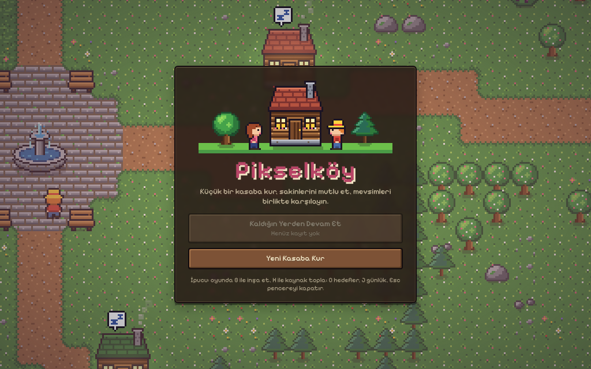
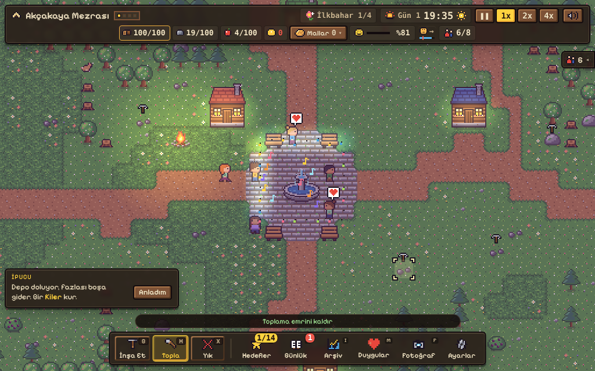
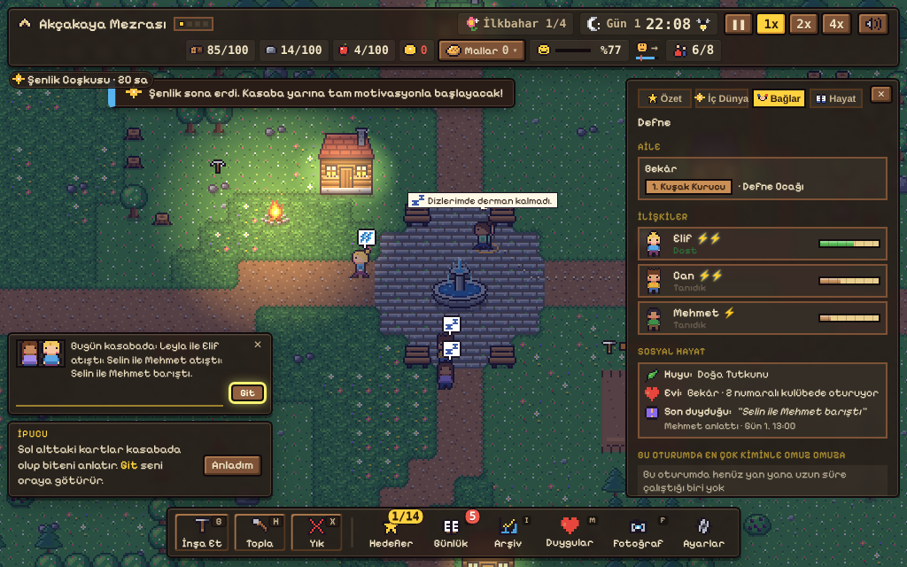
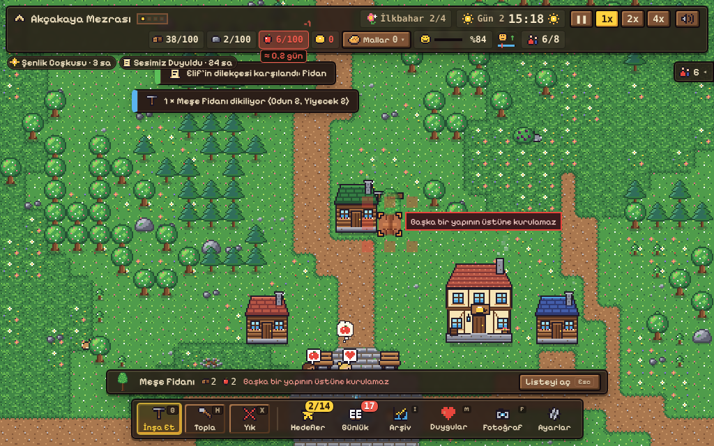
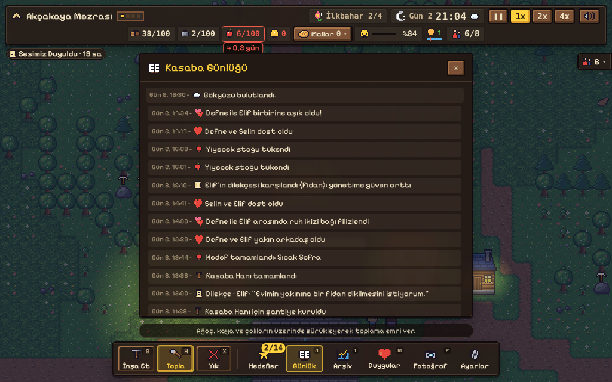

# Pikselköy — Oyuncu Günlüğü 3 (kör oynanış)

> Not: Bu günlük parça parça yazılıyor. İlk 10 dakika bitti; asıl oyun bölümü ve diğer başlıklar sonradan eklenecek.

## 2. Oynama günlüğü

### İlk karşılaşma (19:03 – 19:13, gerçek saat)

Ekran görüntüleri sırayla numaralı; metinde gösterdiklerim `img3/` altında.

**19:03:37** — Oyunu açtım. Başlık ekranı: "Küçük bir kasaba kur, sakinlerini mutlu et, mevsimleri birlikte karşılayın." diyor. Arkada gerçek harita görünüyor, güzel. "Yeni Kasaba Kur"a bastım, bana kasaba adı (Akçakaya) ve isteğe bağlı bir "harita tohumu" sordu. Tohumun ne olduğunu bilmiyorum, boş bıraktım.

**19:03:50** — Kasaba kuruldu. Ekranda bir sürü şey var: üstte odun/taş/yemek/para, "Mallar", bir yüz ikonu %72, bir adam-ok ikonu, 6/6. Sağda altı sakin listesi (Leyla, Defne, Selin, Can, Mehmet, Elif) ve ne yaptıkları yazıyor: "Kulübesinde uyuyor", "Kasabada yürüyüş yapıyor". Altta İnşa Et / Topla / Yık / Hedefler / Günlük / Arşiv / Duygular / Fotoğraf / Ayarlar. Sol altta ipucu kutusu. Doğrudan bir "şunu yap" demiyor ama ipuçları yön veriyor.

**19:03:56** — Hedefler penceresini açtım: "İlk Yuva: bir kulübe yap", "Sıcak Sofra: Kasaba Hanı kur". Bu iyi oldu, ne yapacağım belli. Nüfus 6/13, yapı 3/8 diye bir sonraki seviye ("Köy") şartları var.

**19:04:01** — İnşa menüsü: 24 yapı, hepsi resimli, bazıları gri (kilitli, "Köy" "Kasaba" rozetli). Kulübe'yi seçtim, haritada hayalet bina geliyor. Kulübeyi koydum. Yanlışlıkla Şerbethane'yi seçili bıraktım, ne olduğunu anlamadım.

**19:04:22** — Odun 5'e düştü. "Topla" aracıyla boş zemine sürükledim: "Burada toplanacak bir şey yok". Sonra ağaç/kaya üzerine sürükleyince küçük balta işareti çıktı ve sakinler gidip kesti. Yani ben emir veriyorum, onlar yapıyor; ben kasabayı doğrudan yönetmiyorum. Bunu ilk 2 dakikada çözdüm, ipucu söylemişti.

**19:05:07** — Kulübe bitti, Hedef 1/14. Haritada hiç ağaç görünmüyordu çünkü çok yakındım. WASD tuşuna basınca kamera çok az kayıyor (8 basış ≈ 10 piksel). Tekerlekle uzaklaşınca çok daha fazlasını gördüm (ağaç, kaya, böğürtlen).

**19:06:22** — Günlük'ü açtım: "Uykucu Selin, çalışkan Mehmet ile atıştı (Süs Havuzu)", "İçine Kapanık Leyla, sosyal kelebek Elif ile atıştı (Kulübe)". Demek sakinlerin huyları var ve kavga ediyorlar. İlginç. Odun 93/100'e fırladı, yemek 25'ten 10'a düşmüş. Kimse yemek toplamıyormuş, ben sadece odun/taş emri vermiştim.

**19:06:35** — Han'ı (45 odun 25 taş) koymayı denedim: kırmızı yazı "Yetersiz kaynak: Taş" (19/25). Yani çıkarken ne eksik olduğunu söylüyor, güzel. Kayalara emir verdim.

**19:07:11** — Akşam oldu, çeşmenin etrafında toplanma, müzik notaları, kalpler. Ekran gerçekten hoş. Ama yemek 4/100, kırmızı yanıp sönüyor.

**19:07:19** — Sebze Bahçesi seçtim. Yeşil kareler = kurulabilir zemin, kırmızı = olmaz; "Toprak Patika üzerine kurulamaz". İkinci yerde kurdum. Şantiye kuruldu bildirimi çıktı.

**19:07:42** — Bir sakine (Defne) tıkladım: profil açıldı. 21 yaşında, 2 numaralı kulübede Mehmet'le oturuyor, etiketler (Çırak Yapı Ustası, Doğa Sever, Sosyal Kelebek, Doğa Tutkunu), Tokluk/Enerji/Sosyallik/Keyif çubukları, "Elif ile şenlikte dans ediyor". Dört sekme var: Özet, İç Dünya, Bağlar, Hayat. İç Dünya'da "Arzular, korkular", "Kişilik eksenleri" (Uykucu↔Çalışkan, İçine Kapanık↔Sosyal Kelebek...) kaydırıcıları. Bağlar'da arkadaşlar ve "Son duyduğu: Selin ile Mehmet barıştı — Mehmet anlattı". Yani dedikodu bile yayılıyor. Beklemediğim kadar derin.

**19:09:23** — Gece geçti, yemek 1/100. "Kiler boşalıyor: yiyecek bir günden az yeter" diye uyardı. Bahçe henüz bitmemiş, çünkü herkes uyuyormuş.

**19:11:13** — Bahçe bitti, filizler çıktı. Yemek 18'e çıktı.

**19:11:19** — Han'ı kurdum (taş 27 olmuştu). Üstte "Dilekçe · Elif": "Evimin yakınına bir fidan dikilmesini istiyorum." Çipe tıklayınca Elif'in profili açıldı, kamera da onu takip etti ama dilekçenin kendisini ayrıca okumam gerekmedi. Peyzaj sekmesinden Meşe Fidanı'nı (2 odun + 2 yemek, ayıp, yemek zaten azken) evinin yanına diktim.

**19:12:07** — "Elif'in dilekçesi karşılandı: Fidan" + "Sesimiz Duyuldu · 84 sa" diye bir etiket çıktı. Ne işe yaradığını bilmiyorum ama "yönetime güven arttı" yazdı. İyi hissettirdi.

**19:13:02** — Yemek 6'ya düştü yine, ben bahçe yaptım ama yetmiyor. Böğürtlen ve kaya emirleri verdim.

**19:13:33** — Günlüğe baktım: "Defne ile Elif birbirine âşık oldu!", "ruh ikizi bağı filizlendi", "Selin ve Elif dost oldu", "Yiyecek stoğu tükendi" (iki kez). Hikâye gibi akıyor.

### Ek notlar (ilk 10 dakika)
- Escape tuşu bende kafa karıştırdı: bazen seçimi iptal ediyor, bazen menüyü açıp kapatıyor; sol alttaki ipucundaki "Anladım" düğmesine basmaya çalışırken iki kez başka bir yapıyı (Şerbethane) seçmiş oldum.
- Zamanı hızlandırmadım (ilk 10 dk kuralı).
