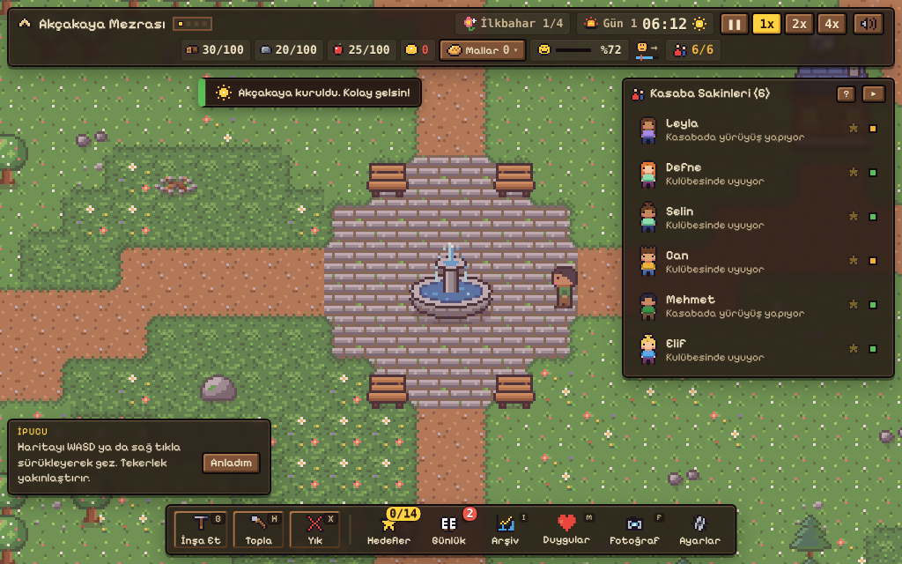
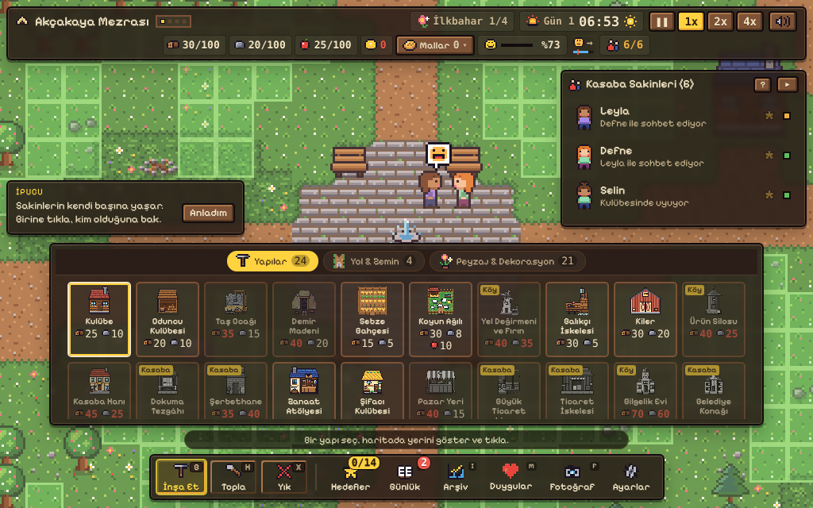
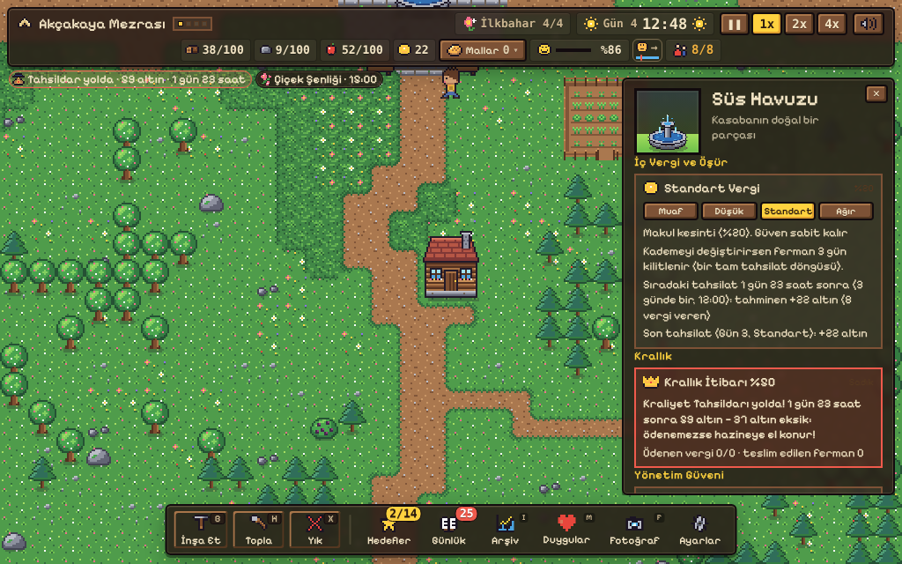
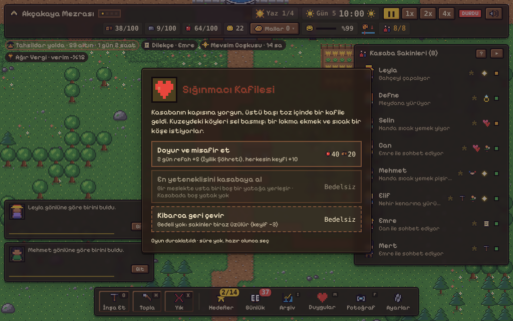
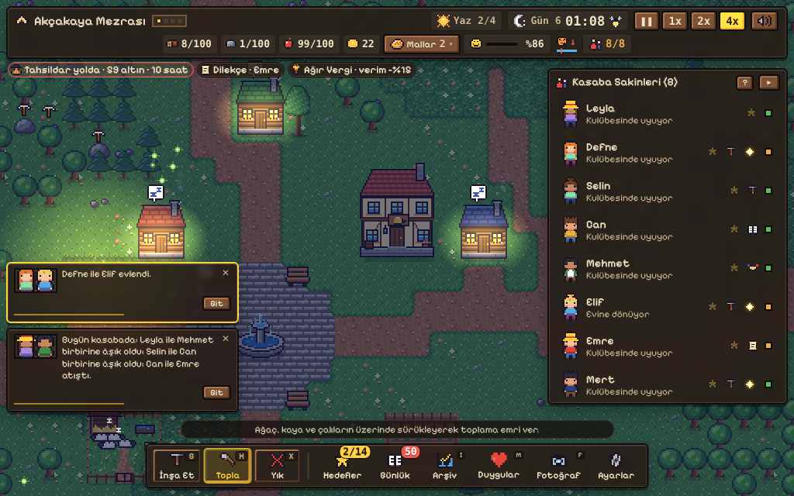
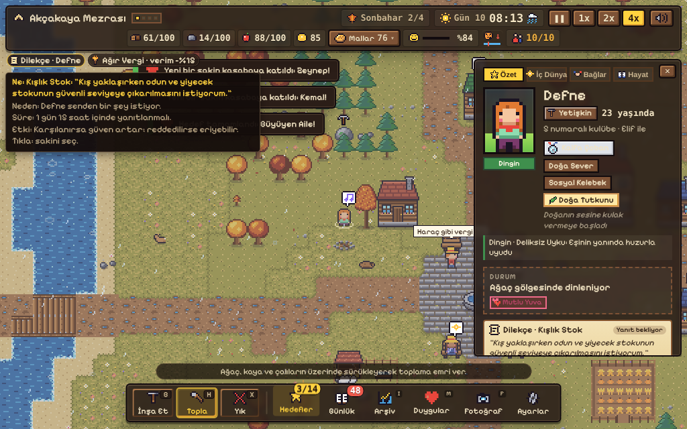
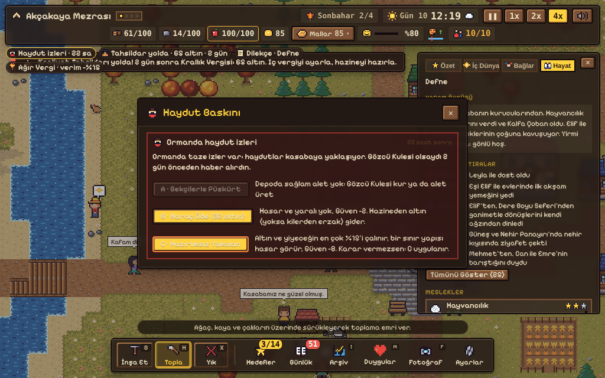
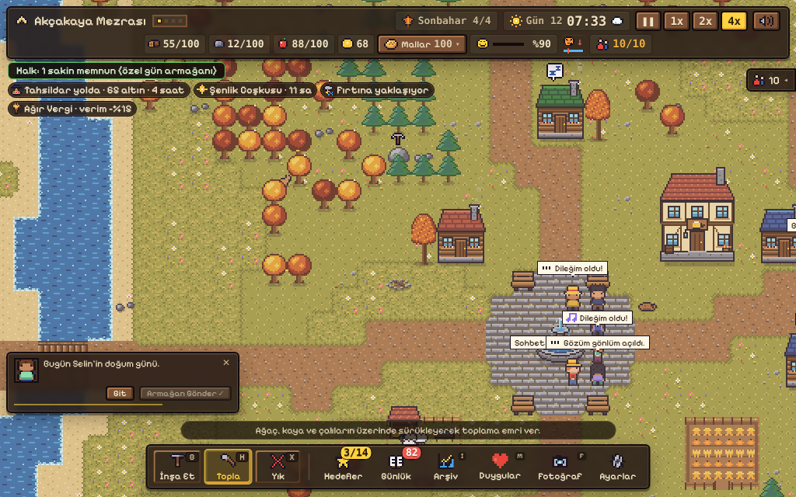

# Pikselköy — Oyuncu Günlüğü 3 (kör oynanış)

Oynama süresi: 19:03 – 19:33 (≈30 gerçek dakika). 98 ekran görüntüsüne baktım. Bütçenin (45–60 dk) altında kaldım: ekran görüntüsü sınırına (110) yaklaştım ve ilk 30 dakikada her denenmesi istenen şeye en az bir kez dokunmuştum. Kural çiğnemedim: yalnızca `tools/serve.py`'yi okudum, oyun kodunu/dokümanını açmadım, sayfada kod çalıştırmadım; yalnızca fare/klavye gönderdim.

## 1. Mağaza yorumum

**★★★★☆ (4/5) — 30 dakika oynadım.**

Mağaza sayfasında "kasaba ve hayat simülasyonu" yazıyordu, sıradan bir kasaba kurucu bekliyordum. İlk beş dakikada ne yapacağımı hedef listesi sayesinde bildim, buna sevindim. Asıl beni tutan şey sakinler oldu: herkesin huyu, arkadaşı, dilekçesi var ve oyun bunları sana "Günlük"te yazıyla anlatıyor. Defne ile Elif birbirine âşık oldu, evlendi, haritada düğün oldu; Mehmet "Selin'le Mehmet barıştı" diye dedikodu yaydı. Bunu planlamadım, izledim, hoşuma gitti.

Beni yoran şey: yemek bir anda 1'e kadar düşüyor ve neden olduğunu bir süre anlamadım; ekranda anlamını bilmediğim çok küçük simge var; Escape tuşu bazen menüyü kapatıyor bazen açıyor. Vergi ekranında "Ağır" tuşuna basınca üç gün kilitleneceğini, tıkladıktan sonra okudum. Kasabayı büyütme kısmı (hedeflerde 3/14) yavaş ve asıl keyfi sakinleri izlemek.

Parayı geri istemezdim; ama "bir tur daha" diyecek kadar bağlandığımı söyleyemem — 30 dakikada, yarın açar mıyım diye düşündüm, belki açardım (bkz. bölüm 9).

---

## 2. Oynama günlüğü

### İlk karşılaşma (19:03 – 19:13, gerçek saat)

Ekran görüntüleri sırayla numaralı; metinde gösterdiklerim `img3/` altında.

**19:03:37** — Oyunu açtım. Başlık ekranı: "Küçük bir kasaba kur, sakinlerini mutlu et, mevsimleri birlikte karşılayın." diyor. Arkada gerçek harita görünüyor, güzel. "Yeni Kasaba Kur"a bastım, bana kasaba adı (Akçakaya) ve isteğe bağlı bir "harita tohumu" sordu. Tohumun ne olduğunu bilmiyorum, boş bıraktım.

**19:03:50** — Kasaba kuruldu. Ekranda bir sürü şey var: üstte odun/taş/yemek/para, "Mallar", bir yüz ikonu %72, bir adam-ok ikonu, 6/6. Sağda altı sakin listesi (Leyla, Defne, Selin, Can, Mehmet, Elif) ve ne yaptıkları yazıyor: "Kulübesinde uyuyor", "Kasabada yürüyüş yapıyor". Altta İnşa Et / Topla / Yık / Hedefler / Günlük / Arşiv / Duygular / Fotoğraf / Ayarlar. Sol altta ipucu kutusu. Doğrudan bir "şunu yap" demiyor ama ipuçları yön veriyor.

**19:03:56** — Hedefler penceresini açtım: "İlk Yuva: bir kulübe yap", "Sıcak Sofra: Kasaba Hanı kur". Bu iyi oldu, ne yapacağım belli. Nüfus 6/13, yapı 3/8 diye bir sonraki seviye ("Köy") şartları var.

**19:04:01** — İnşa menüsü: 24 yapı, hepsi resimli, bazıları gri (kilitli, "Köy" "Kasaba" rozetli). Kulübe'yi seçtim, haritada hayalet bina geliyor. Kulübeyi koydum. Yanlışlıkla Şerbethane'yi seçili bıraktım, ne olduğunu anlamadım.

**19:04:22** — Odun 5'e düştü. "Topla" aracıyla boş zemine sürükledim: "Burada toplanacak bir şey yok". Sonra ağaç/kaya üzerine sürükleyince küçük balta işareti çıktı ve sakinler gidip kesti. Yani ben emir veriyorum, onlar yapıyor; ben kasabayı doğrudan yönetmiyorum. Bunu ilk 2 dakikada çözdüm, ipucu söylemişti.

**19:05:07** — Kulübe bitti, Hedef 1/14. Haritada hiç ağaç görünmüyordu çünkü çok yakındım. WASD tuşuna basınca kamera çok az kayıyor (8 basış ≈ 10 piksel). Tekerlekle uzaklaşınca çok daha fazlasını gördüm (ağaç, kaya, böğürtlen).

**19:06:22** — Günlük'ü açtım: "Uykucu Selin, çalışkan Mehmet ile atıştı (Süs Havuzu)", "İçine Kapanık Leyla, sosyal kelebek Elif ile atıştı (Kulübe)". Demek sakinlerin huyları var ve kavga ediyorlar. İlginç. Odun 93/100'e fırladı, yemek 25'ten 10'a düşmüş. Kimse yemek toplamıyormuş, ben sadece odun/taş emri vermiştim.

**19:06:35** — Han'ı (45 odun 25 taş) koymayı denedim: kırmızı yazı "Yetersiz kaynak: Taş" (19/25). Yani çıkarken ne eksik olduğunu söylüyor, güzel. Kayalara emir verdim.

**19:07:11** — Akşam oldu, çeşmenin etrafında toplanma, müzik notaları, kalpler. Ekran gerçekten hoş. Ama yemek 4/100, kırmızı yanıp sönüyor.

**19:07:19** — Sebze Bahçesi seçtim. Yeşil kareler = kurulabilir zemin, kırmızı = olmaz; "Toprak Patika üzerine kurulamaz". İkinci yerde kurdum. Şantiye kuruldu bildirimi çıktı.

**19:07:42** — Bir sakine (Defne) tıkladım: profil açıldı. 21 yaşında, 2 numaralı kulübede Mehmet'le oturuyor, etiketler (Çırak Yapı Ustası, Doğa Sever, Sosyal Kelebek, Doğa Tutkunu), Tokluk/Enerji/Sosyallik/Keyif çubukları, "Elif ile şenlikte dans ediyor". Dört sekme var: Özet, İç Dünya, Bağlar, Hayat. İç Dünya'da "Arzular, korkular", "Kişilik eksenleri" (Uykucu↔Çalışkan, İçine Kapanık↔Sosyal Kelebek...) kaydırıcıları. Bağlar'da arkadaşlar ve "Son duyduğu: Selin ile Mehmet barıştı — Mehmet anlattı". Yani dedikodu bile yayılıyor. Beklemediğim kadar derin.

**19:09:23** — Gece geçti, yemek 1/100. "Kiler boşalıyor: yiyecek bir günden az yeter" diye uyardı. Bahçe henüz bitmemiş, çünkü herkes uyuyormuş.

**19:11:13** — Bahçe bitti, filizler çıktı. Yemek 18'e çıktı.

**19:11:19** — Han'ı kurdum (taş 27 olmuştu). Üstte "Dilekçe · Elif": "Evimin yakınına bir fidan dikilmesini istiyorum." Çipe tıklayınca Elif'in profili açıldı, kamera da onu takip etti ama dilekçenin kendisini ayrıca okumam gerekmedi. Peyzaj sekmesinden Meşe Fidanı'nı (2 odun + 2 yemek, ayıp, yemek zaten azken) evinin yanına diktim.

**19:12:07** — "Elif'in dilekçesi karşılandı: Fidan" + "Sesimiz Duyuldu · 84 sa" diye bir etiket çıktı. Ne işe yaradığını bilmiyorum ama "yönetime güven arttı" yazdı. İyi hissettirdi.

**19:13:02** — Yemek 6'ya düştü yine, ben bahçe yaptım ama yetmiyor. Böğürtlen ve kaya emirleri verdim.

**19:13:33** — Günlüğe baktım: "Defne ile Elif birbirine âşık oldu!", "ruh ikizi bağı filizlendi", "Selin ve Elif dost oldu", "Yiyecek stoğu tükendi" (iki kez). Hikâye gibi akıyor.

### Ek notlar (ilk 10 dakika)
- Escape tuşu bende kafa karıştırdı: bazen seçimi iptal ediyor, bazen menüyü açıp kapatıyor; sol alttaki ipucundaki "Anladım" düğmesine basmaya çalışırken iki kez başka bir yapıyı (Şerbethane) seçmiş oldum.
- Zamanı hızlandırmadım (ilk 10 dk kuralı).

### Asıl oyun (19:14 – 19:33)

Hedefim: kasabayı "Köy" seviyesine çıkarmak (nüfus 13, ikinci seviye bir yapı) ve vergiyi ödeyip iflas etmemek. Arada tavsiye edilen denemeleri yaptım.

**19:14** — Zamanı 4x yaptım (üstteki 1x/2x/4x düğmeleri, yanında "duraklat"). Sabah "Göçmenler bu sabah gelmedi: yiyecek stoğu yetersiz (3/18)". Yani yiyecek az olduğunda yeni insan gelmiyor; bunu mesajdan anladım.

**19:15:50** — Hedefler: Nüfus 6/13, Yapı 7/8, "Seviye 2 yapı 0/1 — yapının panelindeki Yükselt düğmesiyle". Kulübe'ye tıkladım; "Seviye 2: Taş Ev, 20 odun 25 taş". Taşım yoktu, yapamadım.

**19:16:54** — Nüfus 8/8: Emre ve Mert geldi. Üstte yeni bir şerit: "Tahsildar yolda · 59 altın · 1 gün 23 saat". **Bunu hiç beklemiyordum.** Paranın 22 altın olduğunu görünce paniğe kapıldım.

**19:17:00** — Çeşmeye (Süs Havuzu) tıklayınca "İç Vergi ve Öşür" paneli çıktı. "Krallık İtibarı %80: 37 altın eksik; ödenemezse hazineye el konur". Standart vergide tahmini +22 altın; yetmeyecekti. Ağır vergiye bastım (kötü yönetici denemesi de oldu): hemen "Halk: 8 sakin hoşnutsuz", "güven −8, keyif −10, verim −%18" (s. 09 resmi).

**19:18:38** — "Sığınmacı Kafilesi" olayı oyunu durdurdu: "Doyur ve misafir et (40 yemek, 20 altın)" / "En yeteneklisini al" (gri, yatak yok) / "Kibarca geri çevir (keyif −3)". Geri çevirdim: "Kafile başını önüne eğip yoluna devam etti." Pek bir şey olmadı; belki −3 keyif olmuştur ama göremedim.

**19:20:10** — "Defne ile Elif evlendi" kartı; ayrıca günlükte "Leyla ile Mehmet birbirine âşık oldu, Selin ile Can… Can ile Emre atıştı". 19:21 günlükte: "İç vergi tahsil edildi (Ağır): +62 altın", "Krallık Vergisi ödendi (59 altın)". Ödedim, kurtuldum.

**19:21 – 19:22** — Gelen/giden "Dilekçe · Emre" için Meşe Fidanı diktim ("Emre'nin dilekçesi karşılandı: Fidan"). Çeşme panelinde "Erzak Dağıt" ve "Altın Dağıt" düğmeleri var; erzak dağıtınca "Halk: 8 sakin memnun (erzak dağıtımı)". Arşiv'e baktım: nüfus, refah, stok, hazine grafikleri çıkıyor (çok sade; sadece 6 gün). Fotoğraf modu (F) arayüzü gizliyor; Ayarlar'da Kaydet/Yükle, tehlike sıklığı, rehber, hikâye kartları, karar süre sınırı var.

**19:22:36** — Sayfayı yeniledim. Oyun, kaydettiğim kasabayı (Gün 7, hâlâ 8 sakin) açtı; hiçbir şey kaybolmamış gibi göründü. Ben "Kaydet"e basmamıştım; otomatik kayıt ("her sabah 06:00") sağ olsun.

**19:24:46** — "Kayıp Hazine Haritası" olayı (1 izci gönder 15 yemek, 2 kişilik sefer gri). Tek izci yolladım. Sonra "Maceracı Günlüğü: Azgın Dere" ikinci bir karar: "sığ geçit ara" dedim, "yol sorunsuz geçti".

**19:27:51** — Sonbahar. Defne profili: Yaşam öyküsü, anılar listesi ("Elif'ten Dere Gözü Seferi'nden ganimetle dönüşlerini kendi ağzından dinledi"). Yani benim yolladığım sefer bir sakinin hatırasına girmiş. Bu hoşuma gitti.

**19:28:22** — "Haydut Baskını": "A · Bekçilerle püskürt" gri (sağlam alet yok, Gözcü Kulesi öneriliyor); "B · Haraç öde (38 altın)"; "C · Hazırlıksız yakalan". C'yi seçtim (kötü yönetici). Sonuç: üstte "1 hasarlı yapı" etiketi. Hangi yapı olduğunu bulamadım.

**19:30:41** — "Sert Fırtına Uyarısı": demir/taş-kalasla güçlendir (yetersiz demir/taş, gri) ya da "Şansına güven". Şansa güvendim. Sonuç için zaman yetmedi; 19:33'te günlükte Defne, Leyla ve Mehmet'in "yönetime kırgın" olduğunu gördüm (kartta kısaltılmış görünüyor). Kırgınlığın tam sebebi (vergi mi, fırtına mı) belli değil.

**19:32:06** — "Bugün Selin'in doğum günü" kartında "Armağan Gönder" butonu. Bastım; "Halk: 1 sakin memnun (özel gün armağanı)". Bunu bilerek birini mutlu etme denemesi saydım. Hem yazı hem çubuk değişti. (s. 23)

**19:33:11** — Kış geldi. Günlük: "Kış geldi! Tarlalar dondu: evler ısınmak için odun yakacak." 10 sakin kutladı Hasat Bayramı. Yedinci/sekizinci gün bayram vardı; bayramın içeriğini (ne yaptığını) ayrıca izleyemedim. Durdum.

---

## 3. Ne yapacağımı bilemediğim anlar

1. **İlk dakika, harita boş görünüyordu (19:04).** "Topla" aracıyla boş yere sürükledim, "Burada toplanacak bir şey yok". Ağaç/kaya üzerine sürüklemem gerektiğini ipucundan değil denemeden buldum. ≈2 dk.
2. **Yemek 1'e düşünce (19:09).** Herkes odun/taş toplarken kimse yemek toplamıyordu. Üstteki kırmızı "≈0,1 gün" yazısının "kaç gün yeter" olduğunu çıkardım. Sebze bahçesi çözdü. ≈4 dk.
3. **Vergi/tahsildar (19:16).** Şeridi okuyup anladım ama "ne kadar vergi koymalıyım?" bilmedim; ağır vergiyi riskini okumadan seçtim. ≈1 dk. Çözdüm ama bedeli kasabaya yüklemiş oldum.
4. **Escape tuşu (19:07 ve sonrası).** Yapı seçimi iptal mi, menü mü kapanıyor, bazen tersi. Tam çözemedim.
5. **Yük seçimi: hangi sakine tıklayacağım?** Kamera sakini sevinçle takip ediyor ama "Git" düğmesi ile tıklama aynı mı bilemedim.

## 4. "Vay" dediğim anlar

- **19:07 — akşam çeşme.** Karanlık, müzik notaları, kalpler, herkes çeşmenin etrafında. İlk "bu oyun benim sandığımdan güzel" anı. (Ses duyamadım; müzik notaları görsel.)

- **19:27 — Defne'nin anılar listesi.** Benim yolladığım sefer, Defne'nin "Elif'ten ganimet hikâyesini dinledi" anısı olmuş. Kendi kararımın birinin hatırasına girdiğini görmek vay dedirtti.

## 5. Sinir olduğum şeyler

1. **Yemek bir anda çöküyor** ve ben hâlâ ona hazırlıksızken. İlk 10 dakikada üç kez 10'un altına düştü.
2. **Escape ve menü davranışı** (bölüm 3).
3. **WASD tek basışta çok az kayıyor** (8 basışta ≈10 piksel). Tekerlekle uzaklaşmak zorunda kaldım.
4. **Sağdaki "Kasaba Sakinleri" paneli** harita üstünde büyük yer kaplıyor; katlamayı geç buldum (▸).
5. **Önemli olay kartları 6-8 sn'de kayboluyor**; "Selin'in doğum günü" kartının "Armağan Gönder" düğmesi neredeyse solarak kayboluyordu. Yetişmesem kaçırırdım.
6. **Kararların sonuçlarını bulmak zor:** haydut baskınından sonra "1 hasarlı yapı" yazıyor ama hangisi, ne kadar?

## 6. Ekranda olup da hiç anlamadığım şeyler

- Üstteki **"Mallar 100"** düğmesi (yün, demir, ekmek...) ve neden 0/100 yazan şeylerin çoğu "üreten yapı yok" diyor.
- Üst çubuktaki **adam-ok simgesi** ve **%72/%86 yüzleri** (refah olduğunu sonradan anladım ama tam ne ölçtüğünü bilmiyorum).
- Sakin listesindeki **sağ taraftaki küçük simgeler** (yıldız, T, kıvılcım, yüzük, kalp, kupa...). Yüzük evli, kalp aşk mı çıkardım; ama "T" ve yıldızı bilmiyorum.
- Kasaba seviyesi şeridi ("Mezra → Köy → ...") neyi açtığı hedef penceresinde yazıyor, ama "Yel Değirmeni", "Bilgelik Evi" ne işe yarar anlamadım.
- Sol üstteki küçük simge sırası ("Sesimiz Duyuldu · 84 sa", "Ağır Vergi · verim −%18"): bunlar etiket, süre sayıyor. Çoğunu okudum ama ilk gördüğümde ne olduğunu bilemedim.
- **"Duygular" katmanı** (kalpli simge): legend var (eş/ruh ikizi/kırgın/yakın dost) ama haritada çizgi olarak bir şey görmedim; tek bir sakini tıklamak mı gerekiyordu bilemedim.
- **Kişilik eksenleri** (Uykucu↔Çalışkan...) — değiştirilebilir mi bilemedim, dokunmadım.

## 7. Sakinler

Evet. **Defne** (21→23 yaş, hayvancılık, Elif'le evli) ve **Leyla** (57 yaşında, çırak çiftçi, "gönlüme göre birini bulayım" dilekli). İkisini de adıyla hatırlıyorum. Elif'in fidan dileği, Emre'nin fidan dileği, Selin'in doğum günü — hepsi küçük ama yüze bir kişilik veriyor. Defne ile Elif'in ilişkisinin hikâyesi (arkadaş → ruh ikizi → âşık → evlendi) bana oyun tarafından "anlatıldı" ve umursadım. Selin ile Can evlendiğinde aynı hissi daha az yaşadım; çünkü o ilişkiyi izlemedim.

## 8. Benim yaptıklarım önemli miydi?

Kısmen. Yemek yoksa göçmenlerin gelmediğini gördüm — kararım (bahçe) nüfusu etkiledi. Vergiyi ağır yapınca halk hoşnutsuz oldu ve para geldi, kralın vergisini ödedim; bu somut bir takas. Armağan ve fidan dilekleri bir sakinin rozetini değiştirdi. Ama hangi hamlemin kasabanın kaderini değiştirdiğini söylemek zor: ben müdahale etmeden de çoğu ilişki, evlilik, dostluk kendiliğinden gelişti ("Mehmet ve Kemal dost oldu"). Bu bana "ben olmasam da sakinler hayatlarını yaşardı" dedirtti; hoş ama kendi rolümü küçülttü.

## 9. Bıraktığım an

~30. dakikada, kışın başında kapattım. Sebep: ekran görüntüsü bütçesi; gerçek bir oyuncu olarak **~25. dakikaya kadar (Gün 8-9, sonbahar)** oynardım. Haydut ve fırtına olaylarında "ne oldu" sorusunu cevaplayamayınca merakım azaldı. Yarın yeniden açar mıydım? Defne ve Leyla'nın hikâyesi için evet, ama kasaba kurma tarafı için bir hedef (Köy'ün 13 nüfusu) beni çekmeyebilir.

## 10. Karşılaştığım hatalar

Bozuk görünen bir şey yaşamadım; sayfa çökmedi, yenilemede kayıt geri geldi. Küçük pürüzler:
- Yapı seçiliyken "Escape" bazen hiçbir şey yapmadı, bazen menüyü açtı.
- Bir kısım sakin balonu yazısı üst üste biniyordu (örnek: "Kileler boş, yönetim nerede?" balonu başka bir balonla çakıştı, 19:25).
- Sağ panel açıkken uyarı şeridi panelin altında kesiliyor ("Çiçek Şenliği" yazısı).
Bunlar ciddi değil; "hata" mı yoksa tasarım mı olduğunu ayıramıyorum.

## 11. Keşke olsa dediklerim

- Vergi değiştirirken **bir ön hesap göstersin** ("bu seviyede kralın vergisini öder misin?").
- **Yemek yoksa ilk günde söylesin** ("kimse yemek toplamıyor" gibi bir ipucu).
- Olay kartları kaybolmasın, bir yerde birikip kalsın.
- Haydut/fırtına sonrası **neyin hasar gördüğünü** göstersin.
- Sakinleri takip etme ("kamerayı sabitle") ve "bu kişi şimdi ne istiyor" özeti.
- Bir hikâye defteri: "Defne ve Elif'in evliliği" gibi kendi anılarım.
- Küçük simgeler için tek bir açıklama listesi.

## 12. Karnem (10 üzerinden)

| Konu | Not | Gerekçe |
|---|---|---|
| İlk 10 dakika | **7** | Hedefler ve ipuçları yol gösterdi; yemek çöküşü ve Escape beni yordu. |
| Ne yapacağını anlama | **6** | İnşa/topla kolay; vergi, mallar, simgeler, olay sonuçları belirsiz. |
| Görünüş ve okunurluk | **8** | Çok güzel; ama küçük yazılar ve simgeler 1024×640'ta zor okunuyor. |
| Sakinlere bağlanma | **8** | Defne/Elif/Leyla'yı hatırlıyorum; dilek ve anılar etkili. |
| "Bir tur daha" hissi | **6** | Bir sonraki olayı görmek istiyorum ama kasaba hedefi çekmiyor. |
| Kendi kararlarımın ağırlığı | **6** | Vergi, bahçe, armağan etkili; haydut/fırtına sonuçları görünmüyor. |

## 13. Yaşayamadıklarım

- **Sesi duyamadım** (müzik/efekt hiçbir şey yazmıyor bende).
- Kışın tamamı, ikinci yılı, "Köy" seviyesine geçişi yaşamadım.
- Haydut baskınının tam sonucu, fırtınanın sonucu, kralın vergisinin ikinci tahsilatı.
- Yap/Yık aracını ve "Yıkma" sonuçlarını denemedim.
- Mallar/zanaat zincirini (yün, kumaş, şerbet) hiç başlatmadım.
- Gözcü Kulesi, Han'ın içi, Pazar, Bilgelik Evi, Belediye Konağı gibi kilitli yapıları açmadım.
- Dilekçeleri reddetmeyi, Kışlık Stok dileğini yanıtlamayı denemedim (Defne'nin kışlık dileğini cevapsız bıraktım).
- Zor/çetin tehlike sıklığını, 30 saniye karar sınırını denemedim.
- Sakinlerin "İç Dünya" sekmesindeki arzu/korku ayrıntılarını ve kişilik kaydırıcılarını okudum ama etkisini sınamadım.
