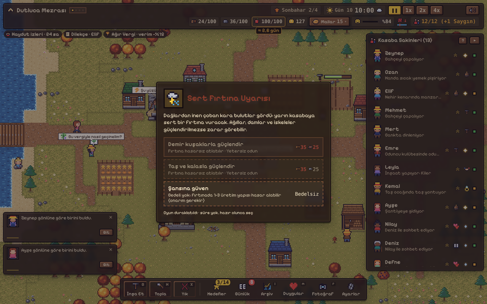
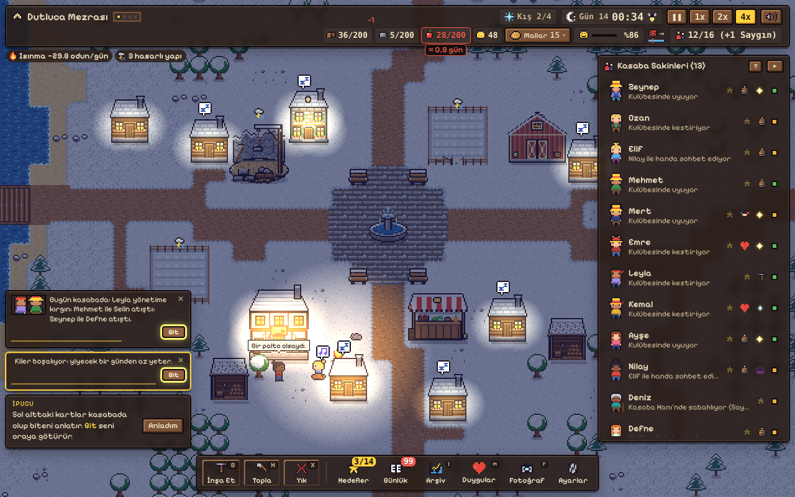
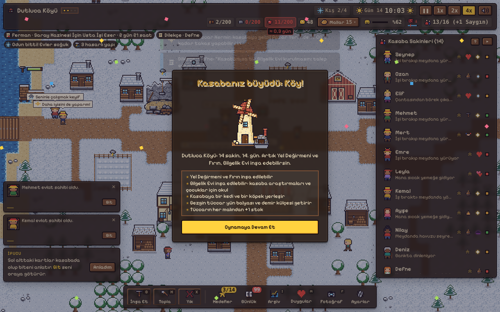
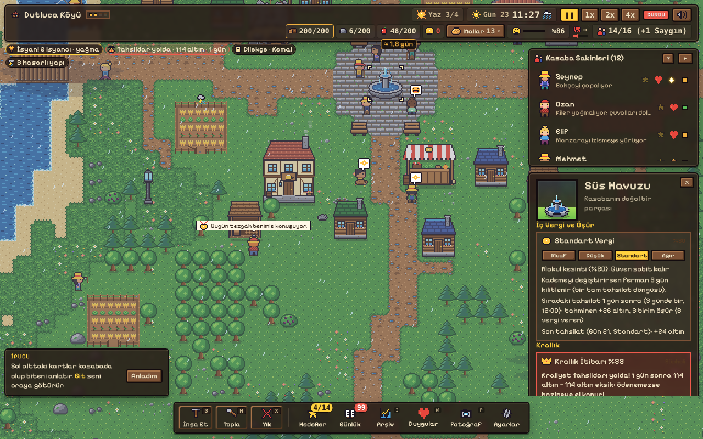
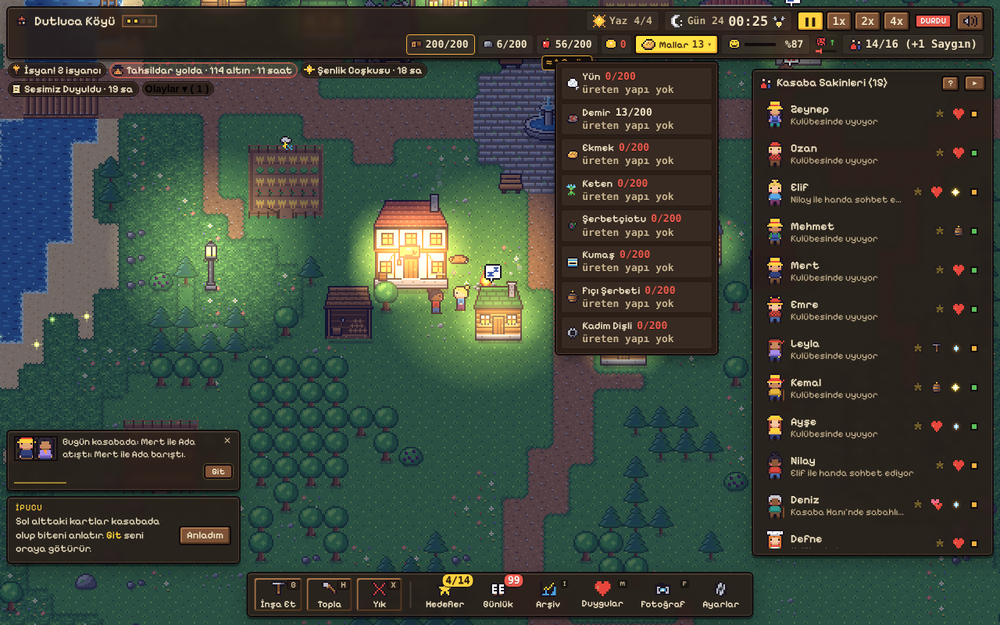
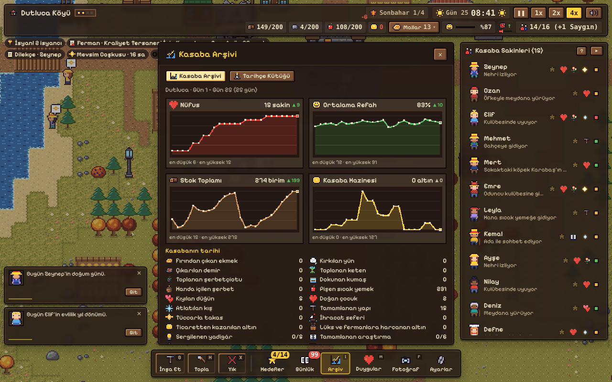
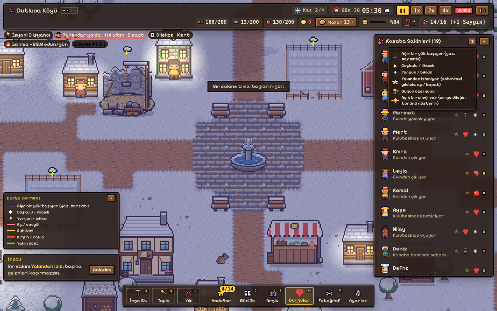
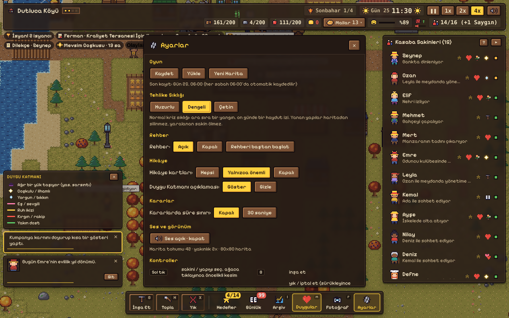
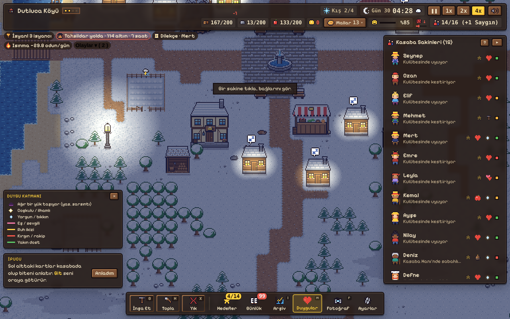

# Oyuncu günlüğü 4

# Oyuncu günlüğü 4

> **Dürüstlük notu (önce bunu oku):** Bütçem 100–120 dakikaydı. Ben ~53 dakika oynadım (19:41–20:34), 30. güne ulaştım, 119 ekran görüntüsü aldım ve orada bıraktım. Sıkılıp bırakmadım; kendi oturumumun sınırı yüzünden durdum. Aşağıdaki "bıraktığım an" bölümünü bunu bilerek oku. Kuralları çiğnemedim: yalnızca fare/klavye ile oynadım, oyun dosyalarını açmadım. Tek istisna: hazırlık komutlarını çalıştırdım ve `tools/serve.py`'yi okudum.

## 1. Mağaza yorumum

**★★★★☆ (4/5)**. Kısa süre (53 dk, 30 gün) oynadım. Tavsiye ediyorum, ama "tamamen rahat bir kasaba oyunu" arayan birine değil.

Görünüş çok iyi: piksel sanatı temiz, mevsim değişince harita gerçekten başka görünüyor, geceleri evlerin ışığı sıcak. Sakinler birbirleriyle konuşuyor, kavga ediyor, barışıyor, evleniyor; günlükte bunlar yazıyor ve ben dokunmadan oluyor. Elif ile Emre'nin düğününü ben kurmadım, günlükten öğrendim. Bu hoşuma gitti.

Beni en çok şaşırtan, oyunun beni cezalandırması oldu. Sebze bahçesini geç kurdum ve 2. gün yiyecek 1'e düştü. Kışa hazırlıksız girdim ve 13–15. günlerde odun ile yiyecek sıfırı gördü. Vergiyi "ağır" seçince tahsildar geldi, sonra para yetmeyince depodan odun çekti ve 8 sakin isyan etti. Bunların her biri ekranda bir şeyle anlatıldı; yalnız bir kısmını bulmam için tıklamam gerekti.

Beni uzaklaştıran şey: 20. günden sonra yeni bir şey görmemeye başladım. Hedefler 4/14'te takıldı; taş sıfıra yakın, altın sıfır, tahsildar borcu 114 altın. Elimden ne gelirse yaptım ama "para kazanmak için ne yapmalıyım" sorusunun cevabını bulamadım. Pazar Yeri'ni kurmuştum ama gelir görmedim. Ayrıca bir oyun gününün 1x'te ~9 dakika sürmesi, 4x zorunlu demek.

Parayı geri istemezdim. Ama bir oyun arkadaşıma "ilk 15 gün muhteşem, sonra ekonomi seni duvara çarpıyor" derdim.

## 2. Oynama günlüğü (ham notlar)

- **19:41** Oyunu açtım. Mağaza sayfasında yazan şeyden başka bir şey bilmiyorum, bir arkadaşımın notu var. Oyun zaten çalışıyor, 6 sakinim var, 1. gün sabahı. İlk bakış:  Görünüş hoşuma gitti, piksel sanatı temiz. Ama beni bir şeye yönlendiren bir şey yok; "Hedefler"e bakıyorum.
- Hız varsayılan 1x ve bir oyun günü gerçek zamanda yaklaşık 9 dakika sürüyor gibi. 4x'e alınca günü ~1 dakikada bitiriyor. 30 gün 1x'te beş saat olurdu, yani 4x zorunlu.
- **19:42** Kulübe kurdum (25 odun / 10 taş). "Topla" aracıyla ilk sürüklemem ağaçları işaretlemedi, taşı işaretledi; ağaçlar için ikinci kez denemem gerekti. Neden olduğunu anlamadım.
- **~19:44, 2. gün sabahı** Yiyecek 1/100'e düşmüştü, üstünde "≈0.0 gün" yazan kırmızı bir kutu. Odun da 1 idi.  Günlükte "Göçmenler gelmedi: yiyecek stoğu yetersiz" yazıyordu. Yani oyun bana bunu söyledi ama ben bakmasam fark etmezdim. Sebze bahçesini çok geç kurdum çünkü odunum yoktu: ilk 30 odunu kulübe + oduncu kulübesine harcayıp bahçeye 15 bırakmamıştım.
- 3. gün: Sebze bahçesi bitince yiyecek hızla 100'e çıktı (3 bahçe, bir yerden sonra depo doldu). Günlükte Mert'in dilekçesi: sokağa fener ya da bank istiyor. Mert yasta, Mehmet teselli etti diye yazıyor; kim ölmüş, bilmiyorum.
- 4. gün: bir olay penceresi çıktı ve oyun durdu: "Sığınmacı Kafilesi". 40 yiyecek + 20 odun karşılığı misafir et, ya da kabul et (yatak yok) ya da geri çevir. Elimde 33 yiyecek vardı, geri çevirdim.  Okuması rahat, süre yok yazıyor.
- 4. gün: Tekerlekle uzaklaştırınca harita çok daha büyükmüş (göl, köprü, orman). Üstte kırmızı "Tahsildar yolda · 89 altın" çıktı, elimde 17 altın var. Süs havuzuna tıklayınca "İç vergi" paneli açıldı. Ağır vergi seçtim, tahmini 96 altın diyor ama "güven -8, keyif -10, çalışma hızı -%15" ve "3 gün ferman kilitli". 
- 5. gün: Elif'in doğum günü bildirimi "Armağana gönder" ile 5 altın harcadım. İki yeni kulübe, taş ocağı (sadece açık yeşil karolara kurulabiliyor; bunu deneyerek buldum). Nüfus 10/10.
- **5. gün ara notu (19:53, ~12 dk):** Şu an kulübeleri yükseltmeye çalışıyorum çünkü Hedefler "seviye 2 yapı" istiyor. Bir sonraki hedef Kasaba Hanı. Sıkılmıyorum ama çoğu zaman bekliyorum: odun/taş gelsin diye. Kasaba 5 gün öncekinden büyük: 3→4 ev, iki bahçe, taş ocağı. İnsanlar eskisi gibi benim emrim olmadan dolaşıyor, bir de randevuya gidiyorlar. Olay pencereleri (kafile, hazine haritası, tapınak) iyi sürpriz.

- **19:55, 8. gün** Nüfus 12'ye çıktı (kulübe yetmedi, iki kişi kaldı ama yeni gelenler Kasaba Hanı'nda sabahlıyor yazıyor). "Kasaba Hanı" 45 odun + 25 taş. Hedefler 3/14. Ekranda "Şenlik Coşkusu", "Güneş ve Nehir Panayırı" gibi bildirimler var; kimse bana ne yapmam gerektiğini söylemiyor ama olaylar anlatılıyor.
- **19:57, 9. gün** Günlük listesinde: Elif ile Emre evlendi, düğün meydanda yapıldı.  Güzel şeydi, ama ben bir şey yapmadım; sakinler kendi başına bunu yaptı. Bu hoşuma gitti.
- **19:58, 10. gün** Fırtına uyarısı penceresi: iki güçlendirme seçeneği "yetersiz odun" diye gri; "şansına güven" seçtim.  Hemen ardından "Haydut Baskını" paneli geldi.  Gözcü kulesi yok, alet yok, 31 altın haraç ödemeyi seçtim.
- 10. gün: Ağır vergiyi standarda çektim (ferman kilidi yüzünden 3 gün beklemem gerekti). Elif'in sayfasına baktım: Özet / İç Dünya / Bağlar / Hayat sekmeleri. Hayat sekmesi onun hikâyesini yazıya dökmüş, düğün günü, en iyi arkadaşı Nilay. 
- **20:01, 12. gün** Seyyar tiyatro olayı: parasını verdim (40 altın) → herkesin keyfi +%1... Emre bir "İşlemeli Yadigâr Sandık" yaptı, Arşiv'de sergilenebilir.
- **20:03, 13. gün** Kış başladı. Ekinler karla kaplandı, bahçeler boş. Kiler 200'e çıkmıştı ama yiyecek 142'den 28'e düştü (kış ısınma -89.8 odun/gün diye de bir uyarı çıktı).  Ben bunu görünce çok geç kaldım: balıkçı iskelesi kurdum.
- **14. gün, 20:05** "Kasabanız büyüdü: Köy!" ekranı çıktı ama aynı anda odun 2, taş 0, yiyecek 11.  Tuhaf: tebrik ekranı arkasında kasaba açlıkla boğuşuyor.
- **15. gün ara notu (20:09, ~28 dk):** Şu an kıtlığı atlatmaya çalışıyorum; yiyecek 0/200 ama insanlar ölmüyor, yalnız "hasta" sayısı 1-2. Sıkılmadım, gerginim. Sakinlerin "Bu soğukta odun bile yok!" lafları geçiyor. Kasaba 10 gün öncekinden farklı: 3 mevsim değişti, kış var. Bu, oyunun ilk gerçek tepkisi: "bahçeyi geç kurdun, kış gelince bedelini ödersin."

- **20:13, 18–19. gün** Vergi ödenemedi uyarısı: "Krallık Vergisi ödenemedi! Tahsildar hazineyi (26 altın) el koydu, depodan zorla mal çekti." Hemen ardından yeni sakin geldi, Mehmet evlat sahibi oldu. Oyun kötü ve güzel şeyleri aynı akışta veriyor.
- **20:15, 19. gün** Gezgin Ozanlar olayı: Büyük Panayır (30 altın/20 taş yetersiz, gri) / akşamlık gösteri (15 yiyecek) / uğurla. Akşamlık gösteri seçtim. Taş ve altın yoktu; yiyecek bol olduğu sürece seçenek var.
- **20:19, 22. gün** "Kayıp Hazine Haritası": 2 kişilik sefer 30 yiyecek, tek izci 15 yiyecek, ya da sandığa kaldır. Sandığa kaldırdım (borç içindeydim, kaybetmek istemedim). Bunun sonunu görmedim.
- **20:21, 23. gün** Üstte "İsyan! 8 isyancı" ve "yağma" çıktı, sakinler "Hıh, ne yüzsüzlük!" "Bu vergiyle nasıl geçinelim?" diye konuşuyor. İsyancılar kileri yağmalıyor. Tahsildar bir gün sonra 114 altın istiyor, bende 0.  Vergi paneli standarttı ama borcun sebebi önceki ağır vergi ve 0 altın.
- **20:22, 24. gün** Mallar (13) düğmesi: yün, demir (13), ekmek, keten, şerbetçiotu, kumaş, fıçı şerbeti, kadim dişli; hepsinin altında "üreten yapı yok" yazıyor. Yani ekonomi bu 14 yapıyla bir yere gitmiyor; yeni bir ağ gerekiyor. 
- 25. gün: Arşiv: nüfus 6→18 (grafik), refah %83, stok, hazine grafikleri. Hazine grafiği iki zirve yapıp sıfıra düşmüş.  "Tarihçe Kütüğü" sekmesine tıklamadım (not: görmediğim sekme).
- 25. gün: Duygular katmanı (♥ düğmesi) açılınca sol alta simge açıklamaları ve kişilerin üstüne ilişki çizgileri geliyor.  Fotoğraf (F) arayüzü gizliyor; geri dönmek için sağ alttaki "Arayüzü Göster" düğmesi lazım, F tuşu geri getirmedi (bkz. hatalar). Ayarlar: Kaydet/Yükle/Yeni Harita, Tehlike sıklığı (Huzurlu/Dengeli/Çetin), Rehber, Hikâye kartları, Karar süre sınırı, Ses, Kontroller. 
- **20:26, 26. gün** Odun 200/200 dolu, taş 13. Taş toplamak için kayaları işaretledim. Üç hasarlı yapı var. İsyan hâlâ var.
- **20:30, 28. gün** Bir olay penceresi oyunu durdurmuştu ve ben fark etmeden ~1,5 dk bekledim; 10:00'da donmuş saat bunu ele verdi.
- **20:33, 29–30. gün** Kış 2/4. İsyancı sayısı 8'den 3'e düşmüş, ama "tahsildar yolda · 114 altın" hâlâ duruyor, para 0. 
- **30. gün ara notu (20:33, ~52 dk):** Şu an hiçbir şey yapamıyorum çünkü para ve taş yok, Hedefler 4/14'te takılı. Sıkıldım mı? Hayır, ama beklemekten başka şey yapmıyorum. Kasaba 10 gün öncekinden (20. gün) pek farklı değil: aynı 14 kişi, aynı yapılar. 15. gündekinden daha az gergin, daha az heyecanlı.
- **20:33 Kaydet / yenile testi:** Ayarlar > Kaydet, sonra F5. Oyun 30. günde, doğru saatte, duraklatılmış olarak geri geldi; yakınlaştırma sıfırlandı (harita yakın görünüyordu). Kayıp bir şey görmedim.

## 3. İlk saat ile sonrası
Ben tam bir saat oynamadım; ~53 dakikanın ilk 25'i (1–15. gün) çok iyiydi, her birkaç dakikada bir yeni bir olay, yeni bir hedef, yeni bir ihtiyaç vardı. 15. günden sonra gerginlik azalmadı ama yeni şey de azaldı. Yeni bir şey görmemeye 20–22. günlerde başladım (olay kartları tekrar etti: tiyatro iki kez, ozanlar iki kez).

## 4. Ne yapacağımı bilemediğim anlar
- **Başlangıç (19:42):** "Topla" ile ağaçları işaretlemek. Ağaç işaretlenmedi, taş oldu. İki denemede çözdüm (~3 dk).
- **2. gün:** Yiyecek bitti, oduncu kulübesi var ama odun yok. Hedefler pencere bana "sebze bahçesi" demiyordu; kendim buldum. ~2 dk.
- **Vergi:** Süs havuzuna tıklayınca vergi paneli açılıyormuş; bunu tesadüfen buldum, bir yerde yazmıyordu (belki Hedefler'de yazıyordu, ben okumadım). ~3 dk.
- **22–30. gün (altın/taş):** Para nasıl kazanılır? Çözemedim, ~8 dakika. Pazar Yeri kurulu, ama arşivde "ticaretten kazanılan altın 0".
- **Yapı kurma:** Bazı yapılar "Toprak patika üzerine kurulamaz" ya da "Başka bir yapının üstüne kurulamaz" dedi; yeşil karolar yalnız belirli yerlerde. Pazar Yeri'ni üç denemede yerleştirdim.

## 5. "Vay" dediğim anlar
- **Düğün (9. gün):** Elif ile Emre evlendi, hiç emir vermemiştim. Günlüğe yazıldı ve meydanda kalabalık toplanmıştı.
- **Kış (13. gün):** Aynı kasaba bir anda bembeyaz ve soğuk; evlerin pencereleri yandı. Güzel.
- **İsyan (23. gün):** "Hıh, ne yüzsüzlük!" balonları. Kendi ağır vergi kararımın bedelini görmek.

## 6. Sinir olduğum şeyler
1. 30 gün 1x'te beş saat; 4x'e mecburum ve olay pencereleri o hızda oyunu durdurup bekliyor.
2. Para kazanmanın yolunu bulamadım; Mallar listesinde her şey "üreten yapı yok".
3. Tahsildar 114 altın istiyor ve 0 altınla hiçbir şey yapamıyorum.
4. Fotoğraf modundan F tuşuyla çıkamadım (bir kez daha denemeye gerek kaldı).
5. Bildirimler üst üste biniyor (sağ üstte iki şerit, solda 3 kart) ve bazen asıl önemli şeyi kapatıyor.
6. Olay kararları duraklatıyor ama saat tuhaf biçimde bir kere 1,5 dk boşa geçti.
7. Taş toplamak: "Topla" araç mantığı bazen ağaçta çalışmıyor.

## 7. Ekranda olup da hiç anlamadığım şeyler
- Üst çubuktaki küçük "Saygın" / bayrak ve ok simgeleri (kraliyet itibarı mı, güven mi?). "+1 Saygın" ibaresi yan nüfus kutusunda.
- Sakin satırlarındaki yıldız, mor şapka, yeşil/sarı/kırmızı kutu: bir kısmını simge açıklamasında okudum (Duygu Katmanı), kutuların rengini (yeşil/sarı/kırmızı) açıklamasını bulamadım.
- Kenardaki küçük "18" kutusu (sağ üst, panel katlanınca).
- "Tarihçe Kütüğü" sekmesi: açmadım.
- Üstteki yuvarlak simge: nüfus kutusunun yanındaki kırmızı-mavi ikon.

## 8. İzlediğim sakinin hikâyesi
İzlediğim kişi Elif. 9. günde Emre ile evlendi; en yakın dostu Nilay. 15. günlerde "Elif iskelede olta atıyor" gibi satırlar gördüm. 26. günde çocuk yok. Arşiv sayfasında "doğan çocuk: 2" yazıyor; kimin çocuğu olduğunu görmedim. Mehmet 15. günde "evlat sahibi oldu" (günlükten). Yani oyun bir şeyleri kendisi anlattı (düğün, doğum günü, evlat); ama bir sakinin baştan sona hikâyesini ben izlemedim, yalnız 2–3 parça yakaladım. Zeynep'in "Yaşam Öyküsü" kutusunda "yönetime kırgın. Otuz yedi yaşında: içi huzursuz." yazıyordu; bunu okuyunca fener isteğini karşılamak istedim, bir sonraki gün kendi başıma kurdum. Umursadım: evet, biraz.

## 9. İyi ve kötü yöneticilik
Kötü yönetim: ağır vergi (güven -8, keyif -10, çalışma -%15 yazıyordu). Sonuç: 20–23. günlerde isyan, depodan mal çekme, "Krallık Cezası". Ceza göründü: üstte çipler ve günlük. İyi yönetim: ilk 15 günde yiyecek ve fener/bank gibi küçük istekleri karşılamak; sonuç: refah %80–97, "Şenlik Coşkusu" bonusları. Toparlanma: kısmi (isyancılar 8→3), ama borç ve para kıtlığı duruyor. Fark yarattı; oyunun tepkisini anladım, bunu gösteren sayılar ve yazılar vardı.

## 10. Benim yaptıklarım önemli miydi?
Evet: sebze bahçesi (açlık), vergi seçimi (isyan), olaylarda yiyecek harcamak (keyif). Hayır: sakinlerin ilişkileri, düğünler, doğumlar bensiz oldu.

## 11. Bıraktığım an
Gerçek bırakmadım, sınırım yüzünden durdum: 20:34, 30. gün. Gerçek bir oyuncu olarak ise 22. günde, para ve taş tıkandığında bırakırdım; yarın yeniden açar mıydım: evet, merak ederdim. Bir hafta sonra: muhtemelen hayır, ekonomi çözülmezse.

## 12. Karşılaştığım hatalar
- "Fotoğraf" (F) sonrası arayüz F ile geri gelmedi; sağ alttaki düğmeye tıklamak gerekti. (görüntü: 104/105 numaralı ekran, burada yok)
- Mallar açılır paneli (24. gün) kapanmadan kaldı; ben tıklayınca kapandı.
- Olay penceresi açıkken saatin "durdu" kalması ve bana fark ettirmemesi (28. gün, ~1,5 dk kayıp).
- Kaydet/yükle doğru çalıştı.

## 13. Keşke olsa dediklerim
Para kazanma için açık bir yol/hedef; altını görebileceğim bir "gelir/gider" özeti; olaydaki kararın sonucunu sonradan gösteren kart (hazine seferi gibi); 1x'in daha hızlı olması; bildirimlerin tek bir listede toplanması; Mallar'daki "üreten yapı yok" için neyin kurulacağı ipucu.

## 14. Karnem
- İlk saat: **8/10** — güçlü, hızlı gelişen, çok olay.
- Sonraki saat: **5/10** — ekonomi tıkanıyor, tekrar eden olaylar. (Tam bir saat oynamadım; ~28 dk "sonrası".)
- Ne yapacağını anlama: **5/10** — Hedefler iyi ama para/vergi kısmı kapalı.
- Görünüş ve okunurluk: **8/10** — çok güzel, ama üst üste bildirimler.
- Sakinlere bağlanma: **6/10** — günlük ve Hayat sekmesi güzel, ama ben yalnız parçalar yakaladım.
- "Bir tur daha": **6/10** — ilk 20 gün evet, sonra hayır.
- Kendi kararlarımın ağırlığı: **7/10** — vergi ve açlık somut sonuç verdi.
- Uzun vadede merak: **5/10** — 4/14 hedefte takılınca merak azaldı.

## 15. Yaşayamadıklarım
- Sesi duyamadım (ses açık/kapalı düğmesi var, çalıp çalmadığını bilmiyorum).
- 100–120 dakikalık oturumun yarısından azını oynadım (53 dk).
- Geç oyun hedefi: 14 hedefin 10'unu görmedim; "Kasaba" ve sonrası seviyeleri görmedim.
- Hazine haritası seferinin sonu, tapınak, Bilgelik Evi, Belediye Konağı, Pazar'da takas.
- Tarihçe Kütüğü sekmesi, bir sakin panelinin Özet/İç Dünya/Bağlar sekmelerinin ayrıntılı içeriği (tıkladım ama not almadım).
- Yağma ve isyanın tam çözümü.
