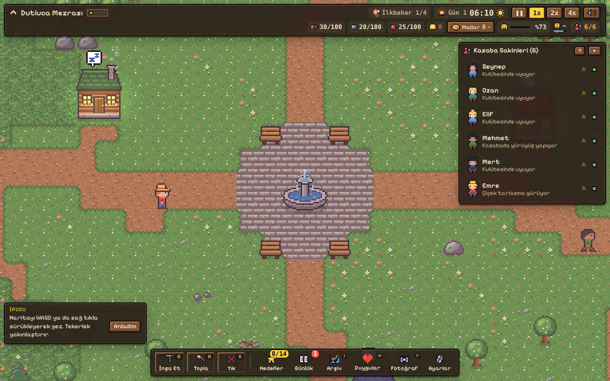
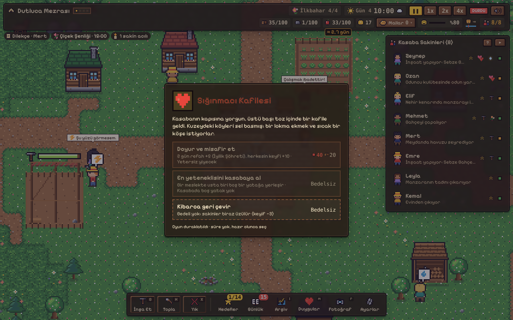

# Oyuncu günlüğü 4 (devam ediyor — ara kayıt, 5. gün)

## Oynama günlüğü (ham notlar)

- **19:41** Oyunu açtım. Mağaza sayfasında yazan şeyden başka bir şey bilmiyorum, bir arkadaşımın notu var. Oyun zaten çalışıyor, 6 sakinim var, 1. gün sabahı. İlk bakış:  Görünüş hoşuma gitti, piksel sanatı temiz. Ama beni bir şeye yönlendiren bir şey yok; "Hedefler"e bakıyorum.
- Hız varsayılan 1x ve bir oyun günü gerçek zamanda yaklaşık 9 dakika sürüyor gibi. 4x'e alınca günü ~1 dakikada bitiriyor. 30 gün 1x'te beş saat olurdu, yani 4x zorunlu.
- **19:42** Kulübe kurdum (25 odun / 10 taş). "Topla" aracıyla ilk sürüklemem ağaçları işaretlemedi, taşı işaretledi; ağaçlar için ikinci kez denemem gerekti. Neden olduğunu anlamadım.
- **~19:44, 2. gün sabahı** Yiyecek 1/100'e düşmüştü, üstünde "≈0.0 gün" yazan kırmızı bir kutu. Odun da 1 idi.  Günlükte "Göçmenler gelmedi: yiyecek stoğu yetersiz" yazıyordu. Yani oyun bana bunu söyledi ama ben bakmasam fark etmezdim. Sebze bahçesini çok geç kurdum çünkü odunum yoktu: ilk 30 odunu kulübe + oduncu kulübesine harcayıp bahçeye 15 bırakmamıştım.
- 3. gün: Sebze bahçesi bitince yiyecek hızla 100'e çıktı (3 bahçe, bir yerden sonra depo doldu). Günlükte Mert'in dilekçesi: sokağa fener ya da bank istiyor. Mert yasta, Mehmet teselli etti diye yazıyor; kim ölmüş, bilmiyorum.
- 4. gün: bir olay penceresi çıktı ve oyun durdu: "Sığınmacı Kafilesi". 40 yiyecek + 20 odun karşılığı misafir et, ya da kabul et (yatak yok) ya da geri çevir. Elimde 33 yiyecek vardı, geri çevirdim.  Okuması rahat, süre yok yazıyor.
- 4. gün: Tekerlekle uzaklaştırınca harita çok daha büyükmüş (göl, köprü, orman). Üstte kırmızı "Tahsildar yolda · 89 altın" çıktı, elimde 17 altın var. Süs havuzuna tıklayınca "İç vergi" paneli açıldı. Ağır vergi seçtim, tahmini 96 altın diyor ama "güven -8, keyif -10, çalışma hızı -%15" ve "3 gün ferman kilitli". 
- 5. gün: Elif'in doğum günü bildirimi "Armağana gönder" ile 5 altın harcadım. İki yeni kulübe, taş ocağı (sadece açık yeşil karolara kurulabiliyor; bunu deneyerek buldum). Nüfus 10/10.
- **5. gün ara notu (19:53, ~12 dk):** Şu an kulübeleri yükseltmeye çalışıyorum çünkü Hedefler "seviye 2 yapı" istiyor. Bir sonraki hedef Kasaba Hanı. Sıkılmıyorum ama çoğu zaman bekliyorum: odun/taş gelsin diye. Kasaba 5 gün öncekinden büyük: 3→4 ev, iki bahçe, taş ocağı. İnsanlar eskisi gibi benim emrim olmadan dolaşıyor, bir de randevuya gidiyorlar. Olay pencereleri (kafile, hazine haritası, tapınak) iyi sürpriz.
