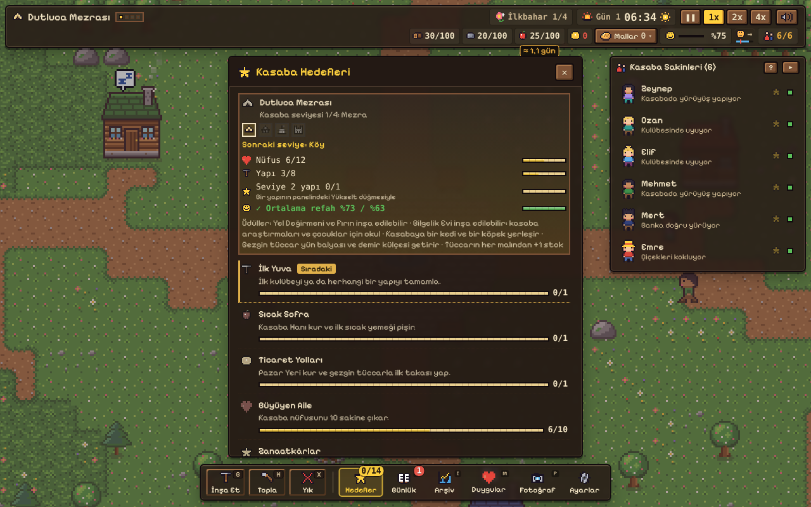
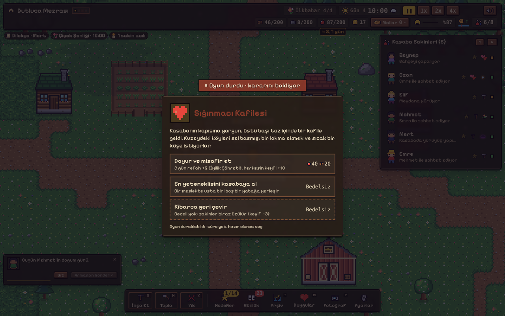

# Oyuncu günlüğü 5 (devam ediyor — ara kayıt, 5. gün)

## 2. Oynama günlüğü (ham notlar)
- 08:40 — Oyunu açtım, 1. gün 06:16. Üstte kaynaklar, sağda sakin listesi, altta düğmeler. Sol altta ipucu kutusu. Hedefler penceresi "Dutluca Mezrası" diye bir ilerleme gösteriyor.
  
- 08:41 — "Topla" aracında tek tıklama yetmedi; kayanın üstüne iki kez tıklayınca işaret kalktı. Sürükleyince oldu. İşaretin kendisi ancak duraklatınca/bir süre sonra net göründü.
- 08:42 — 1. gün akşamı yiyecek 19'a düştü, kiler "bir günden az yeter" diye kırmızı uyardı. Sebze bahçesi + kiler kurdum, yetişti. Şenlik başladı, herkes meydanda dans etti, inşaat durdu.
- 08:47 — 4. gün: sığınmacı kafilesi geldi, oyun durup karar sordu. En yetenekliyi aldım: Leyla katıldı.
  
- 08:48 — 5. gün: mevsim değişti. Ürün siloyla ilgili uyarı çıktı. Mert'in "fener/bank" dileği süresi dolunca kaçırdım; ne olduğunu sonradan günlükte gördüm.
- 08:50 — Ozan'ı izlemeye karar verdim: çırak oduncu, hayal kırıklığı dolu, "kalbimin kırılması" korkusu var.
  
- 08:55 — Vergi tahsildarı mesajını bir ipucu kutusundan öğrendim: 40 altın istiyor. Bu, altının nereye gittiğinin ilk açıklaması.
- 08:55 — Fırtına kararı: demir/taş güçlendirme için malzemem yoktu, "şansına güven"i seçtim.
  
- 08:56 — 9. gün, sonbahar. Ozan ile Ayşe aşık oldu; Ozan ve Mert "Huysuz" oldu.
- 09:00 (G10) — Taş ocağı kurdum. Kayıp Hazine Haritası, Maceracı Günlüğü gibi duran-karar-bekle pencereleri çıkıyor; seçenek maliyeti var. Tapınağa girmeyi seçtim, Nilay "eski tuzağa yakalandı" ama kafile yarı ganimetle döndü; hasar anlaşılır.
- 09:07 (G14, Kış) — Kurt Sürüsü kararı: çit için odun yetmedi, "Önlem alma"yı seçtim. Ağıl hasar aldı (sonra G15'te "Kurtlar Koyun Ağılı'na daldı"). Kararın sonucu bir sonraki günlük kartında geldi, ama kaç koyun öldü bilmiyorum.
- 09:10 (G15) — Yiyecek 2/200, "≈0,0 gün" kırmızı. Kış, ısınma −31 odun/gün. Kimse ölmedi/yok. Balıkçı İskelesi kurdum, yiyecek biraz toparladı. Işıklar Gecesi şenliği.
- 09:12 (G16) — Mert ile Nilay evlendi. Hasta sayısı 8'e çıktı; nedenini bulamadım.
- 09:14 (G17) — Mezra → Köy oldu (1/4'ten). İlk "Sığınmacı" kararı bu sefer aynı; "Kibarca geri çevir" dedim çünkü yatak yok. Yiyecek tekrar 0'a düşmüştü, bahçe daha kurdum.
- 09:17 (G19) — Deniz 68 yaşında öldü; kart "öyküsünü oku" çıkardı. Yeni keşif: Su Havuzu'na (kasaba merkezi) tıklayınca Vergi seçeneği ve "Güven %99" göstergesi çıkıyor. Ferman (Kraliyet Tersanesi: 60 odun + 40 taş) → 120 altın teslim ettim. Altın 78 → 198.

## 5. gün ara notu (geriye dönük, 15. günü yazmayı geciktirdim)
5. günde bahçe-kiler sonrası rahatlamıştım ama ne yapacağımı hâlâ yarı-bilmiyordum; sakin ilişkileri kartları (aşık oldu / atıştı) kasabayı canlı gösteriyordu ama neye yaradığını anlamadım.

## 15. gün ara notu
Şu an ana işim yiyecek-odun-ısınma dengesini tutmak. Kış ısınma yüzünden odun hep tükeniyor; yiyecek 2/200'e düştü ve oyun bunu kırmızı bir sayı olarak gösteriyor ama ne yapacağımı söylemiyor. 10 gün öncesinden farklı: kasaba 10 → 14 kişi, 8 hasar, Köy olmaya yaklaşıyor. Sıkılma: henüz yok ama tekrarlayan "Ne güzel sohbetti" balonları ve aynı karar pencereleri (sığınmacı, kurt) 2. kez çıktı.
