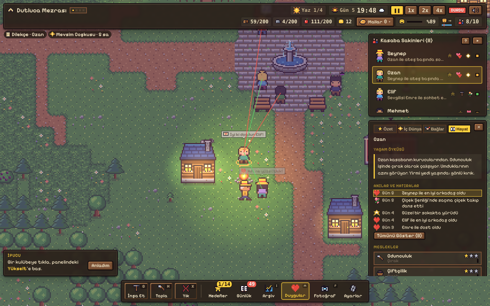
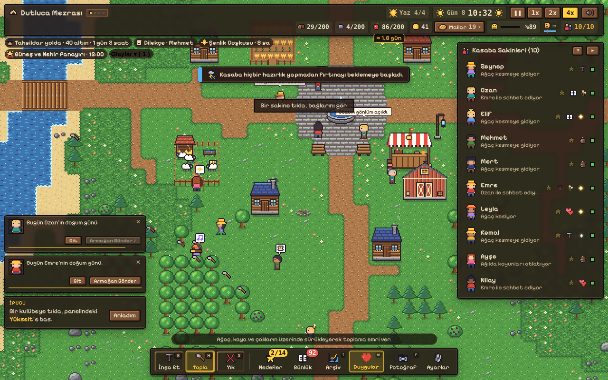
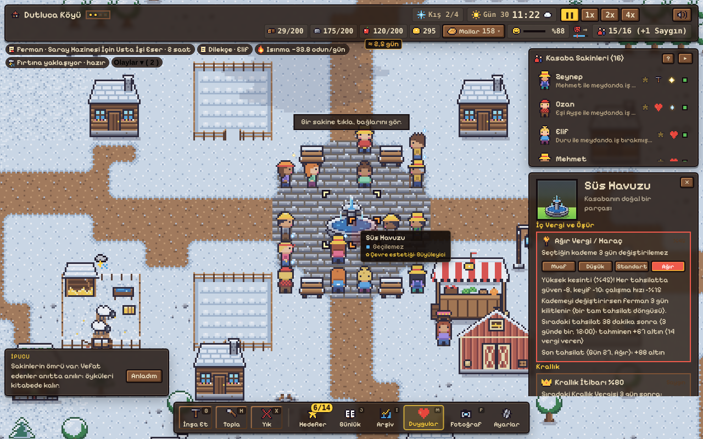
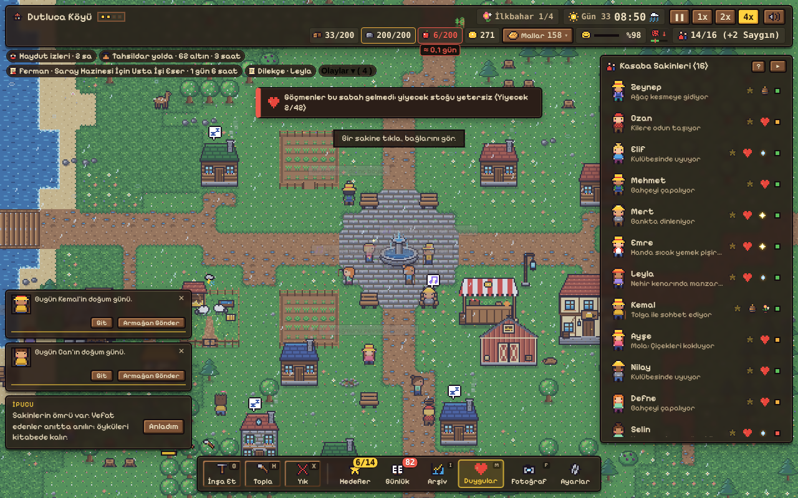
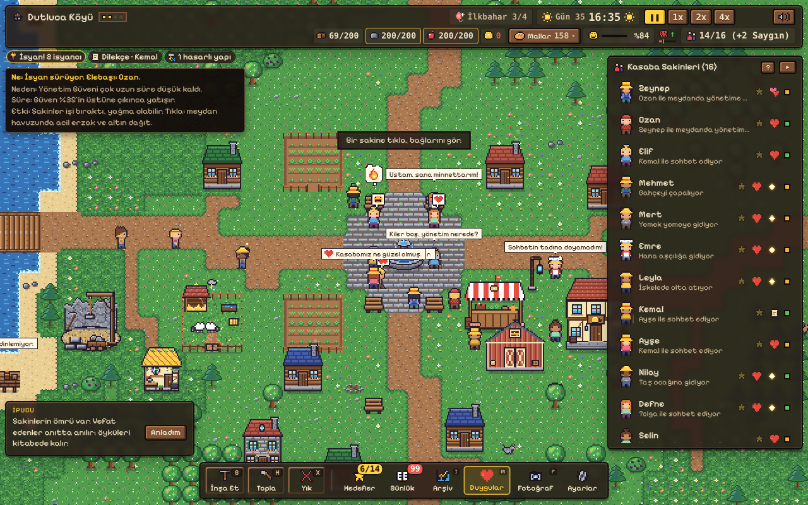
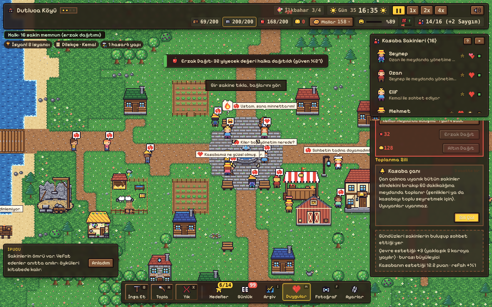
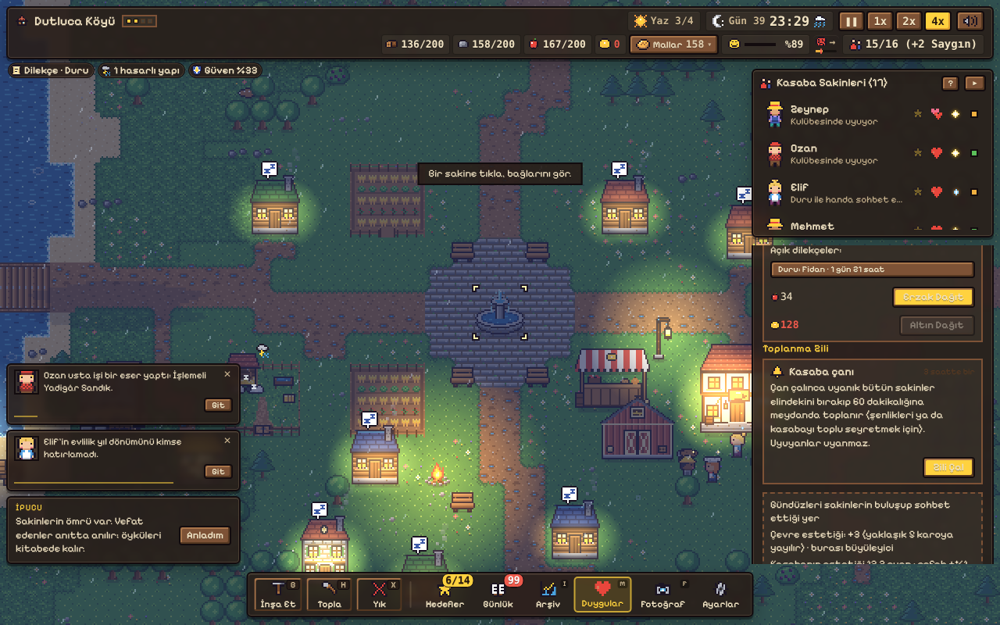

# Oyuncu günlüğü 5

Oturum: 08:40 – 09:57 (yaklaşık 77 gerçek dakika), Gün 39'a kadar, ~166 ekran görüntüsü. Tek oyun, `?seed=42`. Kaydet + sayfa yenile denedim.

## 1. Mağaza yorumum

**★★★☆☆ (3/5) — Parayı geri istemezdim, ama kimseye de "al" demem.**

İlk yarım saat gerçekten hoştu. Küçük bir mezra, ağaç kesen, şenlik yapan, aşık olan, atışan minik adamlar; hepsi okunur ve canlı. Kasabanın kendi kendine yaşadığını görmek keyifli. Alttaki "Topla" aracını bir arkadaşım söylemeseydi bulamazdım; ilk dakikada yiyecek 19'a düştü ve ne yapacağımı kırmızı uyarılardan çıkardım. Hedefler penceresi gerçekten yol gösteriyor.

Sonra iş şuna dönüyor: kış geliyor, odun ve yiyecek bitiyor, ben ağaç işaretliyorum, kasaba toparlanıyor, bir sonraki kış yine aynısı. Karar pencereleri (sığınmacı, kurt sürüsü, hazine haritası) 30. güne kadar tekrar tekrar geldi; Kayıp Hazine Haritası'nı üç kez aynı metinle gördüm. Yöneticilik tepkisi var: ağır vergi koydum, sakinler "haraç gibi vergi bu" dedi, bir süre sonra "İsyan! 8 isyancı" çıktı ve elebaşı, izlediğim Ozan'dı. Bunu beğendim. Ama bu isyan benim vergiyi koyduğum günden değil, kıştaki yiyecek/odun krizinden sonra geldi ve nedenini ancak bir etiketin üstüne gelince okudum.

Hikâye kartları ve sakin ilişkileri sevimli, ama bir kişiyi takip etmek için kendim panelleri kazmam gerekti. Sesi duyamadım. Şikâyetlerim: yapı yerleştirirken hata mesajlarının hep "başka yapının üstüne kurulamaz"/"patika üzerine kurulamaz" gibi olması ve yeri kendim bulmak zorunda kalmam; altın kıtlığı ve krallık vergisinin neden bana sürekli sıfır altın bıraktığını geç anlamam.

Gün 39'a geldim, daha ileri gitmeyi merak etmedim değil, ama "bir tur daha" hissi 30. günden sonra zayıfladı. Karar: fiyatı bilmiyorum, düşük fiyata alırdım; yüksek fiyatta parayı geri isterdim.

## 2. Oynama günlüğü (ham notlar)
- 08:40 — Oyunu açtım, 1. gün 06:16. Üstte kaynaklar, sağda sakin listesi, altta düğmeler. Sol altta ipucu kutusu. Hedefler penceresi "Dutluca Mezrası" diye bir ilerleme gösteriyor.
  
- 08:41 — "Topla" aracında tek tıklama yetmedi; kayanın üstüne iki kez tıklayınca işaret kalktı. Sürükleyince oldu. İşaretin kendisi ancak duraklatınca/bir süre sonra net göründü.
- 08:42 — 1. gün akşamı yiyecek 19'a düştü, kiler "bir günden az yeter" diye kırmızı uyardı. Sebze bahçesi + kiler kurdum, yetişti. Şenlik başladı, herkes meydanda dans etti, inşaat durdu.
- 08:47 — 4. gün: sığınmacı kafilesi geldi, oyun durup karar sordu. En yetenekliyi aldım: Leyla katıldı.
  
- 08:48 — 5. gün: mevsim değişti. Ürün siloyla ilgili uyarı çıktı. Mert'in "fener/bank" dileği süresi dolunca kaçırdım; ne olduğunu sonradan günlükte gördüm.
- 08:50 — Ozan'ı izlemeye karar verdim: çırak oduncu, hayal kırıklığı dolu, "kalbimin kırılması" korkusu var.
  
- 08:55 — Vergi tahsildarı mesajını bir ipucu kutusundan öğrendim: 40 altın istiyor. Bu, altının nereye gittiğinin ilk açıklaması.
- 08:55 — Fırtına kararı: demir/taş güçlendirme için malzemem yoktu, "şansına güven"i seçtim.
  
- 08:56 — 9. gün, sonbahar. Ozan ile Ayşe aşık oldu; Ozan ve Mert "Huysuz" oldu.
- 09:00 (G10) — Taş ocağı kurdum. Kayıp Hazine Haritası, Maceracı Günlüğü gibi duran-karar-bekle pencereleri çıkıyor; seçenek maliyeti var. Tapınağa girmeyi seçtim, Nilay "eski tuzağa yakalandı" ama kafile yarı ganimetle döndü; hasar anlaşılır.
- 09:07 (G14, Kış) — Kurt Sürüsü kararı: çit için odun yetmedi, "Önlem alma"yı seçtim. Ağıl hasar aldı (sonra G15'te "Kurtlar Koyun Ağılı'na daldı"). Kararın sonucu bir sonraki günlük kartında geldi, ama kaç koyun öldü bilmiyorum.
- 09:10 (G15) — Yiyecek 2/200, "≈0,0 gün" kırmızı. Kış, ısınma −31 odun/gün. Kimse ölmedi/yok. Balıkçı İskelesi kurdum, yiyecek biraz toparladı. Işıklar Gecesi şenliği.
- 09:12 (G16) — Mert ile Nilay evlendi. Hasta sayısı 8'e çıktı; nedenini bulamadım.
- 09:14 (G17) — Mezra → Köy oldu (1/4'ten). İlk "Sığınmacı" kararı bu sefer aynı; "Kibarca geri çevir" dedim çünkü yatak yok. Yiyecek tekrar 0'a düşmüştü, bahçe daha kurdum.
- 09:17 (G19) — Deniz 68 yaşında öldü; kart "öyküsünü oku" çıkardı. Yeni keşif: Su Havuzu'na (kasaba merkezi) tıklayınca Vergi seçeneği ve "Güven %99" göstergesi çıkıyor. Ferman (Kraliyet Tersanesi: 60 odun + 40 taş) → 120 altın teslim ettim. Altın 78 → 198.

## 5. gün ara notu (geriye dönük, 15. günü yazmayı geciktirdim)
5. günde bahçe-kiler sonrası rahatlamıştım ama ne yapacağımı hâlâ yarı-bilmiyordum; sakin ilişkileri kartları (aşık oldu / atıştı) kasabayı canlı gösteriyordu ama neye yaradığını anlamadım.

## 15. gün ara notu
Şu an ana işim yiyecek-odun-ısınma dengesini tutmak. Kış ısınma yüzünden odun hep tükeniyor; yiyecek 2/200'e düştü ve oyun bunu kırmızı bir sayı olarak gösteriyor ama ne yapacağımı söylemiyor. 10 gün öncesinden farklı: kasaba 10 → 14 kişi, 8 hasar, Köy olmaya yaklaşıyor. Sıkılma: henüz yok ama tekrarlayan "Ne güzel sohbetti" balonları ve aynı karar pencereleri (sığınmacı, kurt) 2. kez çıktı.

## Gün 20–30 notları
- 09:19 (G20) — Yeni sakin Selin ve Deniz'in ölümü sonrası "Anma Töreni" dilekçesi çıktı; Taziye Sofrası 10 altın. Anlamadan ilk kez gördüm.
- 09:23 — "Gezgin Ozanlar" kararı: bir akşamlık gösteri (15 yiyecek) seçtim; keyif %72→%95 sıçradı. Sayı olarak net bir ödül.
- 09:25 (G22) — "Balıkçı İskelesi hasarlı": haydut baskını. Kasaba Hanı'nı yerleştirmek 4 kez "başka yapının üstüne kurulamaz / toprak patika üzerine kurulamaz" kırmızı mesajıyla reddedildi; yeri bulana kadar ~4 dk gerçek zaman harcadım.
- 09:27 (G23) — Süs Havuzu'na tıklayıp vergiyi öğrendim. Standart → Ağır'a bilerek çevirdim (kötü yönetim). Ağır'ın açıklaması: güven −8, keyif −10, çalışma hızı −%15, 3 gün kilit.
- 09:35 (G26–27) — Ağır vergi sonrası balonlar "Haraç gibi vergi bu!" oldu; kartlar "Emre yönetime kırgın, Nilay yönetime kırgın". Güven göstergesi %99 → %91, refah %91 → %88. Yani oyun tepki verdi ama çok yumuşak; kasaba çökmedi. Ağır vergiden +88 altın aldım (Standart'ta +48).
- 09:35 (G27) — Gezgin Tüccar Nermin ile takas yaptım (10 yiyecek → 10 odun); "Ticaret Yolları" hedefi tamamlandı. Lüks malların 400 altınlık olduğunu gördüm, 295 altınım vardı.
- 09:37 (G28) — Pazar Yeri'ni "Tamir Et" ile 25 altına onardım. Elif dilekçesi: "evimin yakınına bir fidan". Büyük Hasat Bayramı. Saray Hazinesi Usta İşi Eser ferman'ı (216 altın + Nadir Tohum) çıktı; teslim etmedim.
- 09:40 (G30) — Kar fırtınası uyarısı: demir yoktu, "Taş ve kalasla güçlendir" seçtim (35 odun + 25 taş): "Damlar taşla bastırıldı". 6/14 hedef.
- 09:40 — Kaydet → sayfayı yenile: Gün 30 11:22, kaynaklar aynı, hasar/hedef aynı. Ama oyun duraklı geldi, harita yakınlaştırma sıfırlandı, olay kartları kayboldu.
- 09:41 — Toparlama: Ağır → Düşük (Güven +2, her sakine +2 sadakat). Kilit: önceki Ağır'dan 3 gün kalmış olmasına rağmen hemen değiştirebildim.
  

## 30. gün ara notu
Ne yapıyorum: yiyecek-odun-ısınma döngüsünü döndürüp karar pencerelerine cevap veriyorum, Kasaba Hanı gibi "büyük" yapıları kuruyorum. Ne bekliyorum: bir sonraki hedef sandıklarının açılması. Sıkılıyor muyum: yarı yarıya. 10 gün öncesine göre kasaba büyüdü ama yenilik hissi azaldı; aynı karar kartları (kurt, sığınmacı, hazine haritası) tekrar çıkıyor. Kış 2. kez geliyor, odun yine −33/gün.

## Gün 33–39 notları
- 09:44 (G32, Kış 4/4) — Refah %86'dan %46-49'a düştü, nüfus 15 → 14 (iki kişi sayıdan düştü; kim olduğunu, öldü mü gitti mi bilmiyorum, kart görmedim). Odun 0/200, yiyecek 69. Kış ortasında "Bu soğukta odun bile yok!" balonları. Ağaç işaretledim; odun toparlanmadan baharı gördüm.
- 09:46 (G33) — İlkbahar: refah %98'e çıktı (46'dan), yiyecek 6/200, "≈0,1 gün" kırmızı. Göçmenler yiyecek yetersiz olduğu için gelmedi. Yiyecek yine toparlandı. Yani her kriz bir iki gün içinde kendi kendine geçiyor; ben olmasam da mı geçerdi bilemedim.
  
- 09:48 (G34) — Altın 295 → 185 (bir şey için harcandı; hangi yapı/işlem olduğunu net bilmiyorum, yerleştirmeyi denediğim bahçeyle ilgili olabilir). Kayıp Hazine Haritası 3. kez.
- 09:50 (G35) — Altın 0. "İsyan! 8 isyancı" etiketi. Üstüne gelince: Elebaşı Ozan. Neden: Yönetim güveni çok uzun süre düşük kaldı. Güven %35'in üstüne çıkınca yatışır. Tıkla: meydan havuzunda erzak ve altın dağıt. Altın 0 olduğu için sadece Erzak Dağıt yapabildim: "32 yiyecek halka dağıtıldı (güven %27)". Yani güven %27'ymiş; üstte hiçbir yerde güven sayısını görmemiştim.
  
  
- 09:52 (G36) — Zeynep'e şehirden iş teklifi: maaş (36 altın) verecek altın yoktu, "onuruna sofra kur" (18 yiyecek) seçtim; Zeynep kaldı. İsyan etiketi bir süre sonra kayboldu, refah %93-95.
- 09:55 (G38) — "Duru evlat sahibi oldu." Krallık Vergisi: yaklaşık 64 altın, 16 saat kaldı, hazinemde 35.
- 09:57 (G39) — Altın 0, "Güven %33" etiketi tekrar çıktı. Ozan usta işi bir eser yaptı: İşlemeli Yadigâr Sandık.
  

## 3. İlk saat ile sonrası
Toplam 77 dakikada "ilk saat" ve "sonrası" diye ikiye bölünecek kadar uzun oynamadım; ama ilk ~25 dakika (G1–G10) hızlı yeni şeyler getirdi: ilk şenlik, sığınmacı kararı, tarihçe, yapı çeşitleri. 15. günden sonra yeni mekanik az geldi; G17'den G39'a görünen yeni şeyler: Kasaba Hanı, Pazar Yeri ile gezgin tüccar, fermanlar, isyan, usta işi eser, kış sınavı hedefi. Aynı karar kartlarını 3. kez görmeye başladığım G30–G34 civarında "yeni bir şey görmüyorum" hissi başladı.

## 4. Ne yapacağımı bilemediğim anlar
- **G1, ilk 3 dakika.** Beklediğim: tıklayınca ağaç kesilsin. Oldu: iki kere tıklayınca işaret geri kalktı. Sürüklemeyi arkadaşın notundan çıkardım. ~3 dk.
- **G22, Kasaba Hanı yerleştirme.** Beklediğim: yeşil kare yeter. Oldu: "Toprak patika üzerine kurulamaz", "başka yapının üstüne kurulamaz", "önce meşe ağacı temizlenmeli". Yeşil karelerin hepsi geçerli değil gibiydi. Çözdüm, ~4 dk (denemeyle, bir tıklamayla yeri tutturdum).
- **G32, kış ortası odun 0.** Beklediğim: oyun bir şey söylesin. Oldu: yalnızca üstte kırmızı 0/200 ve "Isınma −33,8 odun/gün". Odun toplayıcılarının neden çalışmadığını (ağaç işaretlemediğim için mi, ısınma yüzünden mi) anlamadım. Ağaç işaretledim, baharda toparladı; ne kadarının benim hamlem olduğunu bilmiyorum. ~5 dk.
- **G34–35, altın 0.** Altın nereye gidiyor? Krallık vergisini, takas/tamir/yapı harcamalarını ve maaş tekliflerini görünce anladım ama "hesap özeti" yok. Paran bittiğinde yapılacak şey: vergiyi yükseltmek ya da kervan satmak; kervan satış kararını bir olay kartında bir kez gördüm (G27, +10 altın), düzenli bir yolunu görmedim.
- **"İsyan"ın nedeni.** Etiketin tooltipine bakana kadar anlamadım. ~2 dk.

## 5. "Vay" dediğim anlar
- **G1-G2, kasaba yaşıyor.** Şenlik başlayınca herkesin meydana toplanıp dans etmesi, balonlar, kalp simgeleri: küçük ama sevimli. 
- **G35, isyanın elebaşının Ozan olması.** Takip ettiğim kişinin kasabanın aleyhine döndüğünü görmek "vay" dedirtti. Beş dakika önce "Ozan usta işi" yapıyordu, sonra yine o. Bu kısım oyunun bana anlattığı hikâyeydi.
- **G30 → G33, kış çöküşü ve baharda toparlanma.** Refah %46'dan %98'e çıkması sayısal bir "oh" hissi verdi.
(Başka "vay" olmadı; yani üç tane küçük "vay".)

## 6. Sinir olduğum şeyler
1. Ağaç/kaya işaretleme: tek tıkla aç-kapa, sürükleme zorunluluğu, işaretin gözle görünmemesi (ilk dakikada).
2. Yapı yerleştirme hataları (patika, ağaç, başka yapı) ve yerin neden geçersiz olduğunu kareler üstünde göstermemesi.
3. Altın: neden 0'a düştüğünü anlatan bir özet yok; krallık vergisi birden bire cebimi boşalttı.
4. Güven sayısını hiçbir zaman üst çubukta görmedim; ancak olay mesajlarında (%27) ve bir etiketin tooltipinde (%33) buldum. "%91 güven" gördüğüm sırada isyan çıktı: iki farklı güven rakamı mı vardı, bilmiyorum.
5. Karar kartlarının tekrarı: Kayıp Hazine Haritası 3 kez, Sığınmacı 2 kez, Kurt 1-2 kez.
6. Zamanın 4x'te akarken balonların okunamayacak hızda geçmesi; durdurup bakmak zorunda kalıyorum.
7. Sayfa yenileyince oyunun duraklı gelmesi, yakınlaştırma sıfırlanması (bunu hata saymadım, rahatsız etti).

## 7. Ekranda olup da hiç anlamadığım şeyler
- Üstteki küçük "~%88" yüz simgesi + çubuk: sanırım refah; emin değilim. Yanındaki turuncu/kırmızı küçük simge (iki çubuklu) neydi bilmiyorum; hover ettim ama ne dediğini okuyamadım.
- "Mallar 158": Mallar düğmesi, açılır liste; kaç kalem olduğunu görmedim.
- Sakin listesindeki sağ taraftaki küçük simgeler: yıldız, kalp, beyaz elmas, kare (yeşil/sarı/kırmızı). Yeşil-sarı-kırmızı kareyi ruh hali sandım; kalbin ilişki olduğunu tahmin ettim. Doğrulayamadım.
- "Duygular" düğmesinin (kalp) paneli: ne işe yaradığını tam çıkaramadım.
- "Hasarlı yapı" sayacı, "Ferman", "Krallık İtibarı %80/%64" ve "Altın Çağ": ferman ve vergiyi kısmen anladım; Altın Çağ'ın ne olduğunu hedef metninden okudum ama oraya hiç yaklaşmadım.
- Sağ üstteki "(+1 Saygın)" / "(+2 Saygın)" nüfus yanındaki ek: ne demek bilmiyorum.
- Fotoğraf Makinesi düğmesi: açtım, bir şey çekmedim/çıktısını görmedim; ne işe yaradığını anlamadım.

## 8. İzlediğim sakinin hikâyesi (Ozan)
Ozan: çırak oduncu, "kalbimin kırılması" korkusu olan, huysuz. G9'da Ayşe ile aşık oldu (kart). Sonra Ayşe ile evlendi gibi görünüyor (listede "Eşi Ayşe", evlilik yıldönümü kartları). G26'da "Ozan ile Nilay atıştı"; "Ozan ile Selin atıştı" kartları da var. G35 isyanın elebaşı. G39 "Ozan usta işi bir eser yaptı: İşlemeli Yadigâr Sandık". Oyun bunu kartlarla bana kendi kendine anlattı; ama "neden huysuz oldu, neden isyan başlattı" kısmını ben ancak panellerden çıkardım. Umursadım mı? Biraz; isyan sırasında "bu adamı ben mi bu hale getirdim" diye düşündüm, ki bu iyi bir his.

## 9. İyi ve kötü yöneticilik
Kötü yönetim: G23'te vergiyi Ağır'a çektim. Sonuç: +88 altın (Standart'ta +48), balonlar "Haraç gibi vergi bu!", "Emre/Nilay yönetime kırgın" kartı, güven %91, refah %88. Yani cezası yumuşak ve sayısı küçük; para karşılığı yüksek. İsyan Ağır vergi yüzünden değil kış krizi yüzünden geldi (en azından ben öyle anladım). Toparlama: G30'da Düşük vergi (+2 güven, +2 sadakat), G35'te erzak dağıtımı, bahar. Refah %46 → %98'e çıktı, isyan kapandı. Yani oyun kötü yönetimi cezalandırıyor ama toparlanması kolay; "iyi yönetici" ödülü ise net bir şeyle gelmedi (Ticaret Yolları hedefi dışında), daha çok sayıların yeşil kalması.

## 10. Benim yaptıklarım önemli miydi?
Kısmen. İlk gün bahçe/kiler: kesin önemli (yiyecek 19'dan kurtuldu). Sığınmacı kararı (Leyla geldi): nüfus ve yetenek farkı yarattı. Fırtınada taş ve kalasla güçlendirme: hasarı engelledi (mesaj söylüyor). Ağır vergi: altın farkı yarattı, bir isyana yol açtı mı bilmiyorum. Odun işaretlemek, erzak dağıtmak: doğrudan işe yaradı. Dilek karşılama (Mert'in feneri vb.): kaçırdım, sonucunu görmedim. Ben olmasam kasaba kış krizini atlatır mıydı? Büyük ihtimalle hayır, açlık/soğuk olurdu.

## 11. Bıraktığım an
Oyunu 09:57'de, Gün 39'da bıraktım (77. dakika). Bunun nedeni oyunun beni kovması değil; benim oturum bütçem. Ama kendi başıma oynasam muhtemelen Gün 30–35 arası (dakika ~60-70) kapatırdım, çünkü aynı kartlar ve her kış aynı kriz tekrar ediyordu. Yarın tekrar açar mıydım? Evet, belki, Zeynep'in başına ne geldiğini ve altın sıfırlamasını görmek için. Bir hafta sonra? Muhtemelen hayır.

## 12. Karşılaştığım hatalar
- Hiçbir çökme, donma yok. Kaydet/yenile düzgün çalıştı (G30: kaynaklar, gün, hedefler aynı); yalnızca oyun duraklı geldi ve yakınlaştırma sıfırlandı.
- G30 yeniden yükledikten sonra olay kartları ve günlükteki "99" rozeti sıfırlandı (günlük gerçekten sıfırlandı mı yoksa rozet mi bilmiyorum).
- G22'de Kasaba Hanı yerleştirmesi aynı yere üst üste tıklamamı yok saydı ("başka yapının üstüne kurulamaz"), sonra bir başka yere olmuştu.
- G34'te altın 295 → 185 oldu, hangi işlem olduğunu net göstermedi.
- Üstte "Güven %91" gördüğüm bir anda bir olay mesajı "güven %27" dedi: aynı şey olup olmadığını anlayamadım.

## 13. Keşke olsa dediklerim
- Para/altın için "gelir-gider" özeti.
- Güven ve refah için üst çubukta açıkça yazılı sayı.
- Odun/yiyecek tükenirken oyunun "ağaç işaretle" gibi bir öneri vermesi.
- Yapı yerleştirirken geçersiz karelerin kırmızı olması ve nedeninin yazması.
- Tek bir sakini sabitleyip günlüğünü ayrı bir sekmede takip etme.
- Karar kartlarının çeşitlenmesi.
- Kasaba dışına açılma, harita genişletme.
- Hız 8x ya da "bir sonraki olaya kadar atla".

## 14. Karnem
- İlk saat: **7/10** — canlı ve sevimli, ilk dakikalar tıkandı ama toparladım.
- Sonraki saat: **5/10** — 77 dakikada tekrar belirdi; yeni şey azaldı.
- Ne yapacağını anlama: **6/10** — Hedefler yardımcı; altın/güven belirsiz.
- Görünüş ve okunurluk: **7/10** — piksel sanat hoş; 4x'te balonlar okunmuyor, bazı küçük simgeler anlaşılmıyor.
- Sakinlere bağlanma: **6/10** — Ozan'ı umursadım ama kartlar kısa.
- "Bir tur daha" hissi: **5/10** — 30. günden sonra düştü.
- Kendi kararlarımın ağırlığı: **6/10** — kriz anlarında hissettim; vergi cezası hafif.
- Uzun vadede merak: **5/10** — Altın Çağ, Ulu Saat Kulesi gibi hedefler var ama oraya gitmek için çok uzun yol var gibi.

## 15. Yaşayamadıklarım
- Sesi/müziği duyamadım.
- Gün 40'tan sonrasını, Altın Çağ hedefini, Ulu Saat Kulesi ve Kasaba Anıtı'nı görmedim.
- Taziye Sofrası, Kasaba Doktrini, Kuşaktan Kuşağa hedeflerini yapmadım.
- Zeynep'in iş teklifi sonrası hikâyesinin devamını görmedim.
- Hastalık nedenini, ölen/giden iki kişinin kim olduğunu görmedim.
- Fotoğraf Makinesi'nin çıktısını görmedim.
- 4x hızda geçen sohbet balonlarının çoğunu okuyamadım.

## Kural notu
Kural çiğnemedim: yalnızca `tools/serve.py`'yi okudum, `git log/diff/show` çalıştırmadım. Not: proje köküne `ls` çalıştırdım; bu yalnızca üst düzey klasör adlarını gösterdi, hiçbir yasak dosyanın içine bakmadım. Oyunun içinde kod çalıştırmadım, yalnızca fare/klavye gönderdim.
