# Oyuncu günlüğü 6 (geç oyun)

Oturum: Gün 30'dan Gün 70'e, 40 oyun günü; gerçek zamanda yaklaşık iki saat (makine başka ölçümlerle yoğunken oyun yavaş aktı), 4x hız, duraklatma serbest. Başlangıç: otopilotla tohum 42'nin 30. gününe kadar getirilmiş kayıt (`--no-32-builds`: Aşama 32 yapıları kurulmamış). Kayıt Kasaba değil **Gelişmiş Şehir** seviyesinde başladı (otopilot Şehir'e G22'de çıkıyor), bu yüzden hem saray / hobi evleri hem Darülfünun baştan açıktı. Gerçek tarayıcıda (Chromium), yalnızca fare ve klavyeyle oynadım; ekran görüntülerinin bir kısmı `img6/` altında.

## 1. Mağaza yorumum

**★★★★☆ (4/5) — Geç oyunda ilk kez "bir sonraki davaya bakayım" dedim; ama 55. günden sonra yine sönüyor.**

Günlük 5'te 30. günden sonra "aynı kartlar, aynı kış" demiştim. Bu sefer 30-55 arası gerçekten bir şey vardı: Adalet Sarayı'nı kurdum, ilk davam iki gün sonra geldi ve her davada okunacak bir hikâye vardı (ifade, tanık, kurbanın sözü). Karar verip sonucun hemen ekranda "halk adil buldu / zalim buldu" diye geri dönmesi, günlük 5'te en çok özlediğim "kararımın ağırlığı" hissiydi: bilerek zalim bir karar verdim (4 altın aşıran bir gence sürgün), güven −8, 34 kişinin sadakati düştü, itibarım 79'dan 35'e indi ve bunun nedenini rozetin üstüne gelince okudum. Sonra adil kararlarla yeniden 69'a çıkardım. Bu bana "ben yaptım" dedirtti.

Kötü tarafı: 55. günden sonra harcayacak bir şeyim kalmadı. Odun, taş ve yiyecek 440/440'ta tavan yaptı, altın yavaşça birikti, Ulu Saat Kulesi'ni koyacak boş yer bulamadım (4x4; üç farklı noktada denedim, hep "Toprak Patika üzerine kurulamaz"). Davalar da seyrekleşti (30-50 arası 6, 50-70 arası 4). Üstelik yeni yapıların biri, Darülfünun, ilk altı günde öğrencilerinin yarısını (3 / 6) "yarım bıraktı" diye kaybetti; çünkü gençlik süresi 12 gün. Ve bazı küçük şeyler hâlâ eski: yer bulmak için ekranda yeşil boşluk aramak, ferman düğmesinin nerede olduğunu çıkaramamak.

Karar: günlük 5'e göre belirgin iyileşme; yeni sistem benim için hikâye üretiyor. Fiyatı bilmiyorum; bu içerikle düşük-orta fiyata "al" derdim.

## 2. Oynama günlüğü (ham notlar)

Oyun günü ve saatiyle yazdım (günlük 5'teki gerçek saat yerine).

- **G30 22:19** — Kayıttan devam. Dutluca Şehri, 35 sakin, Gelişmiş Şehir, itibar %79 Saygın, altın 1.696. Hedefler 8/18. Hedeflerin sonunda dört yeni geç oyun hedefi: Adaleti Tesis Et, Kasabanın İlk Kulübü, İlk Darülfünun Mezunu, Kraliyet Gözdesi. İlerleme satırı ayrıntılı ("Saray 0/1 · Adil karar 0/3", "Krallık İtibarı %75/90").
  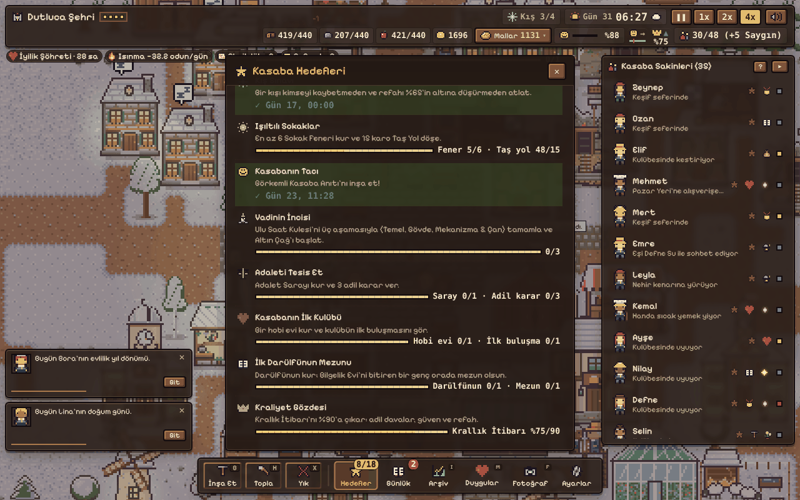
- **G31** — Maceracı Günlüğü kararı: sal ile geçmeyi seçtim ("Risk yok: Zeynep"). İnşa menüsünün **en altına kaydırınca** Adalet Sarayı, Darülfünun ve üç hobi evi duruyor. Ekran boyunca yerleştirme denedim: şehir içinde yer yok; ancak sol üst köşedeki yeşil alana saray sığdı. Hata mesajları gene "Toprak Patika üzerine kurulamaz", "Parke Taş Yol üzerine kurulamaz", "Önce meşe ağacı temizlenmeli".
  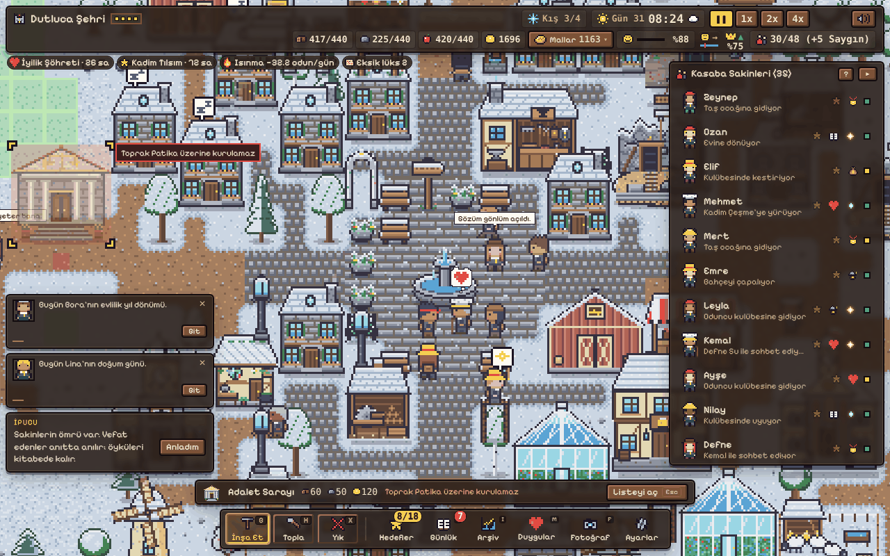
- **G31** — Bahçecilik Kulübü ve Dikiş-Nakış Evi'ni, Darülfünun'u (ancak güneybatı köşede yer vardı) kurdum. Taş 207'den 38'e indi: dört şantiye bütün taşı götürdü.
- **G32** — Kartlar: "Bahçecilik Kulübü kuruldu: Elif, Ayşe, Atlas ilk buluşmayı bekliyor." ve "Dikiş-Nakış Evi kuruldu: Mehmet, Emre, Selin ilk buluşmayı bekliyor." Hobi evleri kendiliğinden üye topluyor; bunu sevdim.
  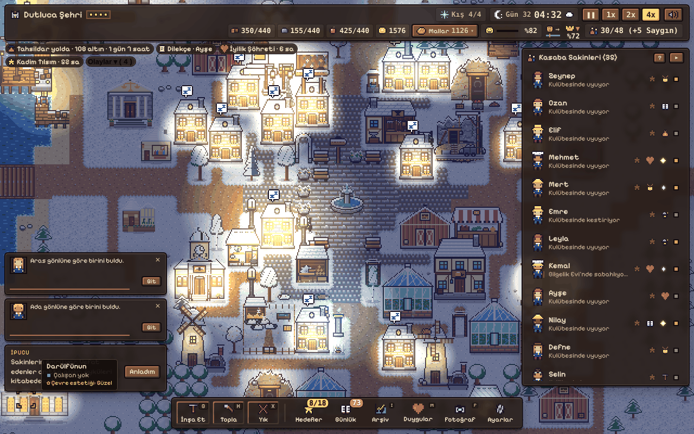
- **G32-33** — Yüklemeden sonra eski ipuçları sırayla çıktı (ömür, gezinme, "birine tıkla", kartlar...). Yeni "Kasaban büyüdü" kartı bu kuyruğun arkasında kaldı; ben inşa ettiğim için hiç görmedim. Ayrı bir oturumda gösterdim: ipuçlarını geçince çıkıyor.
  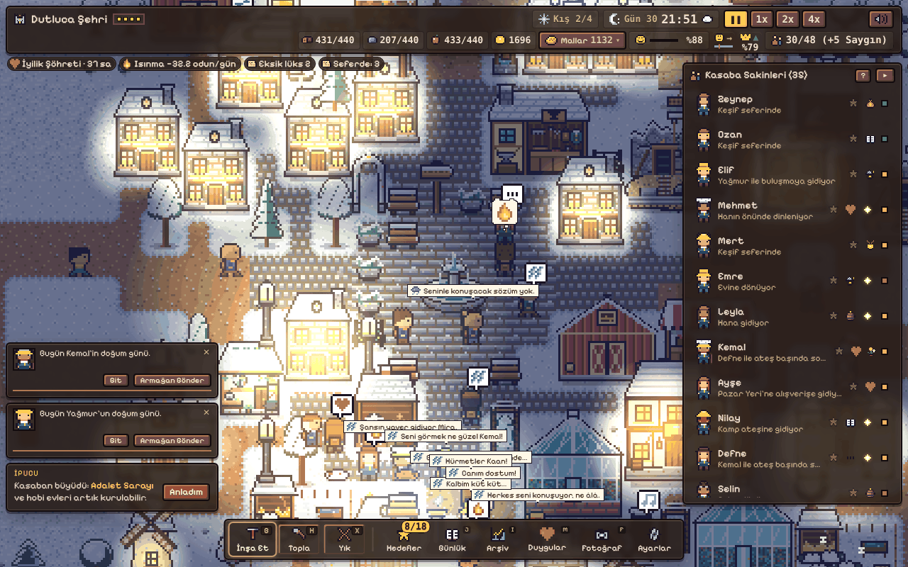
- **G33** — İtibar rozeti: "%69 · Sadık ▼ (24 saatte düşüyor) · Hedef %58 · bu gece −2,8 · Nedenler: Güven yüksek +6 · Refah yüksek +3 · Suçlar çözülmüyor −2 · Eğitim +0 · Kulüpler +0 · Vergi ×1 · ferman ödülü ×1". Saygın'ı kaybetmişiz: neden okunuyor.
  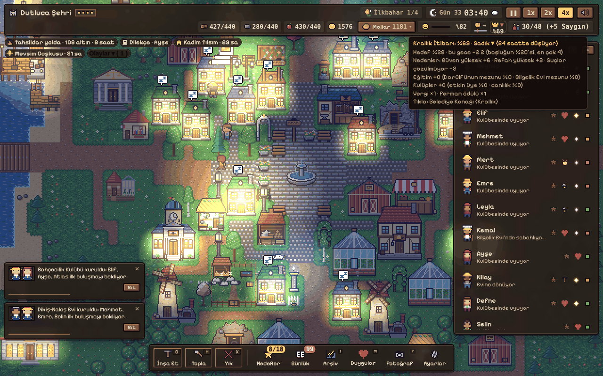
- **G33 23:29 — 1. dava:** Tolga, kilerden 6 torba erzak. İfade "Yanlış adam" (inkâr), tanık Toprak. Aç değil, kesesinde 19 altın, ilk suçu. **Para Cezası (hafif) + iade** → "Halk kararı adil buldu · orantılı · Yönetim Güveni +2 · İtibar hedefi yarından itibaren +8".
  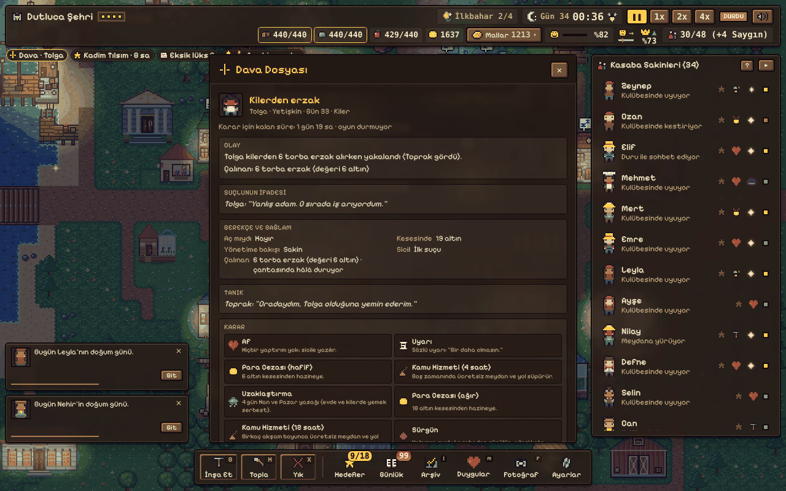
  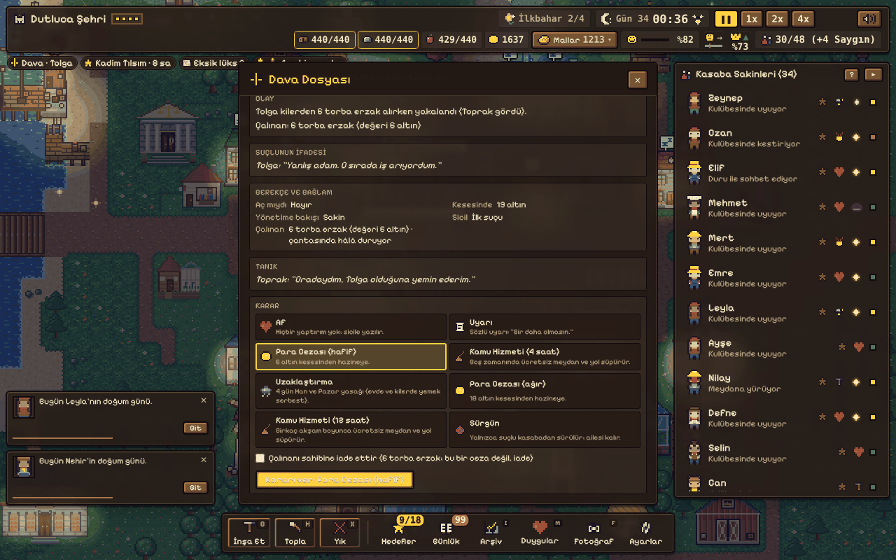
  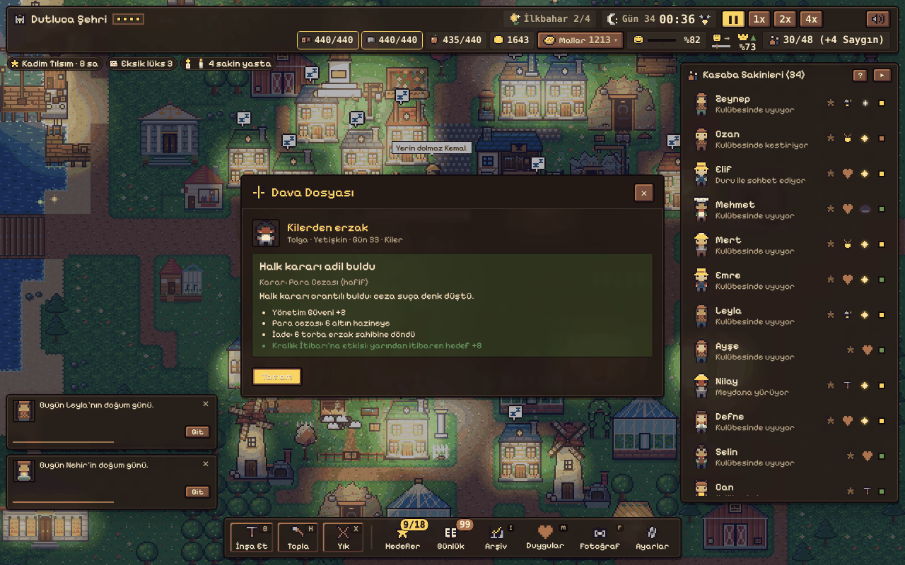
- **G35 21:29 — 2. dava (bilerek zalim):** Masal (Genç), Bora'nın kesesinden 4 altın; özür diledi, ilk suçu, kurban "Gençtir, bir kereliğine affedin" dedi. **Sürgün** verdim. Sonuç: "Halk kararı zalim buldu: bu kadarını hiç kimse beklemiyordu · Güven −8 · 34 sakinin sadakati düştü (−162) · Kasabadan sürüldü, ailesi kalıyor · İtibar hedefi −14". Sürgün seçilince bir uyarı kutusu çıkıyor ve "Kararı ver" düğmesi aşağı kayıyor (ilk tıklamam boşa gitti).
  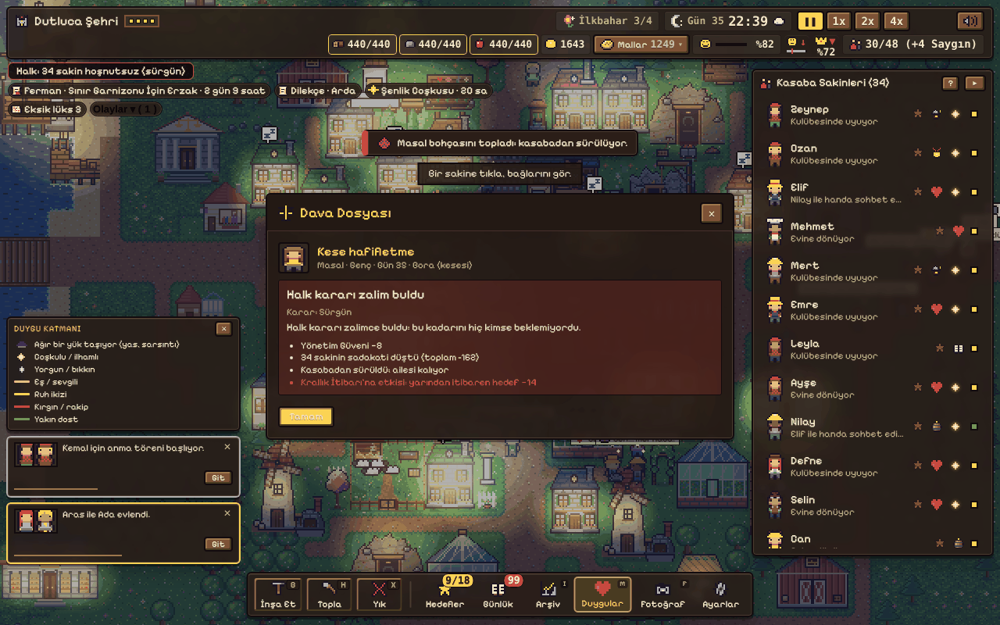
- **G36** — Şehirden iş teklifi (Emre): Maaş ver (78 altın).
- **G37** — Darülfünun paneli: "Öğrenciler 2/6 · Müderris: Emre (şu an yapıda değil) · Çarpanlar: Müderris ×1 (yok: varken ×2) · Günde en çok 90 dk · mezuniyet için 540 ilerleme · Ada Hayvancılık %14 · Kuzey Bilgelik %0 · Mezun 0 · yarım bırakan 3 · toplam kabul 6". **Ada'yı** (Genç, 20, Bilgelik Evi mezunu, evli) ve **Elif'i** (Bahçecilik Kulübü üyesi) "Yakından izle"ye aldım; sol üstte iki portre duruyor.
  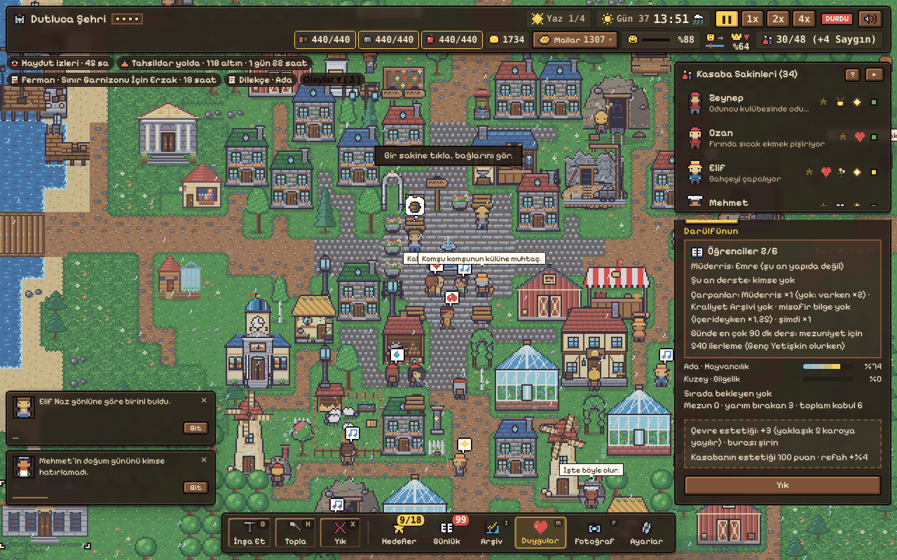
  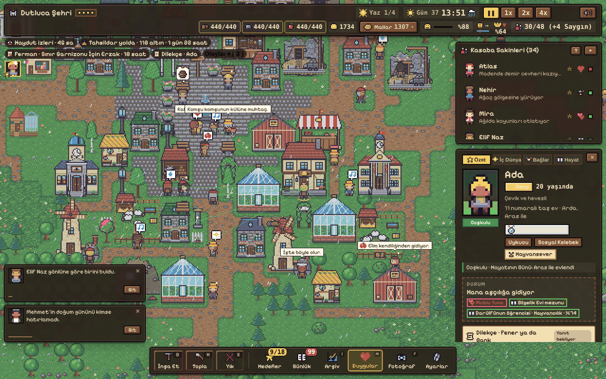
  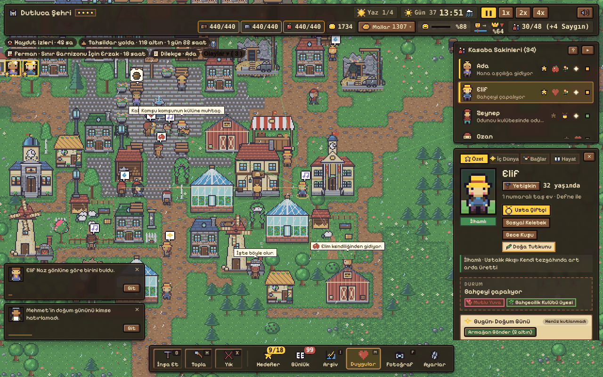
- **G38** — İtibar %50. **G39** — Nehir (%29) ve Mira (%68) Darülfünun'u yarım bıraktı; Pazar Yeri yandı, Acil Seferberlik (30 altın) bastım; Mehmet Saygın Büyük oldu.
- **G39 — 3. dava (bilerek gevşek):** Lina Mira'nın kesesinden 3 altın aldı; ifade "Ücretim zaten az. Kasaba bana borçlu sayılır." **Af** verdim. Sonuç: "Halk kararı gevşek buldu: suç cezasız kaldı sayılır · Güven −2 · Cezasızlık +2: suç riski artar · İtibar hedefi −5".
- **G40 — 4. dava:** Ece, Nilay'ın kesesinden 4 altın; "Benim kesemde onu alacak yer mi var? Bakın, bomboş!" dedi (kesesinde 21 altın vardı), kurban "Ders almalı". **Kamu Hizmeti (4 saat) + iade** verdim → "Halk kararı **gevşek** buldu · Güven −2 · hedef −5". Dört altınlık ilk suça dört saat hizmet + iade bile gevşek sayıldı.
- **G43** — Atlas'ın fidan dilekçesi kabul. Resim Atölyesi'ni kurdum (2x2'lik yer aramak yine bir dakika). Ulu Saat Kulesi için yer bulamadım (4x4): vazgeçtim.
- **G44 — 5. dava:** Elif Naz kilerden 6 torba erzak (2. suçu). **Para Cezası (ağır) + iade** → adil (+5). Kesesi (15) yetmedi; "kalanı 1 saat kamu hizmeti".
- **G47** — "İlk Darülfünun Mezunu" hedefi tamamlandı. **G48** — İtibar %35 Şüpheli: "Zalim karar −4 · Cezasızlık −4 · Güven yüksek +6", "Vergi ×1,2 · ferman ödülü ×0,9 · fermanlar 2 günlük". Okunur; ama "▼ düşüyor" derken satır "bu gece +2,8" diyordu (bunu düzelttim, bulgu 5).
- **G50** — **6. dava:** Nilay, 5 altın (ilk suç). Para Cezası (hafif) + iade → adil. Üçüncü adil karar: "Adaleti Tesis Et" tamamlandı (G50 04:42).
- **G52** — **7. dava:** Ada (izlediğim öğrenci, artık Yetişkin) bahçeden 1 meyve. İfade: "Üç gündür midem kazınıyordu..." ama dosyada "Aç mıydı: Hayır". Uyarı + iade → adil (bunu düzelttim, bulgu 4).
- **G54** — Sığınmacı kafilesi: doyur ve misafir et (15 sn süre). **8. dava:** Can, Pazar'dan 2 meyve (tanık Ece "sonunda konuştu"; çalınan harcanmış). Kamu Hizmeti (4 saat) → adil.
- **G55 19:13** — Dikiş-Nakış Evi paneli: "Üyeler 6/6 · Buluşma 6 · ürün 1 · mendil 1 · **Kulüp evi evlerden uzak: üyeler yolda vakit kaybediyor (ortalama 40 karo, ~88 dk yürüyüş)**" (yerini ben seçmiştim; uyarı haklı). Katılım noktaları ●○○●, "etkin" etiketi, Çıkar / Davet et. Katılımı 0/4 olan Leyla'yı **Çıkar** ile çıkardım ("Leyla Dikiş-Nakış Evi'nden çıkarıldı"); sıradaki aday olarak Nilay'ı eklemek isterken Leyla aday listesinin başına geçmişti, ilk satırdaki "Davet et" onu geri aldı.
  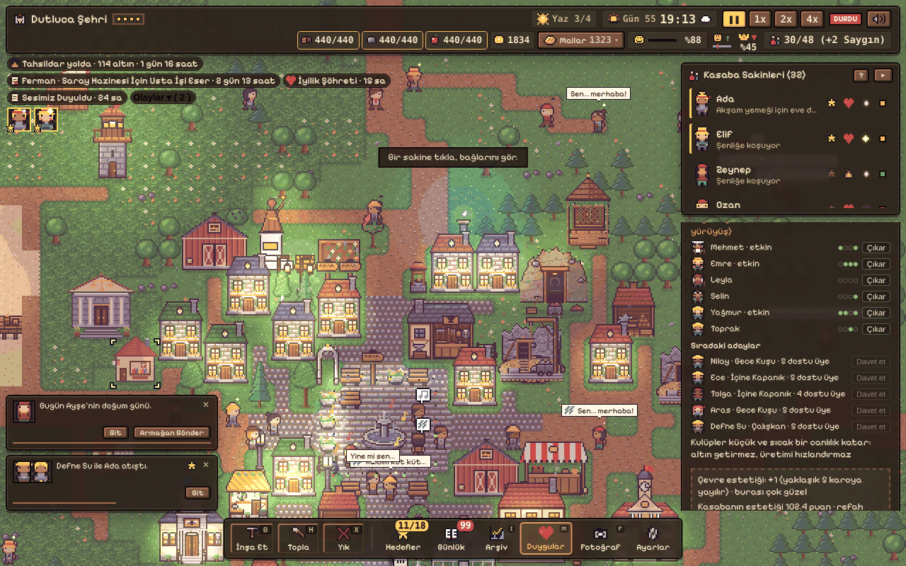
- **G58-G67** — Üç fidan dilekçesi (Defne, Ayşe) ve "Meydanda Buluşma" (Mira) kabul. **G59 — 9. dava:** Lina (2. suç; G39'da affetmiştim) 1 hatıra; itiraf: "Hiç gerek yoktu, biliyorum. Bağışlayın, geri vereceğim." Para Cezası (hafif) + iade seçtim → "Halk kararı **sert** buldu: ceza suçtan ağır · Güven −3 · 18 sakinin sadakati düştü (−72)". İtiraf cezayı düşürüyormuş; Uyarı yeterliymiş.
- **G63** — Arşiv: Nüfus 31 (30 günde −4), refah %93, hazine 1.980, **itibar %52 (en düşük 38, en yüksek 73)**, Darülfünun öğrencisi 1, **Darülfünun mezunu 4**, kulüp üyesi 18.
  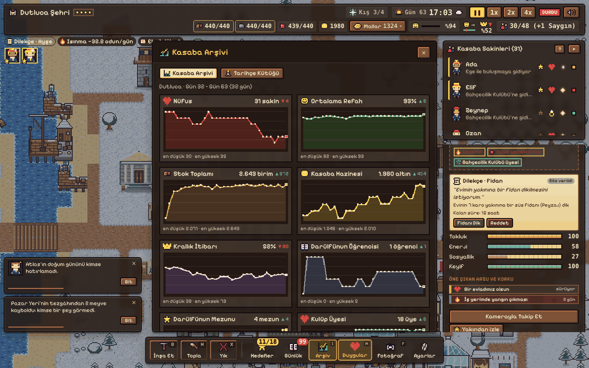
- **G64-66** — Meydan havuzunun (Süs Havuzu) paneli: İç Vergi, "Krallık" bölümü (itibar dökümü, "Kraliyet Lütfu 0/3 · Gözde serisi 0/4 gün", ferman, Teslim Et). Kraliyet Tersanesi fermanını (120 odun + 80 taş → 240 altın + Aslanlı Heykel hakkı) teslim ettim. Ferman çipine tıklayınca Belediye Konağı açılıyor; teslim düğmesi panelin en altında.
  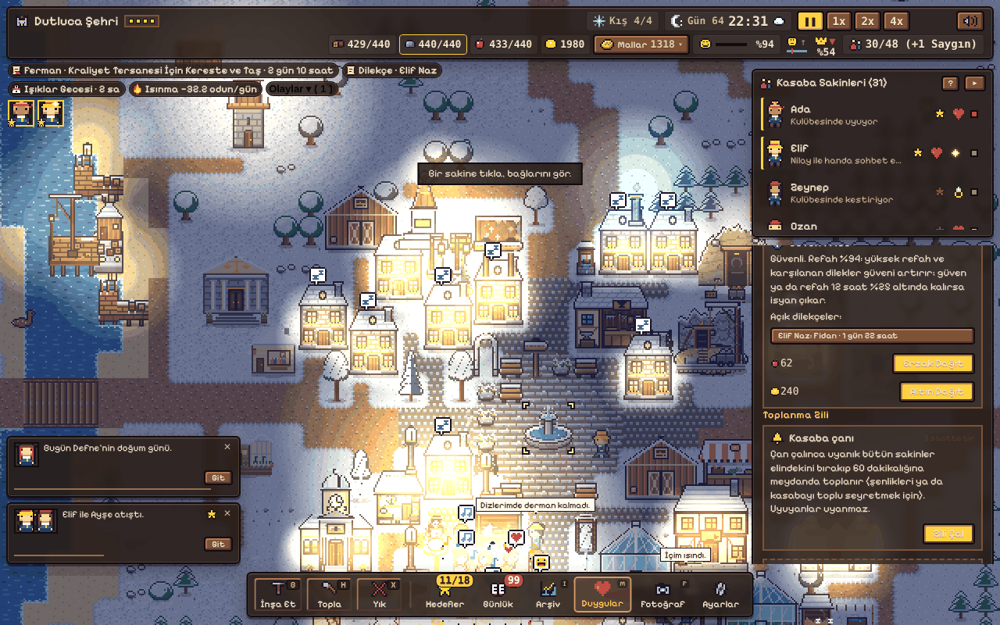
- **G68 — 10. dava:** Mert, ufak haylazlık (çit kazığı). Uyarı → adil.
- **G70** — İtibar %69 Sadık ▲, Kraliyet Gözdesi %68/90. Dört geç oyun hedefinden üçü bitti. Kraliyet Lütfu gelmedi (itibar hiç %90'a yaklaşmadı, en çok 73).
  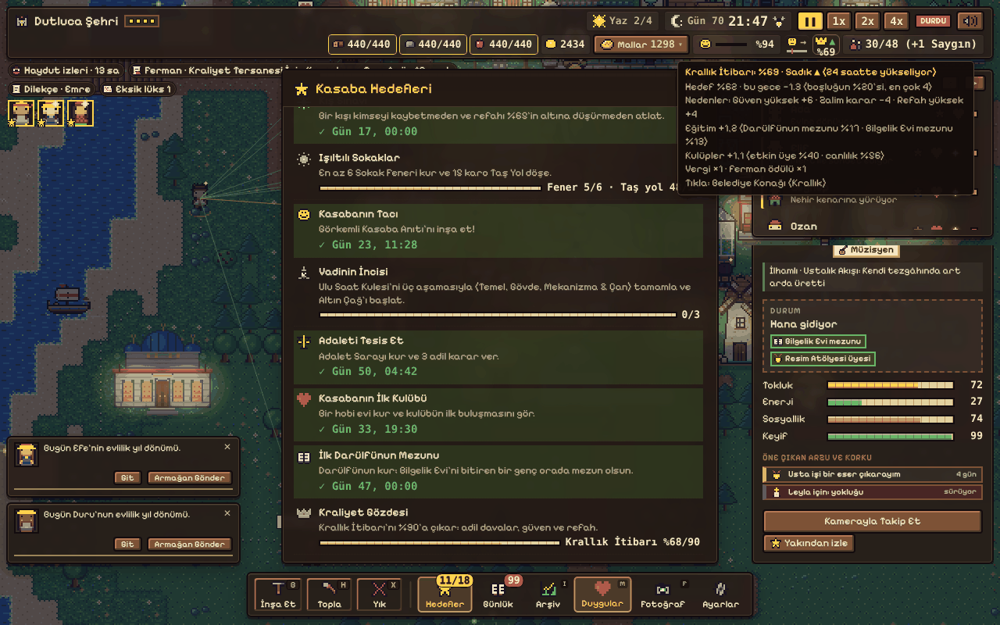

## 3. Geç oyunda yapacak şey

Anlamlı karar saydığım şeyler: dava, kulüp yönetimi (Çıkar / Davet et / izleme), eğitim (öğrenci izleme), inşa (yerleştirdiğim yapı), dilekçe. Yanlarına olay kararları (sal geçidi, iş teklifi, sığınmacı, yangın seferberliği, ferman) ayrıca yazıyorum.

| | G30-50 (21 gün) | G50-70 (20 gün) |
|---|---|---|
| Dava | 6 | 4 |
| Kulüp yönetimi | 1 (Elif'i izle) | 2 (Çıkar + Davet et) |
| Eğitim | 1 (Ada'yı izle) | 0 |
| İnşa | 5 (saray, Bahçecilik, Dikiş-Nakış, Darülfünun, Resim Atölyesi; kule yeri bulunamadı) | 0 |
| Dilekçe | 1 | 3 |
| **Toplam** | **14 → günde 0,67** | **9 → günde 0,45** |
| Olay / yönetim kararı | 3 (sal geçidi, iş teklifi, yangın) | 2 (sığınmacı, ferman) |
| Hepsi | 17 → günde 0,81 | 11 → günde 0,55 |

Günlük 5'teki his değişti mi: **kısmen.** O günlük "30. günden sonra aynı kartlar" diyordu; bu oturumda 30-50 arasında her gün ya bir yapı, ya bir dava ya da bir kulüp / öğrenci kartı vardı ve dava sonuçları (özellikle zalim ve sert kararların itibar eğrisini yıkması) beni yeni karar vermeye itti. 50-70 arasında kararlar yarıya indi: depolar 440/440'a dayandı, harcayacak yer kalmadı (Ulu Saat Kulesi'ne yer bulunamadığı için hazine 1.700 ile 2.400 arasında dolandı), dava ve dilekçe sayısı az ve benzer. "Bir tur daha" hissi yaklaşık 55. güne kadar sürdü; günlük 5'te 30. gündü.

## 4. Adalet sisteminin okunurluğu

- **İfade, bağlam, tanık, kurbanın sözü:** çok iyi. Her dava iki dakikalık bir mini hikâye. Bağlam tablosu (aç mıydı, kesesinde, sicil) kararı gerçekten etkiliyor, bunu karar sonuçlarından anlıyorum.
- **Orantıyı öğrenebildim mi: yarı yarıya.** Önizleme yok (bilerek). İlk adil kararım ve ikincisi şans / sezgiyle geldi. Ece'ye (inkâr, tanık, "ders almalı") 4 saat hizmet + iade "gevşek" çıktı; Lina'ya (itiraf, özür, hafif suç) hafif para cezası "sert" çıktı. Sonuç ekranı "gevşek / sert" diyor ama **ne olmalıydı demiyor**; bir tarafa fazla kaçtığımı bilsem de kaç basamak olduğunu bilmiyorum. İki yanlıştan sonra kuralı çıkardım: itiraf ve özür cezayı düşürür, inkâr + tanık artırır, tekrar eden suç artırır. Bunu oyun bir yerde söylemiyor; ifadeyi okuyarak öğrenmek zor değil ama bir öğretici cümle yararlı olurdu (bulgu 3).
- **Sonuç ekranı:** çok net: bant (adil / zalim / gevşek / sert), güven, sadakat, cezasızlık, itibar hedefi etkisi tek ekranda. İtibar etkisinin "yarından itibaren hedef −14" diye yazılması, bir kararın bedelini hemen gösteriyor.
- **Zalim kararın bedeli:** bu sefer yumuşak değil. Sürgün: güven −8, 34 sakinin sadakati düştü, itibar 79'dan 35'e, Şüpheli'ye (vergi ×1,2, ferman ödülü ×0,9) indi (G30 → G48); %69'a dönmesi G70'i buldu. Ağır vergi cezasının "hafif" kaldığı günlük 5'e göre büyük fark.

## 5. Sıkılan, kafası karışan ya da hata gören anlar

- **G31, G43, G48 — yapı yeri.** Gelişmiş Şehir'de boş yer yok; yeşil alan sol üst köşede tek bir nokta, Ulu Saat Kulesi (4x4) hiç yok. Hata mesajları doğru ama "nerede olur" demiyor. Günlük 5'in bulgusu aynen duruyor.
- **G37 — Darülfünun'da altı öğrencinin üçü ilk altı günde yarım bıraktı.** Gençlik 12 gün; ders günde 90 dakika, mezuniyet 540 dakika (6 tam gün). Geç kabul edilen gençler hiç yetişemiyor. Ada %14'te, 20 yaşındaydı.
- **G48 — itibar ipucunda ok ve satır çelişiyor** ("▼ 24 saatte düşüyor" ile "bu gece +2,8"). Düzelttim.
- **G52 — ifade ile bağlam çelişiyor** ("midem kazınıyordu" / "Aç mıydı: Hayır"). Düzelttim.
- **Her yerde — sarı düğmelerde yazı okunmuyor** ("Tamam", "Kararı ver", "Teslim Et", "Yükselt": sarı zemin üstünde açık krem yazı). Düzelttim.
- **G46 — ferman çipi** Belediye Konağı'nı açıyor ama "Teslim Et" panelin en altında; çipten oraya yol yok. Meydan havuzunda da aynı bölüm var. Bir süre aradım.
- **G55 — kulüp Çıkar / Davet et:** liste yer değiştirince yanlış kişiyi davet ettim. Çıkarılan "8 gün dönmez" yazıyor ama davetle hemen dönüyor.
- **G35 — Sürgün seçince** "Kararı ver" düğmesi aşağı kayıyor (uyarı kutusu eklendiği için). Doğru ama ilk tıklamayı kaçırtıyor.
- **Rehber:** yükleme sonrası eski ipuçları kuyruğu (yalnızca otopilot kaydıyla başlayınca; normal oyunda görmem). Yeni "Kasaban büyüdü" ve "Gelişmiş Şehir oldun" kartları kuyrukta bekliyor.
- Çökme, donma yok; sayfa hatası yok. Kayıt / yükleme yeniden denemedim (G30 kaydıyla başladım).

## 6. Bulguların önem sırası

1. **Geç oyunda (G55+) harcanacak şey yok; ana geç oyun hedefi erişilemiyor.** Odun / taş / yiyecek tavanda, altın birikiyor, Ulu Saat Kulesi'ne yer yok. (Mekanik / denge → kullanıcının kararı.)
2. **Darülfünun'un yarım bırakma oranı çok yüksek (altı öğrencinin üçü G37'ye kadar).** (Denge → kullanıcının kararı.)
3. **Orantı öğrenilebilirliği:** sonuç ekranı yön söylüyor, ölçek söylemiyor. (Tasarım → kullanıcının kararı.)
4. **İfade / bağlam çelişkisi** (düzeltildi).
5. **İtibar ipucunda zaman çerçevesi karışıklığı** (düzeltildi).
6. **Sarı düğmelerde düşük kontrast** (düzeltildi).
7. Yapı yeri bulma; ferman çipi → teslim yeri; kulüp aday sırası (küçük arayüz işleri, kullanıcının kararı).

## 7. Karnem
- Geç oyunda ne yapacağını anlama: **7/10** — hedefler ve kartlar yol gösteriyor.
- Kararlarımın ağırlığı: **9/10** — günlük 5'te 6'ydı.
- Okunurluk: **7/10** — dava ekranı çok iyi, düğme kontrastı düzeltildi.
- Sakinlere bağlanma: **7/10** — dava kişileri ve öğrenci izleme.
- "Bir tur daha": **7/10** — G55'e kadar; günlük 5'te 5/10.
- Uzun vadede merak: **5/10** — Kule'ye yer yok, itibar Gözde'ye çıkmadı, lütuf görmedim.

## 8. Yaşayamadıklarım
- Kraliyet Lütfu ve Barış Çeşmesi / Gül Bahçesi / Arşiv (itibar %90'a çıkmadı).
- Ulu Saat Kulesi ve Altın Çağ.
- Kaydet / yükle (kayıttan başladım).
- Sürgün sonrası ailenin hikâyesi (ailenin evlerinde ne olduğuna bakmadım).

## Kural notu
Oyunda durum yazan, kaynak veren ya da oyunu ilerleten hiçbir yardımcı çalıştırmadım: yalnızca fare / klavye gönderdim (hız düğmesi ve duraklatma dahil), ekrandaki yazıyı ve görüntüyü okudum. Başlangıç kaydını otopilot üretti (istendiği gibi). Küçük düzeltmeleri (bulgu 4-6) oyundan çıktıktan sonra yaptım ve testledim.
