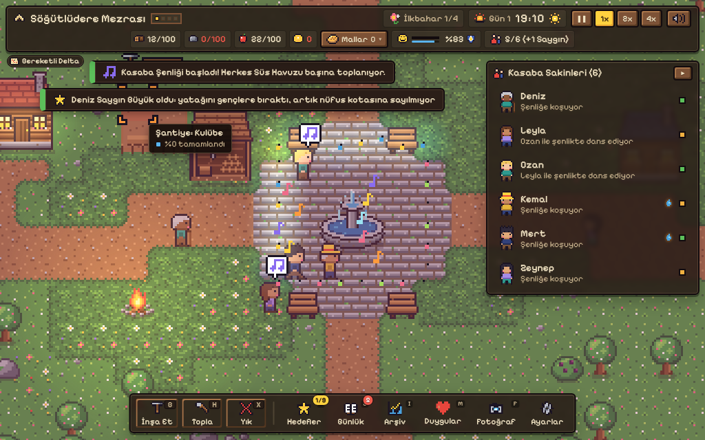
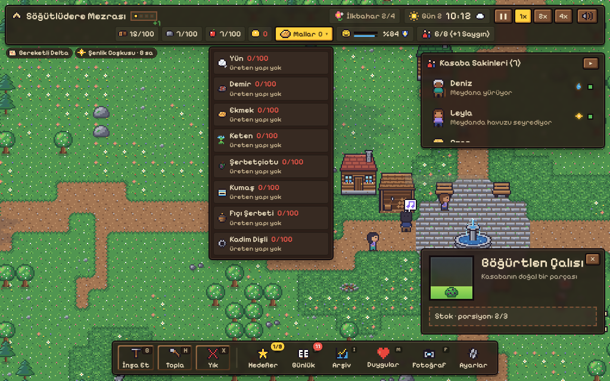
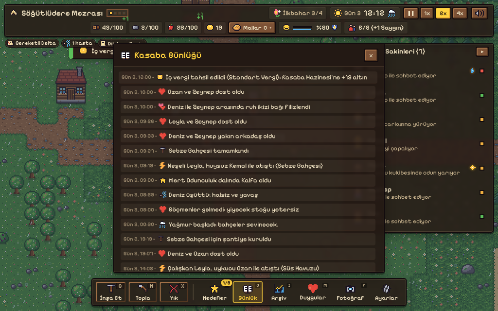
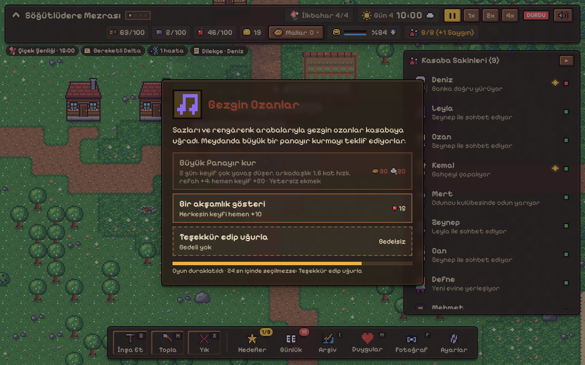
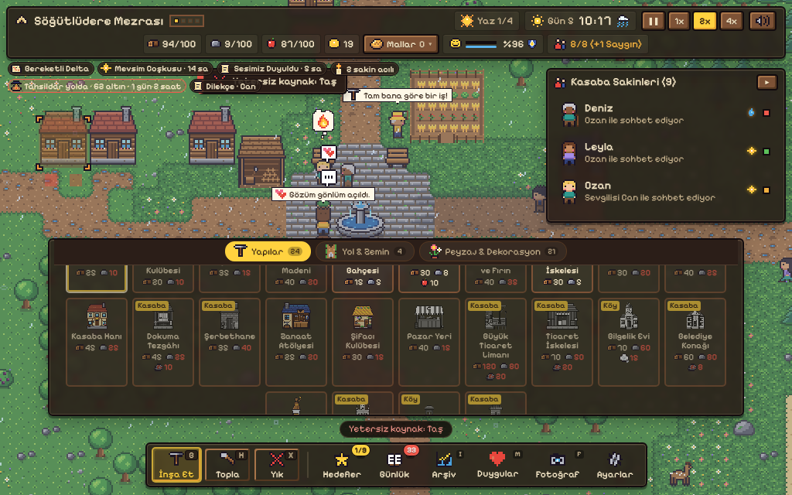
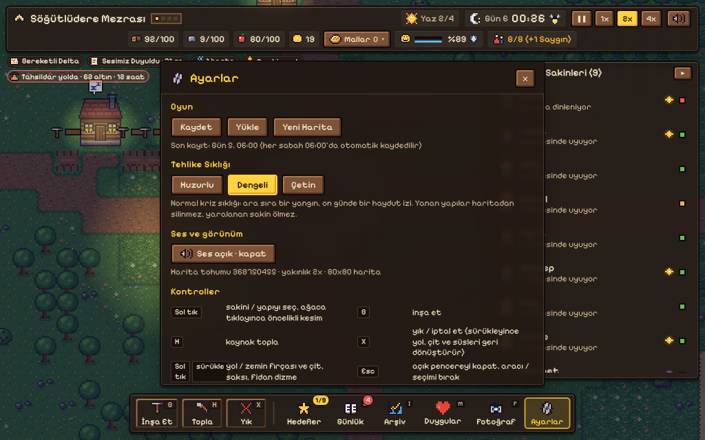
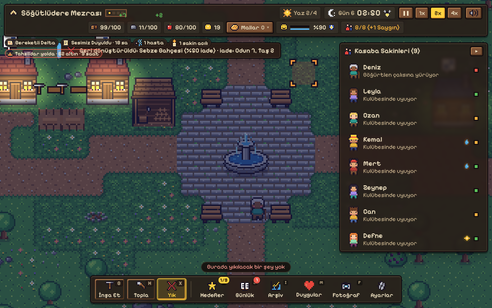

# Pikselköy — Oyuncu günlüğü (kör oynanış)

> Kurallara uydum: oyunun `src/`, `README.md`, `docs/`, `tools/sim/`, `styles/` dosyalarına bakmadım; yalnızca `tools/serve.py`'ı okudum. Sayfada kod çalıştırmadım; yalnızca fare/klavye gönderdim ve ekran görüntüsü aldım. Ses yok, duyamadım. 1024×640 pencere.

> Saatler, benim "el" aracımın açıldığı andan itibaren geçen gerçek dakikadır (d). Oyunun içindeki saat ayrıca "oyun saati" diye yazılı.

## 1. Mağaza yorumum

**★★★☆☆ — Sakinleri sevdim, kasabayı yönetmeyi sevmedim. Şimdilik ne tavsiye ederim ne etmem.**

Yaklaşık 28 dakika oynadım. İlk beş dakika gerçekten güzeldi: piksel sanatı sıcak, sakinler ekranda konuşuyor, kasabada şenlik çıkıyor, günlükte "Leyla ile Zeynep birbirine aşık oldu", "Deniz ile Zeynep arasında ruh ikizi bağı filizlendi" gibi cümleler akıyor. Bir insanın paneline girince yaşını, huyunu, ruh halini, kiminle atıştığını görüyorsun. Bu kadar ayrıntı beklemiyordum.

Gelgelelim bir yerden sonra ben oyunu değil, oyun beni oynadı. Taş bir türlü artmadı (9'da takıldı, ev 10 istiyordu), odun ve yemek 100'de dolup boşa gitti, ben de "nasıl taş çıkarırım" diye ekrana baktım. Çözümü bulamadım. Hedeflere 28 dakikada tek bir hedef ekledim (1/9). Kasabayı bilerek kıtlığa soktum (bahçeyi yıktım), yemek 2'ye düştü, kimse bir şey demedi, refah %88'de kaldı; cezası olmayan bir karar bana pek bir şey hissettirmedi.

Kasaba kendi kendine yaşıyor ve çok güzel yaşıyor, ama "benim" kasabam gibi gelmedi; izleyici gibi hissettim. Yazılar çok küçük ve rakamlar karışıyor (8 ile S, 0 ile O). Paramı geri ister miydim? Hayır; ama üç gün sonra tekrar açacağımı da sanmıyorum. Bir tane "şu işi şöyle yaparsan olur" cümlesi olsa yıldız artardı.

---

## 2. Oynama günlüğü — ilk 10 dakika

**0:00 (ekran 1)** Oyunu açtım. Piksel sanatı hoş, arkada çimen, havuz, bank. Ortada bir kutu: "Pikselköy", altında "Küçük bir kasaba kur, sakinlerini mutlu et, mevsimleri birlikte karşılayın." İki düğme: "Kaldığın Yerden Devam Et" (soluk, kayıt yok) ve "Yeni Kasaba Kur". Alttaki ipucu: "oyunda B ile inşa et, H ile kaynak topla, 0 hedefler, J günlük, Esc pencereyi kapatır." Yazıdaki bazı harfler tuhaf: rakamlar ve harfler karışıyor (aşağıda şikâyet).

**0:10** "Yeni Kasaba Kur"a bastım. Bana "Söğütlüdere" diye bir ad önerdi, yanında "Başka Ad" düğmesi ve bir "harita tohumu (isteğe bağlı)" kutusu. Dokunmadım, "Kasabayı Kur".

**0:20 (ekran 3)** Kasaba açıldı. Üstte bir sürü sayı: odun, taş, elma (?), bir altın simgesi, "Mallar", bir gülen yüz ve yüzde, "6/6" insan simgesi. Sağda "Kasaba Sakinleri (6)" listesi, her birinin altında ne yaptığı yazıyor ("Kulübesinde uyuyor"). Altta araç çubuğu: İnşa Et, Topla, Yık, Hedefler, Günlük, Arşiv, Duygular, Fotoğraf, Ayarlar. Ne yapmam gerektiği konusunda hiçbir şey söylenmiyor, ama kalabalık bir tutorial da yok. Hoşuma gitti, kafam da karışmadı: "Hedefler"e bakarım.

**0:30 (ekran 4)** Hedefler paneli: kasaba seviyesi "Mezra", sonraki "Köy". Şartlar: nüfus 6/13, yapı 3/8, "Seviye 2 yapı 0/1", ortalama refah %78 / %68. Altında görevler: "İlk Yuva" (bir kulübe ya da herhangi bir yapı tamamla), "Sıcak Sofra" (Kasaba Hanı kur), "Ticaret Yolları"... Bu panel tam bana yol gösterdi. İlk gerçek dakikadaki en iyi şey bu.

**1:00 (ekran 5-8)** "İnşa Et"e bastım. Menü yarı ekranı kaplıyor, haritanın tam ortasını kapatıyor. En üst sıradaki kartların üst yarısı kesik, **adları okunmuyor** (sadece fiyat). Kaydırmayı denedim, aşağı doğru çalıştı, üst sıra yine kesik kaldı. Fiyatlara bakıp "Kulübesi 20 10" yazanı seçtim: meğer Odunun Kulübesi (odun kesici) imiş. Haritada fareyi gezdirince yarı saydam bir hayalet bina çıktı, doğru yer yeşil/yanlış yer kırmızı oluyor, altta da neden yazıyor ("Başka bir yapının üstüne kurulamaz"). Bu iyi. Yerleştirdim: odun 30→10, taş 20→10.

**1:15 (ekran 10)** Şantiye göründü, üstünde çekiç ve ilerleme çubuğu, sakinler tek tek "Şantiyeye gidiyor" yazdı. Bir balonda "Kasabamız ne güzel olmuş." yazdı. Hoşuma gitti, kimse bir şey demeden işe koyuldu.

**1:30 (ekran 11-12)** "Topla" aracıyla bir şeyler işaretlemeyi denedim. Ağaçlara tıklayınca "Burada toplanacak bir şey yok" dedi (elma ağacı gibi duruyorlar, neden toplanamıyor bilmiyorum). Böğürtlen çalısına tıklayınca üstünde sepet simgesi çıktı, demek ki o toplanabiliyor.

**2:00 (ekran 13-14)** Odunçu bitti. "Günlük"te şu yazıyor: "İlk Yuva tamamlandı", "Odunçu Kulübesi tamamlandı". Hedefler 1/9. Odun sayısı yükseliyor, güzel.

**2:30-3:00 (ekran 18-24)** Bir ev (kulübe) koymaya çalıştım. Dört deneme sürdü:
1. Odunçunun üstüne bindirdim, kırmızı oldu, "Başka bir yapının üstüne kurulamaz" yazdı.
2. Haritaya değil, yanlışlıkla alt menü paneline tıkladım (panel haritanın üstünü örtüyor, farkında olmadım). Hiçbir şey olmadı, hiçbir mesaj da çıkmadı.
3. Patika (toprak yol) üstüne koymak istedim: "Toprak Patika üzerine kurulamaz". Yolu yıkmadan yan yana ev kurmak zorunda kalıyorsun.
4. Çimene koydum, oldu.
Sonuç: ev kurmak "bir tık" olması gerekirken 4 deneme ve neredeyse 1,5 dakika sürdü; çoğu menünün haritayı örtmesinden.

**3:30 (ekran 25)** Aniden "Kasaba Şenliği başladı! Herkes Süs Havuzu başına toplanıyor." çıktı. İkinci balonda: "Deniz Saygın Büyük oldu: yatağını gençlere bıraktı, artık nüfus kotasına sayılmıyor." Herkes havuza koştu, havuzun etrafında renkli nota efektleri, kalpli balonlar. Burası güzeldi. Ben hiçbir şey yapmadım, oyun kendi kendine bir şey oldu ve bana haber verdi. Benim için ilk küçük "vay" buydu. "Saygın Büyük" ne demek tam anlamadım ama büyük ihtimalle yaşlı demek.

Taş **0/100** oldu, kırmızıya döndü. Taşın nereden geleceğini bilmiyorum.

**4:00 (ekran 26-27)** Bir kayaya "Topla" ile tıkladım, "Taş Kırma" emri verildi. Akşam oldu, şenlik bitti: "Şenlik sona erdi. Kasaba yarına tam motivasyonla başlayacak!". Herkes eve dönüyor. Balonlarda konuşma var: "Ne hoş bir tesadüf!", "Bir lokma ekmek!".

**4:20 (ekran 28-30)** Kemal'i listeden seçtim. Kamera ona geçti. Kişi paneli açıldı: 58 yaşında, "1 numaralı kulübe, tek başına", huyları "Huysuz", "Çalışkan", "Hayvansever", ruh hali "Sıkkın". Başlık altında bir cümle: "Sıkkın · Açlıktan Gözü Dönmüş: Karnı zil çalıyor". "İç Dünya" sekmesinde bir liste: "Tatsız Karşılaşma · güçlü — Leyla ile gergin bir sohbet etti", "Açlıktan Gözü Dönmüş", "Gözü Gönlü Açıldı — Çiçekli, bakımlı bir sokakta vakit geçirdi" (neden her birinin sayısal etkisi yazıyor: "İş -%18, keyif düşüşü +%40"). "Bağlar" sekmesinde "Aile: Bekâr · 1. Kuşak Kurucu", "İlişkiler: Ozan (tanıdık), Mert (tanıdık)". Panelin alt kısmı araç çubuğunun altında kalıyor, aşağısını okuyamıyorum.
Bu sayfalar beni gerçekten şaşırttı: oyun bana bir "bu bir sayı" değil "bu bir insan" gibi davranıyor. Ama Kemal'in aç olduğu yazıyor, ben hâlâ elmaları sayıyorum.

**5:20 (ekran 31-32)** Gece geçti. Elma (kırmızı simge, "yemek" olduğunu varsaydım) **28'den 19'a, 16'ya** düşüyor, her seferinde ekranda küçük kırmızı "-8", "-3" yazıyor. Kim yiyor, neden bu kadar hızlı bitiyor, anlayamadım.

**7:00 (ekran 33-34)** Kamerayı uzaklaştırdım (tekerlek). 7. sakin, **Can**, "Kasabaya geliyor" yazdı, geldi. Üstteki "Mallar" menüsünü açtım: Yün, Demir, Ekmek, Keten, Şerbetçiotu, Kumaş, Pıçı Şerbeti (böyle okudum), Kadim Dişli. Hepsi 0/100, hepsinde kırmızıyla "Üreten yapı yok". Ne işe yaradıklarını bilmiyorum.

**7:20 (ekran 35-36)** Yemek (elma) 7 → 4. Hâlâ ağaçlardan hiçbir şey toplayamıyorum ("Burada toplanacak bir şey yok"). Böğürtlen çalısına tıkladım, bilgi paneli açıldı: "Stok · porsiyon: 2/3". Çalıdan toplanıyor, ama kaç kişi bunu yapıyor bilmiyorum.

**8:20 (ekran 37)** Elma **1/100**. İnsanlar hâlâ yürüyor, sohbet ediyor, refah %80 civarında. Aç kalan kimse yok gibi görünüyor, bu da beni şaşırttı: sayı sıfıra yaklaşırken kimse acı çekmiyor ya da ben görmüyorum.

**8:30 (ekran 38-39)** Üstte "Dilekçe · Deniz" diye bir çip belirdi. Tıkladım, kamera Deniz'e geçti, kişi paneli açıldı: 66 yaşında, "Kıdemli Bilge", "Saygın Büyük (Nüfus Kotasından Muaf)", **"Evsiz"**. Huyları "Huysuz", "İçine Kapanık", "Doğa Tutkunu". Altta: "Coşkulu · Dileği oldu: Yeni bir dost edinelim." Bu cümle hoşuma gitti ama ne yapmam gerektiğini bilmiyorum: "Dilekçe" bir şey mi istiyor, yoksa sadece haber mi? Kimseyle konuşamıyorum, bir düğme yok.

*Ekran 4: "Hedefler" paneli. İlk dakikada bana yol gösteren tek yer.*

*Ekran 9: Yerleştirme hayaleti: kırmızı = olmaz, altta nedeni yazıyor. Menünün üst sırası kesik, adlar okunmuyor.*

*Ekran 25: Şenlik. Herkes havuz başında, nota efektleri; üstte "Deniz Saygın Büyük oldu".*

*Ekran 28: Kemal'in paneli. Alt kısım araç çubuğunun altında kalıyor.*

*Ekran 35: Elma 7/100 ve düşüyor; böğürtlen çalısının paneli açık.*

*Ekran 39: Deniz: "Evsiz", dileği "yeni bir dost edinelim".*

## 2b. Oynama günlüğü — asıl oyun (10. dakikadan sonra)

Hedefim: "Kıtlıktan çıkayım, yeni ev koyayım, nüfus 13'e çıksın, Köy olsun." Hedefler panelindeki ilk madde buydu zaten.

**9.4–9.6 (ekran 40–42)** İnşa menüsünde bu kez "Bahçesi" kartını (odun 15, taş 5) denedim. Hayalet bir tarla gibi görünüyor. Yola konmuyor, çimene konuyor. Koydum: bildirim "Şantiye kuruldu: Sebze Bahçesi (Odun 15, Taş 5)". Yemek o an 1/100'dü.

**10.4 (ekran 43)** Gece oldu, şantiye %0. Kimse gece inşaat yapmıyor, anladım, bekledim. Deniz hâlâ evsiz, kamp ateşinin yanında. İsim üstünde kırmızı bir nokta var; ne olduğunu sonradan anladım: ruh hali göstergesi (kırmızı = kötü).

**11.2–12.1 (ekran 44–45)** Hızı artırdım (sağ üstte 1x / 8x / 4x gibi okuduğum üç düğme; ortadakini seçtim, gerçekten hızlandı). Sabah Sebze Bahçesi bitmişti, Kemal "Bahçeyi çapalıyor", yemek 1'den 32'ye yükseldi. Üstte "1 hasta" çipi çıktı.

**12.1 (ekran 46)** Günlüğü açtım. Burası oyunun en iyi yeri: "Neşeli Leyla, huysuz Kemal ile atıştı (Sebze Bahçesi)", "Göçmenler gelmedi: yiyecek stoğu yetersiz", "Deniz üşüttü: halsiz ve yavaş", "Deniz ile Zeynep arasında ruh ikizi bağı filizlendi", "Mert Odunculuk dalında Kalfa oldu", "İç vergi tahsil edildi: Kasaba Hazinesi'ne +19 altın". Kıtlık yüzünden göçmenlerin gelmediğini ben günlüğü okuyunca anladım, kimse bana ekranda söylemedi.

*Ekran 46: Kasaba günlüğü.*

**13–15 (ekran 47–51)** Stoğa baktım: odun 98, yemek 83, ama taş **2**. Ev kurmak istedim, yetmedi. Kayaları "Topla" ile işaretledim, hiçbir şey olmadı gibi. 15. dakikada iki yeni sakin (Defne, Mehmet) geldi, 9 kişi olduk, nüfus kutusu **8/8 (+1 Saygın)** diye kilitlendi: ev yok, daha fazla kişi gelmeyecek.

**15 (ekran 52–53)** Oyun kendini durdurdu ve bir pencere çıktı: "Gezgin Ozanlar". Üç seçenek: Büyük Panayır kur (gri, "Yetersiz ekmek"), "Bir akşamlık gösteri" (19 elma, herkesin keyfi +10), "Teşekkür edip uğurla" (bedava). Geri sayım yazıyor ("24 sn içinde seçilmezse..."). Gösteriyi seçtim: günlükte "Ozanlar meydanda bir akşam türküler söyledi". Bu bir *karar* gibi hissettirdi; tek yer burası.

*Ekran 52: Gezgin Ozanlar penceresi.*

**16.4 (ekran 54)** Yemek 100/100 doldu (kırmızı çerçeve) ve üstte yeni çipler çıktı: "Çiçek Şenliği · 4 sa", "Sesimiz Duyuldu · 19 sa", "2 sakin acıl…", "Tahsildar yolda · 68 altın · 1 gün 19 saat". İkisini de tam anlamadım. Tahsildar çipi bana "68 altın ver" gibi göründü, altınım 19'du. Taş 9'a çıkmıştı (kendi kendine).

**17–19 (ekran 55–58)** Ev kurmayı dört kez daha denedim. Bir seferinde alt satırda "Kapının önü yola bağlı ve açık olmalı", üç seferinde "Yetersiz kaynak: Taş" dedi. Taş 9, ev 10. **Bir taş eksik.** Bir oyun gününe yakın bekledim, taş 9'da kaldı. Burada çok sinirlendim.

*Ekran 57: "Yetersiz kaynak: Taş". Odun 94, taş 9.*

**19.3 (ekran 59–62)** Günlükte "Dilekçe · Can: Evimin yakınına bir fidan dikilmesini istiyorum." çıktı. Peyzaj sekmesine girdim, Huş Fidanı (2 odun + bir şey) var. Evlerin yanına dört fidan diktim. Çip biraz sonra kayboldu; yerine getirildi mi bilmiyorum (günlükte doğrulamadım).

**19.8–20 (ekran 63–64)** Ayarlar: "Kaydet", "Yükle", "Yeni Harita", tehlike sıklığı, kontrol listesi. Kaydet'e bastım, sayfayı yeniledim. Oyun başlık ekranı göstermeden, aynı günden devam etti (hız 8x korunmuş). Kayıt sorunsuz çalıştı gibi.

*Ekran 63: Ayarlar. "Normal kriz sıklığı: ara sıra bir yangın, on günde bir haydut izi."*

**20.2 (ekran 65)** Kötü yönetici: "Yık" (X) ile Sebze Bahçesi'ne tıkladım. **Onay sormadan anında yıkıldı**, "Geri dönüştürüldü: Sebze Bahçesi (%80 iade) · iade: Odun 7, Taş 8". Taş 9→11. Yani taşı yıkarak buldum.

*Ekran 65: Bahçe onaysız yıkıldı.*

**21.7 (ekran 66)** Yaklaşık 1,5 dakika sonra: yemek 56, altın 19→**0**, refah %86. Fidanlar büyümüş. Günlükte sonradan okudum: "Krallık Vergisi ödendi (62 altın: bir kısmı 30 odun ile)". Yani tahsildar geldi, altınımı ve odunumu aldı, ben hiçbir şey yapmadım.

**24.4 (ekran 67)** Yemek 80→... düşüyor (-3/saat gibi bir şey). Günlükte yeni dostluklar: Kemal–Mehmet, Mert–Mehmet "ruh ikizi". Deniz yine "iyileşti" (kaç kere hasta oldu bilmiyorum).

**27.3–27.5 (ekran 68–69)** Yemek **2/100**. Oyun durdu: "Sığınmacı Kafilesi": "Kuzeydeki köyleri sel basmış; bir lokma ekmek ve sıcak bir köşe istiyorlar." Seçenekler: "Doyur ve misafir et" (40 yemek, 20 başka bir şey; gri, "Yetersiz yiyecek"), "En yeteneklisini kasabaya al" (gri, "Kasabada boş yatak yok"), "Kibarca geri çevir" (keyif −3). Üçünün ikisi *benim hatamdan* kilitliydi: yiyecek yok (bahçeyi ben yıktım), yatak yok (ev kuramadım). Bu an, "kötü yönetici"ye oyunun tepkisi olarak gördüğüm tek şey, ve etkili. Geri çevirdim. Sonra refah %88'de kaldı.

*Ekran 69: Geri çevirdikten sonra. Yemek 2/100, refah hâlâ %88.*

Bütçe doldu (69/70 ekran). Yaklaşık 28 gerçek dakikada durdum.

---

## 3. Ne yapacağımı bilemediğim anlar

1. **İnşa menüsünün adları.** Nerede: İnşa Et'in ilk sırası. Ne bekledim: kartların adlarını okumak. Ne oldu: üst yarısı kesik, sadece fiyat görünüyor. Çözdüm mü: kartı seçip hayalete bakarak ("Odunun Kulübesi", "Kulübe") çözdüm. Süre: ~1 dk.
2. **Ev koymak.** Beklediğim: bir tıkla bir ev. Oldu: 4 deneme (üst üste, panele tıklama, yola konmaz, yetersiz taş). Çözdüm: ilk evi. İkincisini çözemedim. Süre: ilk ev 1,5 dk, ikinci: asla.
3. **Taş nereden gelir.** Nerede: taş 0/2/9 iken. Beklediğim: bir "taş ocağı" ya da işaretlediğim kaya. Oldu: "Topla" ile kaya işaretledim, birkaç saat sonra 9 oldu, sonra durdu. En sonunda taşı bahçeyi yıkıp (%80 iade) elde ettim, bu bir çözüm değil. Çözemedim. Süre: 10+ dk.
4. **Ağaçlar.** Elma ağacı gibi duruyor, "Burada toplanacak bir şey yok" diyor. Çözdüm mü: hayır. Meyve yerine sebze bahçesiyle yemek buldum.
5. **"Dilekçe" çipleri.** Beklediğim: bir şey istiyorlar, düğme olacak. Oldu: çipe tıklayınca kişi paneline gidiyor, orada küçük bir cümle. Fidan istemişse bunu Peyzaj sekmesinden kendim çıkarmam gerekti. Süre: ~2 dk; Deniz'in "Yeni bir dost edinelim"i için ne yapacağımı hiç bulamadım.
6. **Kimin evi var, kim evsiz.** Kasaba 9 kişi, 2 ev, hepsi "kulübesinde uyuyor" yazıyor. Kimin nerede yattığını hiç anlayamadım.
7. **Hız düğmeleri.** 1x / 8x / 4x diye okudum, fontu karıştırdım; ortadakini denedim, hızlandı. Hangisinin ne olduğunu bilmiyorum.

## 4. "Vay" dediğim anlar

1. **Şenlik (ekran 25).** Kendiliğinden başladı, herkes havuz başına koştu, notalar, kalp balonları. Ben hiçbir şey yapmadım ve yine de oyun beni sevindirdi.
2. **Günlük (ekran 46).** "Leyla ile Zeynep birbirine aşık oldu", "Deniz ile Zeynep arasında ruh ikizi bağı filizlendi". Bir cümlede bir hikâye var ve ben bunları üretmedim. İki kere "vay" dedim.

Küçük olanlar: Mert'in "Usta Odunçu" olması, balonlarda "Ne hoş bir tesadüf!" diye konuşmalar.

## 5. Sinir olduğum şeyler

1. **Taş.** Bir taş eksik yüzünden ev kuramamak, nüfus kilitli, 10+ dakika. (Ekran 57)
2. **Yazı ve sayı fontu.** Küçük, 8 ile S, 0 ile O karışıyor. Saatin 10:00 mı 18:00 mı olduğundan emin olamadım; sayı kırmızıysa kötü mü, dolu mu anlamak için bakmak gerekiyor.
3. **Menü haritayı kapatıyor** ve üst sırası kesik; panellerin alt yarısı araç çubuğunun altında kalıyor.
4. **Onaysız yıkma.** Bir tıkla bahçem gitti. İade var ama geri alma yok.
5. **Kötü karara tepki yok.** Yemek 2'ye düştü, kimse bir şey demedi, refah %88. Başladığım "kıtlık" hissi gelmedi.

## 6. Ekranda olup da hiç anlamadığım şeyler

- **"Sesimiz Duyuldu · 19 sa"** çipi. Ne işe yarıyor, anlamadım.
- **"2 sakin acıl..."** çipi (okuduğum kadarıyla). Tam yazıyı okuyamadım; "acıkmış" olabilir.
- **"Tahsildar yolda · 68 altın · 1 gün 19 saat".** Sayaç ne için, ne olacak anlamadım; altın sıfırlandı.
- **Sakin satırlarının sağındaki renkli kareler** (kırmızı/turuncu/yeşil) ve **su damlası, yıldız simgeleri.** Ruh hali olabilir, emin değilim.
- **Sağ üstteki yıldız ve renkli çubuk** (kasaba adının yanındaki küçük çubuk): ilerleme çubuğu mu, seviye mi, bilmiyorum.
- **"Mallar" menüsü:** Yün, Demir, Ekmek, Keten, Şerbetçiotu, Kumaş, "Pıçı Şerbeti" ve "Kadim Dişli"; hepsi 0 ve "Üreten yapı yok". Ne işe yaradıklarını bilmiyorum.
- **Nüfus kutusu "8/8 (+1 Saygın)".** Saygın'ın ne demek olduğunu Deniz'in panelinden yarım yamalak öğrendim.
- **"Arşiv", "Duygular", "Fotoğraf"** düğmelerine hiç basmadım; ne olduklarını bilmiyorum.
- **Kişi panelinde "Hayat" sekmesi:** açmadım.
- **Altın.** Sadece vergi için kullanıldı, başka işe yaradığını görmedim.

## 7. Sakinler

Adını hatırladığım biri **oldu**: Deniz, Kemal, Leyla, Zeynep, Mert, Ozan, Can, Defne, Mehmet. En çok **Deniz**. 66 yaşında, evsiz, kamp ateşinde yatıyor, hasta oldu, iyileşti, tekrar hasta, "Yeni bir dost edinelim" diyor, sonra Zeynep'le ruh ikizi oluyor. Sakinlerin adına bakarken içimden "evsiz kalma, üşüme" dediğimi fark ettim; yani umursadım, ama onu bir eve yerleştirmem mümkün olmadı (taş yok), bu da canımı sıktı. **Kemal**: huysuz, çalışkan, bekâr, bahçeyi çapalıyor, Leyla ile atıştı, sonra herkesle dost oldu. Sakinler hakkında oyun bana hikâye *anlattı*: aşklar, atışmalar, dostluklar günlükte. Ama bunlar benim yaptıklarım yüzünden olmadı; ben seyrettim.

## 8. Benim yaptıklarım önemli miydi?

Kısmen. **Odunçu** ve **Sebze Bahçesi** gerçekten bir şeyi değiştirdi: yemek 1'den 100'e çıktı. **Bahçeyi yıkmak** yemeği 80'den 2'ye düşürdü, bunu da gördüm, ve sığınmacı olayında seçeneklerim kilitlendi. Bunun dışında: fidanlar, gösteri kararı, Gezgin Ozanlar, sığınmacıyı geri çevirmek: etkisini gösteren bir sayı ya da cümle görmedim (gösteri "keyif +10" demişti ama refah çubuğunda fark etmedim). Ben olmasam kasaba: aynı şenlikleri yapar, aynı aşkları yaşar, göçmen kabul etmezdi (zaten kabul etmemişti). Yani ben olmasam kasaba çok daha az farklı olurdu.

## 9. Bıraktığım an

Gerçek bir oyuncu olarak **yaklaşık 18–19. dakikada** (ekran 57–58, taş 9, "Yetersiz kaynak: Taş", ikinci kez) kapatırdım. O zamana kadar günlük beni tutuyordu; orada hedef yoktu, ilerleyemiyordum. Yarın tekrar açar mıydım? Muhtemelen **evet, ama bir kez**: günlükte neler olduğunu merak ederdim. Bir hafta sonra açmazdım.

## 10. Karşılaştığım hatalar

- İnşa menüsünün ilk sırasında kartların üst kısmı kesik, adlar okunamıyor (ekran 9, 40).
- Kişi panelinin alt kısmı araç çubuğunun altında kalıyor (ekran 28).
- Harita sürükleyince kaymadı (Topla modundaydım, belki o yüzden). Tekerlekle uzaklaşmak çalıştı.
- Paneldeki bir kartı seçili tutarken alt panele tıklamak, hata vermeden sessizce hiçbir şey yapmıyor (ekran 20–22).
- Ağaçlar meyve veriyor gibi görünüyor ama "Burada toplanacak bir şey yok" (ekran 11, 36).
- Bazı sayıların okunmaması (8/S) ve "Pıçı Şerbeti" gibi okuduğum bir isim.
- "Sakin listesi" son satırı kesik ("Mehmet" yarım).
- Sayfa yenileyince başlık ekranı hiç gelmedi; kaydedilmiş oyun doğrudan açıldı (hata mı, özellik mi bilmiyorum).

## 11. Keşke olsa dediklerim

- **Taşın nereden geleceğini söyleyen** bir ipucu ("Taş için Taş Ocağı kur"), ve taş azken uyarı.
- Menü kartlarında **adları okunur** olsun, ve her kartın üstüne gelince ne işe yaradığı yazsın.
- Yık için **onay** ya da geri al.
- Her sakinin **kendi evi / yatağı** net olsun, evsizler kırmızı bir simgeyle görünsün.
- Dilekçelerde **"Karşıla" düğmesi**: "Can fidan istiyor → [Fidan dik] [Yoksay]".
- Bir şey bittiğinde ("Dilek yerine geldi") **küçük bir kutlama**.
- Kıtlıkta **sakinler yüzünden konuşsun** ("Acıktım!") ve ruh hali çubuğu belirgin düşsün.
- Yazılar ve rakamlar **daha büyük**, panel araç çubuğunun altına girmesin.
- Bir **"şimdi ne yapmalıyım"** düğmesi.
- Sakinlere **iş atama**, taş kıran birini ben seçeyim.
- Kayıtlar için bir **başlık ekranı**; "kaldığın yerden devam et" gibi.

## 12. Karnem (10 üzerinden)

- **İlk 10 dakika: 7.** Güzel görünüyor, Hedefler paneli yol gösteriyor, ama ev koymak ve taş yüzünden tökezledim.
- **Ne yapacağını anlama: 4.** İlk hedefi buldum, ikincisini bulamadım; taş ve dilekçeler belirsiz.
- **Görünüş: 8.** Piksel sanatı sıcak, gece/gündüz, ateş, şenlik güzel; yazı fontu küçük ve rakamlar karışık.
- **Sakinlere bağlanma: 6.** Adlarını hatırlıyorum, Deniz'i umursadım; ama onlara kendim bir şey yapamadım.
- **"Bir tur daha" hissi: 4.** Günlüğü merak ederim ama oyunda hedefim kalmadı.
- **Kendi kararlarımın ağırlığı: 3.** Bahçeyi yıkmak sayıyı düşürdü, ama kimse tepki vermedi; sığınmacı olayı dışında karar ağırlığı hissetmedim.

## 13. Yaşayamadıklarım

- **Ses ve müzik:** duyamadım.
- **Akıcılık:** hareketin ne kadar akıcı olduğunu bir insan gibi hissedemedim; ekran görüntülerinde takılma görmedim ama bu bir hüküm değil.
- Köy seviyesine geçmek, Kasaba Hanı, Pazar Yeri, Bilgelik Evi gibi yapılar, ticaret, "Sıcak Sofra" hedefi.
- Kış ve sonbahar (yalnızca ilkbahar ve yazın başını gördüm).
- Yangın ve haydut krizleri (Ayarlar'da yazıyor, ben görmedim).
- "Arşiv", "Duygular", "Fotoğraf" ekranları; kişi panelindeki "Hayat" sekmesi.
- Mallar listesindeki ürünlerin (Yün, Demir, Ekmek...) işe yaradığı bir an.
- Can'ın fidan dileğinin gerçekten karşılanıp karşılanmadığı; Deniz'in dostluk dileği.
- Birini kasıtlı olarak mutlu etmenin sonucunu oyunun bana *göstermesi*: bunu net yaşayamadım.
- 30–40 dakikalık hedef sürenin tamamını oynamadım: ekran görüntüsü bütçesi (70) dolduğu için ~28 dakikada durdum.
