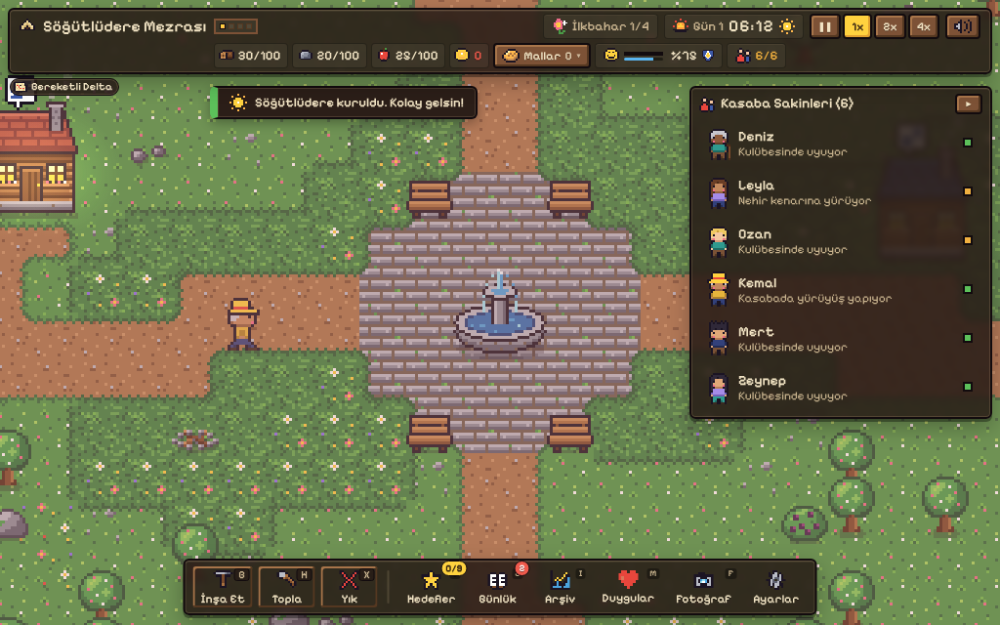
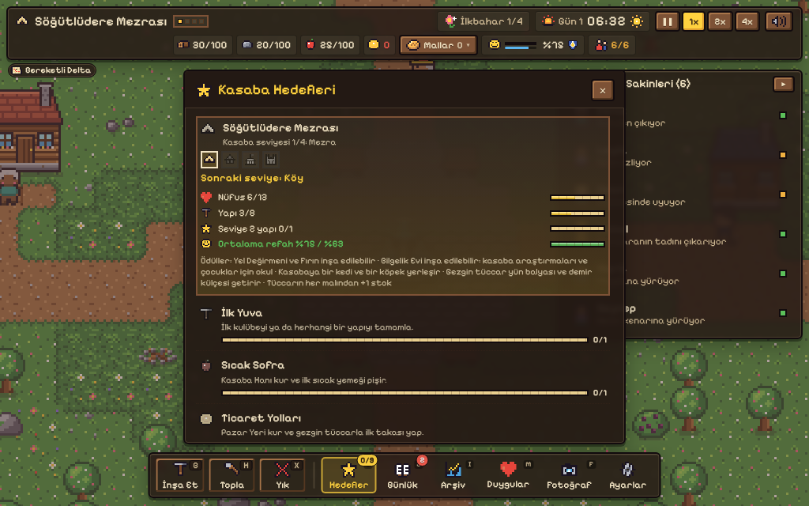
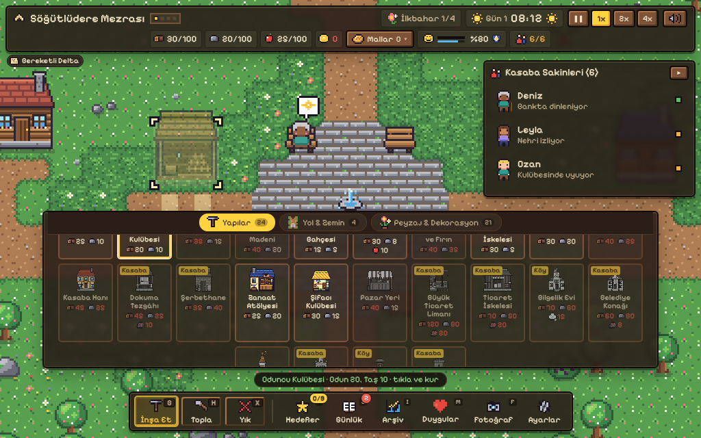
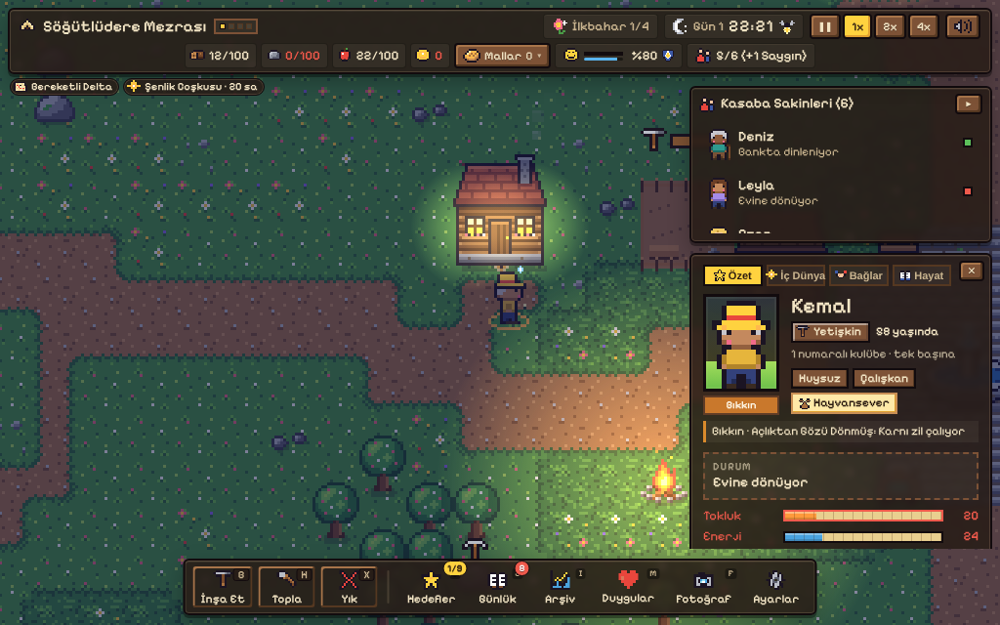
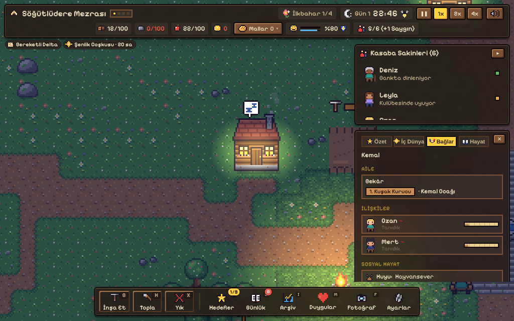
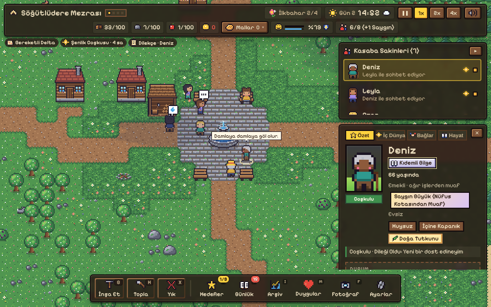

# Pikselköy — Oyuncu günlüğü (kör oynanış)

> Not: Bu günlük parça parça yazılıyor. Bu ilk sürüm yalnızca **ilk karşılaşmayı** (ilk ~10 dakika) içeriyor. Diğer bölümler asıl oyundan sonra dolacak.
> Saatler, benim "el" aracımın açıldığı andan itibaren geçen gerçek dakikadır (d). Oyunun içindeki saat ayrıca "oyun saati" diye yazılı.

## 2. Oynama günlüğü — ilk 10 dakika

**0:00 (ekran 1)** Oyunu açtım. Piksel sanatı hoş, arkada çimen, havuz, bank. Ortada bir kutu: "Pikselköy", altında "Küçük bir kasaba kur, sakinlerini mutlu et, mevsimleri birlikte karşılayın." İki düğme: "Kaldığın Yerden Devam Et" (soluk, kayıt yok) ve "Yeni Kasaba Kur". Alttaki ipucu: "oyunda B ile inşa et, H ile kaynak topla, 0 hedefler, J günlük, Esc pencereyi kapatır." Yazıdaki bazı harfler tuhaf: rakamlar ve harfler karışıyor (aşağıda şikâyet).

**0:10** "Yeni Kasaba Kur"a bastım. Bana "Söğütlüdere" diye bir ad önerdi, yanında "Başka Ad" düğmesi ve bir "harita tohumu (isteğe bağlı)" kutusu. Dokunmadım, "Kasabayı Kur".

**0:20 (ekran 3)** Kasaba açıldı. Üstte bir sürü sayı: odun, taş, elma (?), bir altın simgesi, "Mallar", bir gülen yüz ve yüzde, "6/6" insan simgesi. Sağda "Kasaba Sakinleri (6)" listesi, her birinin altında ne yaptığı yazıyor ("Kulübesinde uyuyor"). Altta araç çubuğu: İnşa Et, Topla, Yık, Hedefler, Günlük, Arşiv, Duygular, Fotoğraf, Ayarlar. Ne yapmam gerektiği konusunda hiçbir şey söylenmiyor, ama kalabalık bir tutorial da yok. Hoşuma gitti, kafam da karışmadı: "Hedefler"e bakarım.

**0:30 (ekran 4)** Hedefler paneli: kasaba seviyesi "Mezra", sonraki "Köy". Şartlar: nüfus 6/13, yapı 3/8, "Seviye 2 yapı 0/1", ortalama refah %78 / %68. Altında görevler: "İlk Yuva" (bir kulübe ya da herhangi bir yapı tamamla), "Sıcak Sofra" (Kasaba Hanı kur), "Ticaret Yolları"... Bu panel tam bana yol gösterdi. İlk gerçek dakikadaki en iyi şey bu.

**1:00 (ekran 5-8)** "İnşa Et"e bastım. Menü yarı ekranı kaplıyor, haritanın tam ortasını kapatıyor. En üst sıradaki kartların üst yarısı kesik, **adları okunmuyor** (sadece fiyat). Kaydırmayı denedim, aşağı doğru çalıştı, üst sıra yine kesik kaldı. Fiyatlara bakıp "Kulübesi 20 10" yazanı seçtim: meğer Odunun Kulübesi (odun kesici) imiş. Haritada fareyi gezdirince yarı saydam bir hayalet bina çıktı, doğru yer yeşil/yanlış yer kırmızı oluyor, altta da neden yazıyor ("Başka bir yapının üstüne kurulamaz"). Bu iyi. Yerleştirdim: odun 30→10, taş 20→10.

**1:15 (ekran 10)** Şantiye göründü, üstünde çekiç ve ilerleme çubuğu, sakinler tek tek "Şantiyeye gidiyor" yazdı. Bir balonda "Kasabamız ne güzel olmuş." yazdı. Hoşuma gitti, kimse bir şey demeden işe koyuldu.

**1:30 (ekran 11-12)** "Topla" aracıyla bir şeyler işaretlemeyi denedim. Ağaçlara tıklayınca "Burada toplanacak bir şey yok" dedi (elma ağacı gibi duruyorlar, neden toplanamıyor bilmiyorum). Böğürtlen çalısına tıklayınca üstünde sepet simgesi çıktı, demek ki o toplanabiliyor.

**2:00 (ekran 13-14)** Odunçu bitti. "Günlük"te şu yazıyor: "İlk Yuva tamamlandı", "Odunçu Kulübesi tamamlandı". Hedefler 1/9. Odun sayısı yükseliyor, güzel.

**2:30-3:00 (ekran 18-24)** Bir ev (kulübe) koymaya çalıştım. Dört deneme sürdü:
1. Odunçunun üstüne bindirdim, kırmızı oldu, "Başka bir yapının üstüne kurulamaz" yazdı.
2. Haritaya değil, yanlışlıkla alt menü paneline tıkladım (panel haritanın üstünü örtüyor, farkında olmadım). Hiçbir şey olmadı, hiçbir mesaj da çıkmadı.
3. Patika (toprak yol) üstüne koymak istedim: "Toprak Patika üzerine kurulamaz". Yolu yıkmadan yan yana ev kurmak zorunda kalıyorsun.
4. Çimene koydum, oldu.
Sonuç: ev kurmak "bir tık" olması gerekirken 4 deneme ve neredeyse 1,5 dakika sürdü; çoğu menünün haritayı örtmesinden.

**3:30 (ekran 25)** Aniden "Kasaba Şenliği başladı! Herkes Süs Havuzu başına toplanıyor." çıktı. İkinci balonda: "Deniz Saygın Büyük oldu: yatağını gençlere bıraktı, artık nüfus kotasına sayılmıyor." Herkes havuza koştu, havuzun etrafında renkli nota efektleri, kalpli balonlar. Burası güzeldi. Ben hiçbir şey yapmadım, oyun kendi kendine bir şey oldu ve bana haber verdi. Benim için ilk küçük "vay" buydu. "Saygın Büyük" ne demek tam anlamadım ama büyük ihtimalle yaşlı demek.

Taş **0/100** oldu, kırmızıya döndü. Taşın nereden geleceğini bilmiyorum.

**4:00 (ekran 26-27)** Bir kayaya "Topla" ile tıkladım, "Taş Kırma" emri verildi. Akşam oldu, şenlik bitti: "Şenlik sona erdi. Kasaba yarına tam motivasyonla başlayacak!". Herkes eve dönüyor. Balonlarda konuşma var: "Ne hoş bir tesadüf!", "Bir lokma ekmek!".

**4:20 (ekran 28-30)** Kemal'i listeden seçtim. Kamera ona geçti. Kişi paneli açıldı: 58 yaşında, "1 numaralı kulübe, tek başına", huyları "Huysuz", "Çalışkan", "Hayvansever", ruh hali "Sıkkın". Başlık altında bir cümle: "Sıkkın · Açlıktan Gözü Dönmüş: Karnı zil çalıyor". "İç Dünya" sekmesinde bir liste: "Tatsız Karşılaşma · güçlü — Leyla ile gergin bir sohbet etti", "Açlıktan Gözü Dönmüş", "Gözü Gönlü Açıldı — Çiçekli, bakımlı bir sokakta vakit geçirdi" (neden her birinin sayısal etkisi yazıyor: "İş -%18, keyif düşüşü +%40"). "Bağlar" sekmesinde "Aile: Bekâr · 1. Kuşak Kurucu", "İlişkiler: Ozan (tanıdık), Mert (tanıdık)". Panelin alt kısmı araç çubuğunun altında kalıyor, aşağısını okuyamıyorum.
Bu sayfalar beni gerçekten şaşırttı: oyun bana bir "bu bir sayı" değil "bu bir insan" gibi davranıyor. Ama Kemal'in aç olduğu yazıyor, ben hâlâ elmaları sayıyorum.

**5:20 (ekran 31-32)** Gece geçti. Elma (kırmızı simge, "yemek" olduğunu varsaydım) **28'den 19'a, 16'ya** düşüyor, her seferinde ekranda küçük kırmızı "-8", "-3" yazıyor. Kim yiyor, neden bu kadar hızlı bitiyor, anlayamadım.

**7:00 (ekran 33-34)** Kamerayı uzaklaştırdım (tekerlek). 7. sakin, **Can**, "Kasabaya geliyor" yazdı, geldi. Üstteki "Mallar" menüsünü açtım: Yün, Demir, Ekmek, Keten, Şerbetçiotu, Kumaş, Pıçı Şerbeti (böyle okudum), Kadim Dişli. Hepsi 0/100, hepsinde kırmızıyla "Üreten yapı yok". Ne işe yaradıklarını bilmiyorum.

**7:20 (ekran 35-36)** Yemek (elma) 7 → 4. Hâlâ ağaçlardan hiçbir şey toplayamıyorum ("Burada toplanacak bir şey yok"). Böğürtlen çalısına tıkladım, bilgi paneli açıldı: "Stok · porsiyon: 2/3". Çalıdan toplanıyor, ama kaç kişi bunu yapıyor bilmiyorum.

**8:20 (ekran 37)** Elma **1/100**. İnsanlar hâlâ yürüyor, sohbet ediyor, refah %80 civarında. Aç kalan kimse yok gibi görünüyor, bu da beni şaşırttı: sayı sıfıra yaklaşırken kimse acı çekmiyor ya da ben görmüyorum.

**8:30 (ekran 38-39)** Üstte "Dilekçe · Deniz" diye bir çip belirdi. Tıkladım, kamera Deniz'e geçti, kişi paneli açıldı: 66 yaşında, "Kıdemli Bilge", "Saygın Büyük (Nüfus Kotasından Muaf)", **"Evsiz"**. Huyları "Huysuz", "İçine Kapanık", "Doğa Tutkunu". Altta: "Coşkulu · Dileği oldu: Yeni bir dost edinelim." Bu cümle hoşuma gitti ama ne yapmam gerektiğini bilmiyorum: "Dilekçe" bir şey mi istiyor, yoksa sadece haber mi? Kimseyle konuşamıyorum, bir düğme yok.

*(Devamı asıl oyundan sonra.)*

---

## Ekran görüntüleri (ilk bölüm)

*Ekran 3: Kasaba açıldı. Üstte sayılar, sağda sakinler, altta araç çubuğu.*

*Ekran 4: "Hedefler" paneli. Bana ilk yolu gösteren yer.*

*Ekran 9: Yerleştirme hayaleti. Kırmızı = olmaz, altta nedeni yazıyor. Menünün üst sırası ise kesik, adlar okunmuyor.*

*Ekran 25: Şenlik. Herkes havuz başında, nota efektleri. Yukarıda iki bildirim, biri "Deniz Saygın Büyük oldu".*

*Ekran 28: Kemal'in paneli. Alt kısım araç çubuğunun altında kalıyor.*

*Ekran 30: Kemal "Bağlar" sekmesi.*

*Ekran 35: Elma 7/100 ve düşüyor. Böğürtlen çalısı paneli açık.*

*Ekran 39: Deniz'in paneli. "Evsiz" yazıyor, dileği "yeni bir dost edinelim".*
